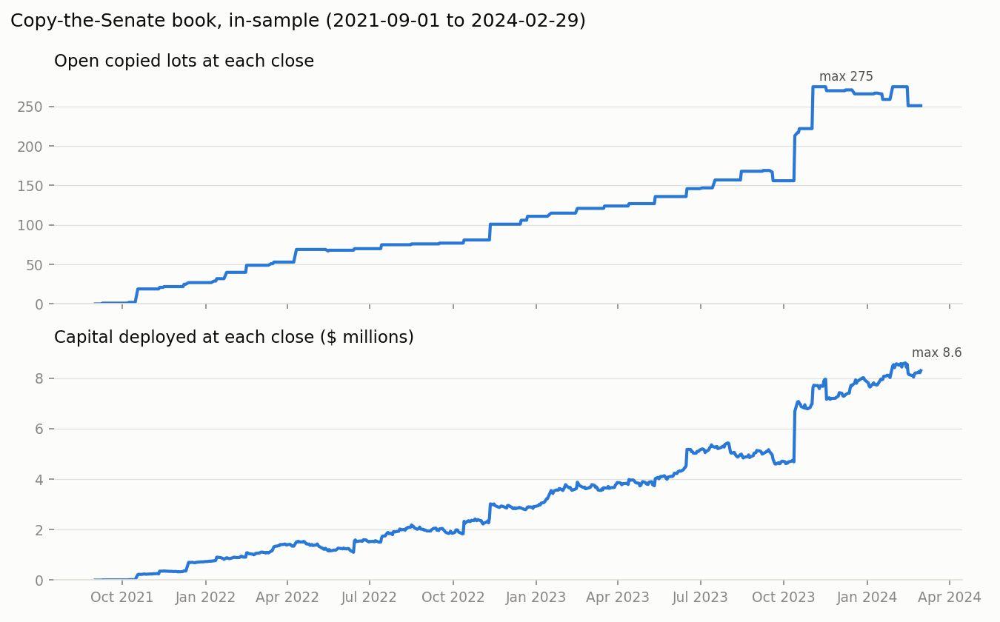

# Data quality log

Every exclusion and every data problem, counted and explained. One section per phase.

## Phase 1: scrape

- Filings in the eFD listing (received 2016-01-01 to 2026-09-30, all filer types): **1,874**; electronic **1,566**, paper **308**, other **0**.
- Electronic PTRs downloaded: **1,566**; failed: **0**; pending: **0**.
- Listing fetched on or before the scrape end date is refreshed automatically on the next run (the 2026 listing is incomplete until after 2026-09-30).

### Download failures

None.

### Paper filings (excluded, D05)

**308** paper filings are scanned images and cannot be parsed; they are excluded. The full list (senator, date, link) is in `data/interim/paper_filings.csv`. By filer:

| filer_name         |   Paper filings |
|:-------------------|----------------:|
| RICHARD BLUMENTHAL |             118 |
| JOHN BOOZMAN       |              74 |
| RICHARD M BURR     |              63 |
| DIANNE FEINSTEIN   |              37 |
| MARK R WARNER      |              14 |
| JAMES M INHOFE     |               1 |
| JOHN FETTERMAN     |               1 |

### Parse validation

Each of the 1,566 downloaded PTRs was checked three ways: rows parsed, `<tbody>` rows counted by a separate parser, and the page's own "(N transactions total)" line.

- Row-count mismatches: **0**
- Owner-count mismatches (page's "N Self / N Spouse ..." line vs parsed Owner column): **0**
- Transaction rows whose date could not be read as MM/DD/YYYY: **0**
- Downloaded PTRs with no "Filed ... @ time" timestamp: **0**
- PTRs whose page "Filed" date differs from the listing's date received: **0**

### Senate service dates (A05)

`data/interim/senate_terms.csv`: 407 Senate terms ending on or after 2010-01-01, 208 senators. 42 terms ended before their scheduled 3 January end; the dataset records the actual last day for each, listed below. An appointee's term that ends at a special election is listed too.

| full_name           | state   | party      | term_start   | term_end   | scheduled_end   | start_how   | end_type         |
|:--------------------|:--------|:-----------|:-------------|:-----------|:----------------|:------------|:-----------------|
| Jeff Sessions       | AL      | Republican | 2015-01-06   | 2017-02-08 | 2021-01-03      |             |                  |
| Luther Strange      | AL      | Republican | 2017-02-09   | 2018-01-03 | 2021-01-03      | appointment |                  |
| John McCain         | AZ      | Republican | 2017-01-03   | 2018-08-25 | 2023-01-03      |             |                  |
| Jon Kyl             | AZ      | Republican | 2018-09-05   | 2018-12-31 | 2023-01-03      | appointment |                  |
| Martha McSally      | AZ      | Republican | 2019-01-03   | 2020-12-02 | 2023-01-03      | appointment | special-election |
| Dianne Feinstein    | CA      | Democrat   | 2019-01-03   | 2023-09-28 | 2025-01-03      |             |                  |
| Laphonza R. Butler  | CA      | Democrat   | 2023-10-03   | 2024-12-08 | 2025-01-03      | appointment | special-election |
| Kamala D. Harris    | CA      | Democrat   | 2017-01-03   | 2021-01-18 | 2023-01-03      |             |                  |
| Alex Padilla        | CA      | Democrat   | 2021-01-20   | 2022-12-21 | 2023-01-03      | appointment |                  |
| Edward Kaufman      | DE      | Democrat   | 2009-01-16   | 2010-11-15 | 2015-01-03      | appointment |                  |
| Marco Rubio         | FL      | Republican | 2023-01-03   | 2025-01-20 | 2029-01-03      |             |                  |
| Ashley Moody        | FL      | Republican | 2025-01-21   | 2026-11-03 | 2029-01-03      | appointment | special-election |
| Johnny Isakson      | GA      | Republican | 2017-01-03   | 2019-12-31 | 2023-01-03      |             |                  |
| Kelly Loeffler      | GA      | Republican | 2020-01-06   | 2021-01-20 | 2023-01-03      | appointment | special-election |
| Daniel K. Inouye    | HI      | Democrat   | 2011-01-05   | 2012-12-17 | 2017-01-03      |             |                  |
| Brian Schatz        | HI      | Democrat   | 2012-12-27   | 2015-01-03 | 2017-01-03      | appointment |                  |
| Roland Burris       | IL      | Democrat   | 2009-01-15   | 2010-11-29 | 2011-01-03      | appointment |                  |
| Paul Kirk           | MA      | Democrat   | 2009-09-25   | 2010-02-04 | 2013-01-03      | appointment |                  |
| John F. Kerry       | MA      | Democrat   | 2009-01-06   | 2013-02-01 | 2015-01-03      |             |                  |
| William M. Cowan    | MA      | Democrat   | 2013-02-06   | 2013-07-16 | 2015-01-03      | appointment |                  |
| Al Franken          | MN      | Democrat   | 2015-01-06   | 2018-01-02 | 2021-01-03      |             |                  |
| Tina Smith          | MN      | Democrat   | 2018-01-03   | 2018-11-06 | 2021-01-03      | appointment | special-election |
| Thad Cochran        | MS      | Republican | 2015-01-06   | 2018-04-01 | 2021-01-03      |             |                  |
| Cindy Hyde-Smith    | MS      | Republican | 2018-04-09   | 2018-11-27 | 2021-01-03      | appointment | special-election |
| Max Baucus          | MT      | Democrat   | 2009-01-06   | 2014-02-06 | 2015-01-03      |             |                  |
| Ben Sasse           | NE      | Republican | 2021-01-03   | 2023-01-08 | 2027-01-03      |             |                  |
| Pete Ricketts       | NE      | Republican | 2023-01-23   | 2024-11-05 | 2027-01-03      | appointment | special-election |
| Robert Menendez     | NJ      | Democrat   | 2019-01-03   | 2024-08-20 | 2025-01-03      |             |                  |
| George S. Helmy     | NJ      | Democrat   | 2024-09-09   | 2024-12-08 | 2025-01-03      | appointment |                  |
| Frank R. Lautenberg | NJ      | Democrat   | 2009-01-06   | 2013-06-03 | 2015-01-03      |             |                  |
| Jeff Chiesa         | NJ      | Republican | 2013-06-10   | 2013-10-31 | 2015-01-03      | appointment |                  |
| John Ensign         | NV      | Republican | 2007-01-04   | 2011-05-03 | 2013-01-03      |             |                  |
| J.D. Vance          | OH      | Republican | 2023-01-03   | 2025-01-09 | 2029-01-03      |             |                  |
| Jon Husted          | OH      | Republican | 2025-01-21   | 2026-11-03 | 2029-01-03      | appointment | special-election |
| James M. Inhofe     | OK      | Republican | 2021-01-03   | 2023-01-03 | 2027-01-03      |             |                  |
| Markwayne Mullin    | OK      | Republican | 2023-01-03   | 2026-03-23 | 2027-01-03      |             |                  |
| Tom Coburn          | OK      | Republican | 2011-01-05   | 2015-01-03 | 2017-01-03      |             |                  |
| Lindsey Graham      | SC      | Republican | 2021-01-03   | 2026-07-11 | 2027-01-03      |             |                  |
| Jim DeMint          | SC      | Republican | 2011-01-05   | 2013-01-01 | 2017-01-03      |             |                  |
| Tim Scott           | SC      | Republican | 2013-01-03   | 2015-01-03 | 2017-01-03      | appointment |                  |
| Robert Byrd         | WV      | Democrat   | 2007-01-04   | 2010-06-28 | 2013-01-03      |             |                  |
| Carte Goodwin       | WV      | Democrat   | 2010-07-20   | 2010-11-14 | 2013-01-03      | appointment |                  |

Checks for departures the dataset may NOT record (a successor in the same seat starting before the predecessor's recorded end; a historical senator with a future end date; a current senator whose last term has ended): **0** found.

### Filer name matching

82 distinct filer names: override 1, exact 80, fuzzy 1, ambiguous 0, unmatched 0. Unmatched or low-confidence: **0** (listed in outputs/phase1_summary.md section 8; their transactions are left out of the key number).

- Matched filers none of whose transactions fall inside that senator's service (would suggest the wrong person): **0**
- Transactions by high-confidence matched filers dated OUTSIDE Senate service (excluded by A05 in Phase 2): **5** of 14,558.

| matched_name    |   Rows outside service |
|:----------------|-----------------------:|
| John R. Curtis  |                      3 |
| David McCormick |                      1 |
| Pete Ricketts   |                      1 |

## Phase 2: clean

_Stage `clean` of `python run_all.py`. Default window: disclosures 2021-09-01 to 2026-08-31 (5 years). Owners: Self, Joint. ETFs included: True. Counts and disclosed dollar ranges only; no prices or returns. Files: `data/processed/trades_clean.csv` (every unique trade in the 3/5/10-year windows that passes every filter except owner, `in_scope` = headline sample), `data/processed/exclusions.csv` (every raw row that is not an in-scope trade, with its reason), `data/processed/tickers.csv`._

### 1. Waterfall: raw rows to in-scope trades

Each row is removed at the FIRST step it fails, in this order. Steps 1-2 count raw rows; from step 3 on, each row is one unique trade (a trade reported in several filings counts once).

| Step   | Reason code         | What happens                                                                     | Removed   |   Left |
|:-------|:--------------------|:---------------------------------------------------------------------------------|:----------|-------:|
| 0      |                     | All parsed transaction rows (Phase 1)                                            |           |  14558 |
| 1      | FILER_UNMATCHED     | Filer not matched to a senator with high confidence                              | 0         |  14558 |
| 2      | DUPLICATE_AMENDMENT | Duplicate: trade restated in an amendment (kept once, first disclosure datetime) | 2158      |  12400 |
| 3      | DUPLICATE_REFILED   | Duplicate: trade repeated from another, unrelated filing                         | 24        |  12376 |
|        |                     | = unique trades                                                                  |           |  12376 |
| 4      | OUTSIDE_SERVICE     | Transaction date outside the senator's Senate service (A05)                      | 5         |  12371 |
| 5      | OUTSIDE_WINDOW      | First disclosure outside the analysis window                                     | 7091      |   5280 |
| 6      | ASSET_TYPE          | eFD asset type is not Stock or Other                                             | 1356      |   3924 |
| 7      | OPTION_IN_NAME      | Asset name shows a call/put option                                               | 33        |   3891 |
| 8      | EXCHANGE            | Exchange transaction (not a purchase or sale)                                    | 24        |   3867 |
| 9      | NO_TICKER           | No ticker, and none recovered from the asset name                                | 235       |   3632 |
| 10     | MUTUAL_FUND         | Yahoo: mutual fund                                                               | 65        |   3567 |
| 11     | OTHER_INSTRUMENT    | Yahoo: neither equity, ETF nor mutual fund                                       | 1         |   3566 |
| 12     | NON_US_LISTING      | Yahoo: not listed in the US                                                      | 3         |   3563 |
| 13     | NON_EQUITY_ETF      | ETF that is not an equity fund (K5: bond, T-bill, commodity or other)            | 187       |   3376 |
| 14     | AMOUNT_UNPARSED     | Amount string not understood                                                     | 0         |   3376 |
| 15     | OWNER               | Owner not in universe.owners                                                     | 1034      |   2342 |
|        |                     | = IN-SCOPE TRADES (headline sample)                                              |           |   2342 |

Owner type by reason (A01: Spouse and Child trades are counted, not silently dropped):

| reason_code         |   Child |   Joint |   Self |   Spouse |
|:--------------------|--------:|--------:|-------:|---------:|
| DUPLICATE_AMENDMENT |      17 |   1,176 |    168 |      797 |
| DUPLICATE_REFILED   |       1 |       2 |      6 |       15 |
| OUTSIDE_SERVICE     |       0 |       3 |      0 |        2 |
| OUTSIDE_WINDOW      |     127 |   3,172 |  1,037 |    2,755 |
| ASSET_TYPE          |      88 |     434 |    382 |      452 |
| OPTION_IN_NAME      |       0 |       0 |     33 |        0 |
| EXCHANGE            |       0 |       7 |      8 |        9 |
| NO_TICKER           |      17 |       7 |     30 |      181 |
| MUTUAL_FUND         |       0 |      24 |      7 |       34 |
| OTHER_INSTRUMENT    |       0 |       0 |      0 |        1 |
| NON_US_LISTING      |       0 |       3 |      0 |        0 |
| NON_EQUITY_ETF      |       0 |     123 |     46 |       18 |
| OWNER               |      39 |       0 |      0 |      995 |
| (in scope)          |       0 |   1,296 |  1,046 |        0 |
| Total               |     289 |   6,247 |  2,763 |    5,259 |

ASSET_TYPE detail (in-window trades only; earlier steps took the rest):

| eFD asset type               |   Trades |
|:-----------------------------|---------:|
| Municipal Security           |      693 |
| Stock Option                 |      326 |
| Corporate Bond               |      162 |
| Commodities/Futures Contract |      141 |
| Non-Public Stock             |       31 |
| Cryptocurrency               |        3 |

OTHER_INSTRUMENT / NON_US_LISTING detail (Yahoo type or exchange):

| reason_code      | reason_detail                                                                                                                                                                   |   Trades |
|:-----------------|:--------------------------------------------------------------------------------------------------------------------------------------------------------------------------------|---------:|
| NON_US_LISTING   | by hand: eFD asset name "Bershire Hathaway Cdr [Cad Hedged]": a Canadian Depositary Receipt (CAD-hedged) listed on Cboe Canada under BRK, not the US class B shares (BRK-B); K4 |        1 |
| NON_US_LISTING   | by hand: eFD asset name "COLGATE PALMOLIVE LTD.": COLPAL is the NSE (India) symbol of Colgate-Palmolive (India) Ltd, not the US company (CL); K4                                |        2 |
| OTHER_INSTRUMENT | ECNQUOTE                                                                                                                                                                        |        1 |

Rows excluded from the headline sample but kept in trades_clean.csv for pre-registered variants: OUTSIDE_WINDOW 4,844, OWNER 1,034, NON_EQUITY_ETF 187, NO_TICKER 1 (OUTSIDE_WINDOW rows there fall inside the 3- or 10-year window; OWNER rows are the V6 family trades).

### 2. Amendments

155 electronic amendments. Each is linked to the earlier filing(s) it amends (same senator, filed earlier, same report title date and/or overlapping transactions) and classified (rules in `src/clean/amendments.py`; per-amendment detail in `data/interim/amendments.csv`).

| class            |   All amendments |   Received in default window |
|:-----------------|-----------------:|-----------------------------:|
| FULL_RESTATEMENT |               97 |                           35 |
| ADDITIVE         |                4 |                            1 |
| AMBIGUOUS        |               40 |                            2 |
| UNLINKED         |               14 |                            0 |

- Duplicate rows removed: **2,182** (2,158 restated in an amendment, 24 repeated from an unrelated earlier filing). Several identical lines inside one filing are separate trades and are kept.
- Trades that exist ONLY in an amendment (dated by the amendment, no look-ahead): **438** (in scope: **0**).
- Trades whose fields an amendment corrected (corrected value used, original datetime kept): **179** (in scope: **29**); with a substantive change (owner, date, ticker, type or amount): **170** (in scope: **29**). By field (`data/interim/amendment_corrections.csv`):

| field                |   trades |   in_scope_trades |
|:---------------------|---------:|------------------:|
| amount               |        6 |                 1 |
| asset_name           |       46 |                 4 |
| asset_type           |        8 |                 0 |
| owner                |       38 |                 2 |
| ticker               |       34 |                 5 |
| transaction_date_iso |       28 |                 2 |
| transaction_type     |       79 |                19 |

- UNLINKED amendments (14): no earlier electronic filing found. Reason: 14 original predates the scrape start. Their rows count as first disclosed by the amendment.
- Trades touched by an AMBIGUOUS amendment: 583 (in scope: **18**). Rule applied: keep every version's trades once (a trade missing from the amendment is NOT deleted). Flag: `amendment_ambiguous`.

**As first published (J3, headline) vs as revised (V14).** A trade corrected by an amendment has two or more records: the original, effective at the first disclosure, and each corrected version, effective at its amendment's datetime (only changes of owner, date, asset, asset type, type or amount make a new record; a reworded asset name does not). Each record passes the filters on its own values and date. `data/processed/trade_records.csv` lists every record for the engine.

- Trades in trades_clean.csv with more than one record: **131**, 267 records; 5 trades have three or more records.
- In scope under both rules: 2,340; only as first published (J3): 2; only as revised (V14): 0. Headline (J3) in-scope trades: **2,342**; as revised: **2,340**.

Corrected trades by which of their records is in scope:

| orig              |   correction in scope |   correction out |
|:------------------|----------------------:|-----------------:|
| original in scope |                    23 |                2 |
| original out      |                     1 |              105 |

AMBIGUOUS amendments (for Harry):

| senator              | date_received   | title_date   | in_window   |   n_rows |   n_amended_report_trades |   n_repeated_exact |   n_repeated_corrected |   n_new |   n_amended_report_not_repeated | ptr_id                               |
|:---------------------|:----------------|:-------------|:------------|---------:|--------------------------:|-------------------:|-----------------------:|--------:|--------------------------------:|:-------------------------------------|
| Susan M. Collins     | 2016-05-03      | 2016-03-04   | False       |        5 |                         5 |                  1 |                      1 |       3 |                               3 | 58a3b1ce-d1c2-4ad6-9458-be9a7fbe6c6d |
| Bill Cassidy         | 2016-10-07      | 2016-01-12   | False       |        3 |                         3 |                  0 |                      2 |       1 |                               1 | 19885715-1a99-459e-bfce-8f5f57ca5e94 |
| Thomas R. Carper     | 2017-03-14      | 2016-12-01   | False       |       21 |                        22 |                 21 |                      0 |       0 |                               1 | 9f6408dd-ef9e-4be8-b763-73fa074c4a0a |
| Susan M. Collins     | 2017-05-10      | 2016-07-08   | False       |        3 |                         5 |                  3 |                      0 |       0 |                               2 | 8ce46f93-dceb-4c05-9cf3-c463ebce7867 |
| Patrick J. Toomey    | 2017-11-30      | 2016-06-16   | False       |        1 |                         3 |                  1 |                      0 |       0 |                               2 | 3073357f-338e-4f4f-b3eb-5c0feabcfa74 |
| David Perdue         | 2017-12-06      | 2017-10-02   | False       |       38 |                        39 |                 38 |                      0 |       0 |                               1 | e0d89ca5-da6d-49f5-b191-07000462306e |
| Patrick J. Toomey    | 2017-12-12      | 2016-01-12   | False       |        2 |                         4 |                  2 |                      0 |       0 |                               2 | fba0b99c-4ab5-4493-aaaa-69268002dca6 |
| Patrick J. Toomey    | 2017-12-19      | 2016-01-12   | False       |        1 |                         4 |                  1 |                      0 |       0 |                               3 | 1179b764-b4af-4732-9948-81a32fbf2a54 |
| Patrick J. Toomey    | 2017-12-21      | 2016-02-11   | False       |        6 |                         7 |                  3 |                      1 |       2 |                               3 | 72854f36-aae4-445b-b63a-4fba86861178 |
| Pat Roberts          | 2018-06-28      | 2017-09-29   | False       |       15 |                        16 |                 15 |                      0 |       0 |                               1 | a329be05-5227-49ed-a7db-605f7939adfb |
| Pat Roberts          | 2018-06-28      | 2017-12-01   | False       |       12 |                        27 |                 12 |                      0 |       0 |                              15 | 5ba30cf2-0019-4c66-9318-23c1283367f3 |
| Tammy Duckworth      | 2018-08-07      | 2018-01-05   | False       |        1 |                         1 |                  0 |                      0 |       1 |                               1 | 9c8e433f-aa03-4595-b25c-3d3305a4f40f |
| Patrick J. Toomey    | 2018-08-13      | 2017-02-09   | False       |        4 |                         5 |                  2 |                      2 |       0 |                               1 | bd44b543-c8e5-4d3b-9638-9a8e0c9c35e1 |
| Patrick J. Toomey    | 2018-08-13      | 2017-03-03   | False       |        4 |                         5 |                  3 |                      1 |       0 |                               1 | c88f4a1d-16de-4362-955d-ab5402b6653e |
| Patrick J. Toomey    | 2018-08-13      | 2017-09-06   | False       |        1 |                         2 |                  0 |                      1 |       0 |                               1 | 9ff9c3ee-4a28-46e5-a818-f02bbb6ebe47 |
| Patrick J. Toomey    | 2018-08-13      | 2018-01-10   | False       |        5 |                         5 |                  0 |                      3 |       2 |                               2 | b133682c-13d9-4484-b7f5-847c1ee7f768 |
| James M. Inhofe      | 2018-12-12      | 2018-12-12   | False       |        2 |                         3 |                  2 |                      0 |       0 |                               1 | ddf06dcd-abf8-4537-a9c6-96e1fc3f2408 |
| Thomas R. Carper     | 2019-05-15      | 2019-01-03   | False       |        5 |                         5 |                  3 |                      0 |       2 |                               2 | acf289a7-36c4-40fb-a491-8f31e24cdb32 |
| Thom Tillis          | 2019-06-15      | 2019-02-27   | False       |        1 |                         2 |                  1 |                      0 |       0 |                               1 | 2c7b33c4-c85b-44a8-b8f7-cfe2f15961f5 |
| Thom Tillis          | 2019-07-30      | 2019-02-27   | False       |        1 |                         2 |                  0 |                      1 |       0 |                               1 | eaa9e663-e475-41a5-ac0d-3e107ed67481 |
| Patrick J. Toomey    | 2019-08-12      | 2018-08-03   | False       |        1 |                         3 |                  1 |                      0 |       0 |                               2 | 6f737b9c-6983-43ae-854d-8e03a702c3b7 |
| Patrick J. Toomey    | 2019-08-12      | 2018-08-03   | False       |        1 |                         3 |                  0 |                      1 |       0 |                               2 | f3401d4b-32f3-4ae3-8fad-d76d5154f170 |
| Patrick J. Toomey    | 2019-08-12      | 2018-02-07   | False       |        6 |                         6 |                  3 |                      1 |       2 |                               4 | 482ea72a-ca70-4fd9-922a-68cd723b0ee7 |
| Patrick J. Toomey    | 2019-08-12      | 2018-03-07   | False       |        2 |                         2 |                  1 |                      0 |       1 |                               1 | fbe05b6b-08c1-4c10-8115-2e453d6f8a06 |
| Patrick J. Toomey    | 2019-08-12      | 2018-04-10   | False       |        2 |                         2 |                  1 |                      0 |       1 |                               1 | adfa0396-aa71-4fe6-8033-600e6e70e669 |
| Patrick J. Toomey    | 2019-08-12      | 2018-06-07   | False       |        3 |                         3 |                  1 |                      0 |       2 |                               2 | a2e8208b-16b3-4e97-ad54-fa8b2e6e443a |
| Patrick J. Toomey    | 2019-08-12      | 2018-10-05   | False       |        1 |                         3 |                  1 |                      0 |       0 |                               2 | d70bb093-22e4-48a6-a682-2aa1f569d32c |
| Patrick J. Toomey    | 2019-08-12      | 2018-09-07   | False       |        3 |                         3 |                  0 |                      2 |       1 |                               1 | 42013227-54d2-4641-ba01-d21a7d77cee7 |
| Patrick J. Toomey    | 2019-11-15      | 2019-08-13   | False       |        2 |                         3 |                  2 |                      0 |       0 |                               1 | 3dd9dbd6-91d8-4e1e-ad52-9193a3ae0d30 |
| Kelly Loeffler       | 2020-05-01      | 2020-02-07   | False       |       20 |                        22 |                 12 |                      8 |       0 |                               2 | 07b4e543-0978-4d51-87d4-bc4bbe63a1fc |
| Kelly Loeffler       | 2020-05-01      | 2020-03-12   | False       |       25 |                        25 |                  4 |                     16 |       5 |                               5 | 8d87d0d9-8094-4891-a29c-c0e0435acb1a |
| Kelly Loeffler       | 2020-05-01      | 2020-04-01   | False       |       42 |                        42 |                 33 |                      8 |       1 |                               1 | b56659bd-564b-46ee-9c6f-4520348904fd |
| Thomas R. Carper     | 2020-05-25      | 2019-07-03   | False       |        6 |                         7 |                  6 |                      0 |       0 |                               1 | 389ee4d6-3c3f-4383-9311-315a74454c90 |
| Jerry Moran          | 2020-08-05      | 2019-10-21   | False       |       40 |                        40 |                 36 |                      0 |       4 |                               4 | c5faa8f8-b17f-478f-9457-794d602266c3 |
| Patrick J. Toomey    | 2020-08-11      | 2019-02-21   | False       |        1 |                         2 |                  1 |                      0 |       0 |                               1 | acdea934-650d-4726-8f8a-af34f2e36706 |
| David Perdue         | 2021-05-02      | 2020-05-08   | False       |      189 |                       189 |                186 |                      1 |       2 |                               2 | b907f852-1e91-473b-ab7b-3b33cf57b58f |
| Thomas R. Carper     | 2021-05-17      | 2020-11-02   | False       |        3 |                         3 |                  1 |                      0 |       2 |                               2 | 14af60f9-7849-45a0-8f42-c7742edfe403 |
| Patrick J. Toomey    | 2021-08-05      | 2021-01-09   | False       |        3 |                         4 |                  3 |                      0 |       0 |                               1 | 355e54ff-08df-4323-b019-5c88cf24aa6f |
| Shelley Moore Capito | 2022-01-21      | 2022-01-15   | True        |        4 |                         5 |                  4 |                      0 |       0 |                               1 | cbca251b-4a4d-40cb-95c9-7ac3fc6b8d7c |
| Dan Sullivan         | 2023-07-26      | 2022-12-21   | True        |       17 |                        41 |                 17 |                      0 |       0 |                              24 | 016757b7-4990-4541-a2e6-3058ea8b0bfe |

### 3. Amount strings

Every distinct amount string in the raw rows and how it was parsed (open top band = lower bound, D10):

| amount                   |   rows | amount_lower   | amount_upper   | amount_mid   | amount_rule                        |
|:-------------------------|-------:|:---------------|:---------------|:-------------|:-----------------------------------|
| $1,001 - $15,000         |   9527 | 1,001          | 15,000         | 8,000.5      | range: midpoint of lower and upper |
| $15,001 - $50,000        |   2712 | 15,001         | 50,000         | 32,500.5     | range: midpoint of lower and upper |
| $50,001 - $100,000       |    911 | 50,001         | 100,000        | 75,000.5     | range: midpoint of lower and upper |
| $100,001 - $250,000      |    751 | 100,001        | 250,000        | 175,000.5    | range: midpoint of lower and upper |
| $250,001 - $500,000      |    337 | 250,001        | 500,000        | 375,000.5    | range: midpoint of lower and upper |
| $500,001 - $1,000,000    |    257 | 500,001        | 1,000,000      | 750,000.5    | range: midpoint of lower and upper |
| $1,000,001 - $5,000,000  |     50 | 1,000,001      | 5,000,000      | 3,000,000.5  | range: midpoint of lower and upper |
| $5,000,001 - $25,000,000 |     13 | 5,000,001      | 25,000,000     | 15,000,000.5 | range: midpoint of lower and upper |

### 4. Tickers

- Unique tickers checked with Yahoo (3/5/10-year windows, any owner): **1,523**; kept 1,463; with at least one in-scope trade 949. Status by ticker: kept 1463, excluded: mutual fund 51, excluded: non-US listing 8, excluded: other instrument type 1.
- Rows with a raw ticker changed by normalisation (case, spaces, share class BRK.B -> BRK-B): 23.
- Missing-ticker asset names recovered: **492** names, 546 trades (383 Self/Joint in the default window). Not recovered: **302** names, 542 trades (37 Self/Joint in window); these are NO_TICKER exclusions. Full list: `data/interim/ticker_recovery.csv`.

Hand-written overrides (J5, `config/asset_name_overrides.yaml`; applied only when Yahoo's, or failing that SEC's, company name for the ticker confirms it):

| contains                    | ticker   | confirmed_by   | note                                                                                         | matched_asset_names                                                   |
|:----------------------------|:---------|:---------------|:---------------------------------------------------------------------------------------------|:----------------------------------------------------------------------|
| glaxo wellcome              | GSK      | yahoo          | Yahoo name for GSK: GSK plc                                                                  | Glaxo Wellcome plc ADR (GSK)                                          |
| rolls-royce                 | RYCEY    | yahoo          | Yahoo name for RYCEY: Rolls-Royce Holdings plc                                               | ROLLS-ROYCE HOLDINGS PLC SPONSORED ADR | ROLLS-ROYCE HOLDINGS PLC ADR |
| rolls royce                 | RYCEY    | yahoo          | Yahoo name for RYCEY: Rolls-Royce Holdings plc                                               | Rolls Royce Holdings plc Sponsored ADR (RYCEY)                        |
| ishares tr russell 1000 etf | IWB      | yahoo          | Yahoo name for IWB: iShares Russell 1000 ETF                                                 | Ishares TR Russell 1000 ETF                                           |
| = starbuck                  | SBUX     | yahoo          | Yahoo name for SBUX: Starbucks Corporation                                                   | starbuck                                                              |
| (wizey)                     | WIZEY    | hand           | K2: ticker WIZEY confirmed by hand; its Yahoo prices are never used (survivorship ledger)    | Wise plc Sponsored ADR (WIZEY)                                        |
| (murgy)                     | MURGY    | yahoo          | Yahoo name for MURGY: Münchener Rückversicherungs-Gesellschaft Aktiengesellschaft in München | Munich Re Group ADR (MURGY)                                           |
| (holx)                      | HOLX     | hand           | K2: ticker HOLX confirmed by hand; its Yahoo prices are never used (survivorship ledger)     | Hologic, Inc. (HOLX)                                                  |
| (bk)                        | BK       | yahoo          | Yahoo name for BNY: The Bank of New York Mellon Corporation                                  | Bank of New York Mellon Corp (BK)                                     |
| (pstg)                      | PSTG     | yahoo          | Yahoo name for P: Everpure, Inc.                                                             | Everpure, Inc. Class A (PSTG)                                         |
| (kyocy)                     | KYOCY    | hand           | K2: ticker KYOCY confirmed by hand; its Yahoo prices are never used (survivorship ledger)    | Kyocera Corporation ADR Japan (KYOCY)                                 |

Recovered:

| asset_name                                                                       | candidate   | method   |   n_trades |   n_trades_self_joint_in_window | note                                                                                                                                                                                                            |
|:---------------------------------------------------------------------------------|:------------|:---------|-----------:|--------------------------------:|:----------------------------------------------------------------------------------------------------------------------------------------------------------------------------------------------------------------|
| INTC-Intel Corporation (NASDAQ)                                                  | INTC        | embedded |          1 |                               0 | embedded ticker INTC; name words shared with Intel Corporation/Intel Corporation/INTEL CORP: intel                                                                                                              |
| AAPL-Apple Inc. (NASDAQ)                                                         | AAPL        | embedded |          1 |                               0 | embedded ticker AAPL; name words shared with Apple Inc./Apple Inc./Apple Inc.: apple                                                                                                                            |
| PFE-Pfizer Inc.                                                                  | PFE         | embedded |          2 |                               0 | embedded ticker PFE; name words shared with Pfizer Inc./Pfizer, Inc./PFIZER INC: pfizer, pfizerinc                                                                                                              |
| GS-The Goldman Sachs Group, Inc.                                                 | GS          | embedded |          1 |                               0 | embedded ticker GS; name words shared with The Goldman Sachs Group, Inc./Goldman Sachs Group, Inc. (The)/GOLDMAN SACHS GROUP INC: goldman, sachs, thegoldmansachsgroupinc                                       |
| OKE-ONEOK Inc.                                                                   | OKE         | embedded |          1 |                               0 | embedded ticker OKE; name words shared with ONEOK, Inc./ONEOK, Inc./ONEOK INC /NEW/: oneok, oneokinc                                                                                                            |
| STT-State Street Corporation                                                     | STT         | embedded |          1 |                               0 | embedded ticker STT; name words shared with State Street Corporation/State Street Corporation/STATE STREET CORP: state, statestreetcorporation, street                                                          |
| Philip Morris Intl                                                               | PM          | sec_name |          1 |                               0 | SEC exact name match: Philip Morris International Inc. (CIK 1413329)                                                                                                                                            |
| HD-The Home Depot, Inc.                                                          | HD          | embedded |          1 |                               0 | embedded ticker HD; name words shared with The Home Depot, Inc./Home Depot, Inc. (The)/HOME DEPOT, INC.: depot, home, thehomedepotinc                                                                           |
| Lincoln National Corporation                                                     | LNC         | sec_name |          1 |                               0 | SEC exact name match: LINCOLN NATIONAL CORP (CIK 59558)                                                                                                                                                         |
| MetLife Inc                                                                      | MET         | sec_name |          2 |                               0 | SEC exact name match: METLIFE INC (CIK 1099219)                                                                                                                                                                 |
| PFS-Provident Financial Services, Inc.                                           | PFS         | embedded |          1 |                               0 | embedded ticker PFS; name words shared with Provident Financial Services, Inc./Provident Financial Services, I/PROVIDENT FINANCIAL SERVICES INC: financial, provident, providentfinancialservicesinc, services  |
| PRGO-Perrigo Company plc                                                         | PRGO        | embedded |          1 |                               0 | embedded ticker PRGO; name words shared with Perrigo Company plc/Perrigo Company plc/PERRIGO Co plc: perrigo, perrigocompanyplc                                                                                 |
| Pfizer Inc                                                                       | PFE         | sec_name |          3 |                               0 | SEC exact name match: PFIZER INC (CIK 78003)                                                                                                                                                                    |
| TMO - Thermo Fisher Scientific Inc.                                              | TMO         | embedded |          1 |                               0 | embedded ticker TMO; name words shared with Thermo Fisher Scientific Inc./Thermo Fisher Scientific Inc/THERMO FISHER SCIENTIFIC INC.: fisher, scientific, thermo, thermofisherscientificinc                     |
| IR-Ingersoll-Rand Plc                                                            | IR          | embedded |          2 |                               0 | embedded ticker IR; name words shared with Ingersoll Rand Inc./Ingersoll Rand Inc./Ingersoll Rand Inc.: ingersoll, rand                                                                                         |
| NFLX-Netflix, Inc.                                                               | NFLX        | embedded |          1 |                               0 | embedded ticker NFLX; name words shared with Netflix, Inc./Netflix, Inc./NETFLIX INC: netflix, netflixinc                                                                                                       |
| KBA - KraneShares Bosera MSCI China A ETF                                        | KBA         | embedded |          1 |                               0 | embedded ticker KBA; name words shared with KraneShares Bosera MSCI China A 50 Connect Index ETF/KraneShares Bosera MSCI China A: bosera, china, kraneshares, msci                                              |
| AAPL-Apple Inc.                                                                  | AAPL        | embedded |          4 |                               0 | embedded ticker AAPL; name words shared with Apple Inc./Apple Inc./Apple Inc.: apple, appleinc                                                                                                                  |
| DIS-The Walt Disney Company                                                      | DIS         | embedded |          1 |                               0 | embedded ticker DIS; name words shared with The Walt Disney Company/Walt Disney Company (The)/Walt Disney Co: disney, thewaltdisneycompany, walt                                                                |
| JPM-JPMorgan Chase & Co.                                                         | JPM         | embedded |          2 |                               0 | embedded ticker JPM; name words shared with JPMorgan Chase & Co./JP Morgan Chase & Co./JPMORGAN CHASE & CO: chase, jpmorgan, jpmorganchaseco, morgan                                                            |
| C-Citigroup Inc.                                                                 | C           | embedded |          1 |                               0 | embedded ticker C; name words shared with Citigroup Inc./Citigroup, Inc./CITIGROUP INC: citigroup, citigroupinc                                                                                                 |
| COP-ConocoPhillips                                                               | COP         | embedded |          1 |                               0 | embedded ticker COP; name words shared with ConocoPhillips/ConocoPhillips/CONOCOPHILLIPS: conocophillips                                                                                                        |
| NKE-NIKE, Inc.                                                                   | NKE         | embedded |          1 |                               0 | embedded ticker NKE; name words shared with NIKE, Inc./Nike, Inc./NIKE, Inc.: nike, nikeinc                                                                                                                     |
| BP-BP p.l.c.                                                                     | BP          | embedded |          1 |                               0 | embedded ticker BP; name words shared with BP p.l.c./BP p.l.c./BP PLC: bp, bpplc                                                                                                                                |
| PG-The Procter & Gamble Company                                                  | PG          | embedded |          3 |                               0 | embedded ticker PG; name words shared with The Procter & Gamble Company/Procter & Gamble Company (The)/PROCTER & GAMBLE Co: gamble, procter, theproctergamblecompany                                            |
| AFL-Aflac Incorporated                                                           | AFL         | embedded |          1 |                               0 | embedded ticker AFL; name words shared with Aflac Incorporated/AFLAC Incorporated/AFLAC INC: aflac, aflacincorporated                                                                                           |
| SO-The Southern Company                                                          | SO          | embedded |          1 |                               0 | embedded ticker SO; name words shared with The Southern Company/Southern Company (The)/SOUTHERN CO: southern, thesoutherncompany                                                                                |
| MRK-Merck & Co., Inc.                                                            | MRK         | embedded |          1 |                               0 | embedded ticker MRK; name words shared with Merck & Co., Inc./Merck & Company, Inc./Merck & Co., Inc.: merck, merckcoinc                                                                                        |
| VNQ-Vanguard REIT ETF                                                            | VNQ         | embedded |          1 |                               0 | embedded ticker VNQ; name words shared with Vanguard Real Estate Index Fund ETF Shares/Vanguard Real Estate ETF: vanguard                                                                                       |
| SBUX-Starbucks Corporation                                                       | SBUX        | embedded |          2 |                               0 | embedded ticker SBUX; name words shared with Starbucks Corporation/Starbucks Corporation/STARBUCKS CORP: starbucks, starbuckscorporation                                                                        |
| BA-The Boeing Company                                                            | BA          | embedded |          1 |                               0 | embedded ticker BA; name words shared with The Boeing Company/Boeing Company (The)/BOEING CO: boeing, theboeingcompany                                                                                          |
| Visa Inc                                                                         | V           | sec_name |          1 |                               0 | SEC exact name match: VISA INC. (CIK 1403161)                                                                                                                                                                   |
| Nvidia Corp                                                                      | NVDA        | sec_name |          1 |                               0 | SEC exact name match: NVIDIA CORP (CIK 1045810)                                                                                                                                                                 |
| Honeywell Intl Inc                                                               | HON         | sec_name |          1 |                               0 | SEC exact name match: HONEYWELL INTERNATIONAL INC (CIK 773840)                                                                                                                                                  |
| Packaging Corp of America                                                        | PKG         | sec_name |          1 |                               0 | SEC exact name match: PACKAGING CORP OF AMERICA (CIK 75677)                                                                                                                                                     |
| Altria Corp                                                                      | MO          | sec_name |          1 |                               0 | SEC exact name match: ALTRIA GROUP, INC. (CIK 764180)                                                                                                                                                           |
| Axis Capital Holdings Ltd                                                        | AXS         | sec_name |          1 |                               0 | SEC exact name match: AXIS CAPITAL HOLDINGS LTD (CIK 1214816)                                                                                                                                                   |
| Medical Properties Trust Inc                                                     | MPT         | sec_name |          1 |                               0 | SEC exact name match: MEDICAL PROPERTIES TRUST INC (CIK 1287865)                                                                                                                                                |
| ETN - Eaton Corporation plc                                                      | ETN         | embedded |          1 |                               0 | embedded ticker ETN; name words shared with Eaton Corporation plc/Eaton Corporation, PLC/Eaton Corp plc: eaton, eatoncorporationplc                                                                             |
| Zoetis Corp                                                                      | ZTS         | sec_name |          1 |                               0 | SEC exact name match: Zoetis Inc. (CIK 1555280)                                                                                                                                                                 |
| PNR - Pentair plc                                                                | PNR         | embedded |          1 |                               0 | embedded ticker PNR; name words shared with Pentair plc/Pentair plc./PENTAIR plc: pentair, pentairplc                                                                                                           |
| Chubb Corp                                                                       | CB          | sec_name |          1 |                               0 | SEC exact name match: Chubb Ltd (CIK 896159)                                                                                                                                                                    |
| Analog Devices Inc                                                               | ADI         | sec_name |          1 |                               0 | SEC exact name match: ANALOG DEVICES INC (CIK 6281)                                                                                                                                                             |
| Bristol Myers Squibb                                                             | BMY         | sec_name |          1 |                               0 | SEC exact name match: BRISTOL MYERS SQUIBB CO (CIK 14272)                                                                                                                                                       |
| CSCO-Cisco Systems, Inc.                                                         | CSCO        | embedded |          1 |                               0 | embedded ticker CSCO; name words shared with Cisco Systems, Inc./Cisco Systems, Inc./CISCO SYSTEMS, INC.: cisco, ciscosystemsinc, systems                                                                       |
| Walt Disney Corp                                                                 | DIS         | sec_name |          2 |                               0 | SEC exact name match: Walt Disney Co (CIK 1744489)                                                                                                                                                              |
| FMC Corp New                                                                     | FMC         | sec_name |          1 |                               0 | SEC exact name match: FMC CORP (CIK 37785)                                                                                                                                                                      |
| GE-General Electric Company                                                      | GE          | embedded |          1 |                               0 | embedded ticker GE; name words shared with GE Aerospace/GE Aerospace/GENERAL ELECTRIC CO: electric, general                                                                                                     |
| INTC-Intel Corporation                                                           | INTC        | embedded |          1 |                               0 | embedded ticker INTC; name words shared with Intel Corporation/Intel Corporation/INTEL CORP: intel, intelcorporation                                                                                            |
| Johnson and Johnson                                                              | JNJ         | sec_name |          1 |                               0 | SEC exact name match: JOHNSON & JOHNSON (CIK 200406)                                                                                                                                                            |
| MSFT-Microsoft Corporation                                                       | MSFT        | embedded |          1 |                               0 | embedded ticker MSFT; name words shared with Microsoft Corporation/Microsoft Corporation/MICROSOFT CORP: microsoft, microsoftcorporation                                                                        |
| NVDA-NVIDIA Corporation                                                          | NVDA        | embedded |          1 |                               0 | embedded ticker NVDA; name words shared with NVIDIA Corporation/NVIDIA Corporation/NVIDIA CORP: nvidia, nvidiacorporation                                                                                       |
| Compass Minerals                                                                 | CMP         | sec_name |          1 |                               0 | SEC exact name match: COMPASS MINERALS INTERNATIONAL INC (CIK 1227654)                                                                                                                                          |
| Hexcel Corp New                                                                  | HXL         | sec_name |          1 |                               0 | SEC exact name match: HEXCEL CORP /DE/ (CIK 717605)                                                                                                                                                             |
| SAFRY - Safran SA                                                                | SAFRY       | embedded |          1 |                               0 | embedded ticker SAFRY; name words shared with Safran SA/Safran SA: safran, safransa                                                                                                                             |
| EADSY - Airbus SE                                                                | EADSY       | embedded |          1 |                               0 | embedded ticker EADSY; name words shared with Airbus SE/Airbus SE: airbus, airbusse                                                                                                                             |
| AAGIY - AIA Group Limited                                                        | AAGIY       | embedded |          1 |                               0 | embedded ticker AAGIY; name words shared with AIA Group Limited/AIA Group, Ltd.: aia, aiagrouplimited                                                                                                           |
| HLT-Hilton Worldwide Holdings Inc.                                               | HLT         | embedded |          1 |                               0 | embedded ticker HLT; name words shared with Hilton Worldwide Holdings Inc./Hilton Worldwide Holdings Inc./Hilton Worldwide Holdings Inc.: hilton, hiltonworldwideholdingsinc, worldwide                         |
| WEC-WEC Energy Group, Inc.                                                       | WEC         | embedded |          1 |                               0 | embedded ticker WEC; name words shared with WEC Energy Group, Inc./WEC Energy Group, Inc./WEC ENERGY GROUP, INC.: energy, wec, wecenergygroupinc                                                                |
| AMZN-Amazon.com, Inc.                                                            | AMZN        | embedded |          1 |                               0 | embedded ticker AMZN; name words shared with Amazon.com, Inc./Amazon.com, Inc./AMAZON COM INC: amazon, amazoncominc                                                                                             |
| ETN-Eaton Corporation plc                                                        | ETN         | embedded |          1 |                               0 | embedded ticker ETN; name words shared with Eaton Corporation plc/Eaton Corporation, PLC/Eaton Corp plc: eaton, eatoncorporationplc                                                                             |
| XOM-Exxon Mobil Corporation                                                      | XOM         | embedded |          1 |                               0 | embedded ticker XOM; name words shared with ExxonMobil Holdings Corporation/ExxonMobil Holdings Corporation/ExxonMobil Holdings Corp: exxon, exxonmobil, mobil                                                  |
| PFS                                                                              | PFS         | embedded |          1 |                               0 | asset name is the bare ticker PFS; Yahoo: Provident Financial Services, Inc.                                                                                                                                    |
| Seagate Technology                                                               | STX         | sec_name |          2 |                               0 | SEC exact name match: Seagate Technology Holdings plc (CIK 1137789)                                                                                                                                             |
| Iron Mountain                                                                    | IRM         | sec_name |          3 |                               0 | SEC exact name match: IRON MOUNTAIN INC (CIK 1020569)                                                                                                                                                           |
| Ares Capital                                                                     | ARCC        | sec_name |          1 |                               0 | SEC exact name match: ARES CAPITAL CORP (CIK 1287750)                                                                                                                                                           |
| Newell Brands                                                                    | NWL         | sec_name |          1 |                               0 | SEC exact name match: NEWELL BRANDS INC. (CIK 814453)                                                                                                                                                           |
| Axis Capital Holdings                                                            | AXS         | sec_name |          1 |                               0 | SEC exact name match: AXIS CAPITAL HOLDINGS LTD (CIK 1214816)                                                                                                                                                   |
| FMC Corp                                                                         | FMC         | sec_name |          1 |                               0 | SEC exact name match: FMC CORP (CIK 37785)                                                                                                                                                                      |
| General Electric                                                                 | GE          | sec_name |          2 |                               0 | SEC exact name match: GENERAL ELECTRIC CO (CIK 40545)                                                                                                                                                           |
| Intel Corp                                                                       | INTC        | sec_name |          2 |                               0 | SEC exact name match: INTEL CORP (CIK 50863)                                                                                                                                                                    |
| Robert Half Intl                                                                 | RHI         | sec_name |          1 |                               0 | SEC exact name match: ROBERT HALF INC. (CIK 315213)                                                                                                                                                             |
| Nvent Electric                                                                   | NVT         | sec_name |          1 |                               0 | SEC exact name match: nVent Electric plc (CIK 1720635)                                                                                                                                                          |
| The Scotts Miracle-Gro Group                                                     | SMG         | sec_name |          1 |                               0 | SEC exact name match: SCOTTS MIRACLE-GRO CO (CIK 825542)                                                                                                                                                        |
| CVS Health                                                                       | CVS         | sec_name |          1 |                               0 | SEC exact name match: CVS HEALTH Corp (CIK 64803)                                                                                                                                                               |
| Amazon.com, Inc.                                                                 | AMZN        | sec_name |          1 |                               0 | SEC exact name match: AMAZON COM INC (CIK 1018724)                                                                                                                                                              |
| GILD                                                                             | GILD        | embedded |          2 |                               0 | asset name is the bare ticker GILD; Yahoo: Gilead Sciences, Inc.                                                                                                                                                |
| Knight-Swift Transportation Holdings                                             | KNX         | sec_name |          1 |                               0 | SEC exact name match: Knight-Swift Transportation Holdings Inc. (CIK 1492691)                                                                                                                                   |
| Danaher Corp                                                                     | DHR         | sec_name |          1 |                               0 | SEC exact name match: DANAHER CORP /DE/ (CIK 313616)                                                                                                                                                            |
| Sprott Physical Gold and Silver                                                  | CEF         | sec_name |          1 |                               0 | SEC exact name match: Sprott Physical Gold & Silver Trust (CIK 1726122)                                                                                                                                         |
| Abbvie                                                                           | ABBV        | sec_name |          2 |                               0 | SEC exact name match: AbbVie Inc. (CIK 1551152)                                                                                                                                                                 |
| Analog Devices                                                                   | ADI         | sec_name |          2 |                               0 | SEC exact name match: ANALOG DEVICES INC (CIK 6281)                                                                                                                                                             |
| Hexcel Corp                                                                      | HXL         | sec_name |          1 |                               0 | SEC exact name match: HEXCEL CORP /DE/ (CIK 717605)                                                                                                                                                             |
| Qualcomm Inc                                                                     | QCOM        | sec_name |          2 |                               1 | SEC exact name match: QUALCOMM INC/DE (CIK 804328)                                                                                                                                                              |
| Agilent Technologies                                                             | A           | sec_name |          1 |                               0 | SEC exact name match: AGILENT TECHNOLOGIES, INC. (CIK 1090872)                                                                                                                                                  |
| Lazard Global Total Return & Income                                              | LGI         | sec_name |          1 |                               0 | SEC exact name match: LAZARD GLOBAL TOTAL RETURN & INCOME FUND INC (CIK 1278211)                                                                                                                                |
| Packaging Corp                                                                   | PKG         | sec_name |          1 |                               0 | SEC exact name match: PACKAGING CORP OF AMERICA (CIK 75677)                                                                                                                                                     |
| Fedex Corp                                                                       | FDX         | sec_name |          2 |                               0 | SEC exact name match: FEDEX CORP (CIK 1048911)                                                                                                                                                                  |
| Altria Group                                                                     | MO          | sec_name |          1 |                               0 | SEC exact name match: ALTRIA GROUP, INC. (CIK 764180)                                                                                                                                                           |
| Metlife                                                                          | MET         | sec_name |          1 |                               0 | SEC exact name match: METLIFE INC (CIK 1099219)                                                                                                                                                                 |
| Zoetis Inc Class A                                                               | ZTS         | sec_name |          1 |                               0 | SEC exact name match: Zoetis Inc. (CIK 1555280)                                                                                                                                                                 |
| Pentair PLC                                                                      | PNR         | sec_name |          1 |                               0 | SEC exact name match: PENTAIR plc (CIK 77360)                                                                                                                                                                   |
| Fifth Third Bancorp                                                              | FITB        | sec_name |          1 |                               0 | SEC exact name match: FIFTH THIRD BANCORP (CIK 35527)                                                                                                                                                           |
| Tyson Foods                                                                      | TSN         | sec_name |          1 |                               0 | SEC exact name match: TYSON FOODS, INC. (CIK 100493)                                                                                                                                                            |
| Amazon                                                                           | AMZN        | sec_name |          5 |                               0 | SEC exact name match: AMAZON COM INC (CIK 1018724)                                                                                                                                                              |
| Marathon Petroleum Corp                                                          | MPC         | sec_name |          2 |                               0 | SEC exact name match: Marathon Petroleum Corp (CIK 1510295)                                                                                                                                                     |
| Pfizer                                                                           | PFE         | sec_name |          1 |                               0 | SEC exact name match: PFIZER INC (CIK 78003)                                                                                                                                                                    |
| Apple Inc.                                                                       | AAPL        | sec_name |          2 |                               0 | SEC exact name match: Apple Inc. (CIK 320193)                                                                                                                                                                   |
| General Electric Company                                                         | GE          | sec_name |          1 |                               0 | SEC exact name match: GENERAL ELECTRIC CO (CIK 40545)                                                                                                                                                           |
| Apple Inc                                                                        | AAPL        | sec_name |          1 |                               0 | SEC exact name match: Apple Inc. (CIK 320193)                                                                                                                                                                   |
| Cameco Corp                                                                      | CCJ         | sec_name |          1 |                               0 | SEC exact name match: CAMECO CORP (CIK 1009001)                                                                                                                                                                 |
| Newell Brands Inc                                                                | NWL         | sec_name |          1 |                               0 | SEC exact name match: NEWELL BRANDS INC. (CIK 814453)                                                                                                                                                           |
| Altria Group Inc                                                                 | MO          | sec_name |          1 |                               0 | SEC exact name match: ALTRIA GROUP, INC. (CIK 764180)                                                                                                                                                           |
| Quest Diagnostics                                                                | DGX         | sec_name |          1 |                               0 | SEC exact name match: QUEST DIAGNOSTICS INC (CIK 1022079)                                                                                                                                                       |
| Hormel Foods                                                                     | HRL         | sec_name |          1 |                               0 | SEC exact name match: HORMEL FOODS CORP /DE/ (CIK 48465)                                                                                                                                                        |
| GOOG - Alphabet Inc. C                                                           | GOOG        | embedded |          1 |                               0 | embedded ticker GOOG; name words shared with Alphabet Inc./Alphabet Inc./Alphabet Inc.: alphabet                                                                                                                |
| GOOGL - Alphabet Inc. A                                                          | GOOGL       | embedded |          1 |                               0 | embedded ticker GOOGL; name words shared with Alphabet Inc./Alphabet Inc./Alphabet Inc.: alphabet                                                                                                               |
| The Allstate Corporation                                                         | ALL         | sec_name |          1 |                               0 | SEC exact name match: ALLSTATE CORP (CIK 899051)                                                                                                                                                                |
| Verizon Communications Inc.                                                      | VZ          | sec_name |          1 |                               0 | SEC exact name match: VERIZON COMMUNICATIONS INC (CIK 732712)                                                                                                                                                   |
| PPL                                                                              | PPL         | embedded |          1 |                               0 | asset name is the bare ticker PPL; Yahoo: PPL Corporation                                                                                                                                                       |
| Costco Wholesale Corporation                                                     | COST        | sec_name |          1 |                               0 | SEC exact name match: COSTCO WHOLESALE CORP /NEW (CIK 909832)                                                                                                                                                   |
| The Boeing Company                                                               | BA          | sec_name |          1 |                               0 | SEC exact name match: BOEING CO (CIK 12927)                                                                                                                                                                     |
| Walmart Inc.                                                                     | WMT         | sec_name |          1 |                               0 | SEC exact name match: Walmart Inc. (CIK 104169)                                                                                                                                                                 |
| Spotify Technology S.A.                                                          | SPOT        | sec_name |          1 |                               0 | SEC exact name match: Spotify Technology S.A. (CIK 1639920)                                                                                                                                                     |
| Editas Medicine, Inc.                                                            | EDIT        | sec_name |          1 |                               0 | SEC exact name match: Editas Medicine, Inc. (CIK 1650664)                                                                                                                                                       |
| GSMYX - GOLDMAN SACHS SM MD CAP GROWTH I                                         | GSMYX       | embedded |          2 |                               0 | embedded ticker GSMYX; name words shared with Goldman Sachs Small/Mid Cap Growth Instl/Goldman Sachs Small/Mid Cap Gro: cap, goldman, growth, sachs                                                             |
| Bristol-Myers Squibb Company Common Stock                                        | BMY         | sec_name |          1 |                               0 | SEC exact name match: BRISTOL MYERS SQUIBB CO (CIK 14272)                                                                                                                                                       |
| WFC - Wells Fargo & Company                                                      | WFC         | embedded |          1 |                               0 | embedded ticker WFC; name words shared with Wells Fargo & Company/Wells Fargo & Company/WELLS FARGO & COMPANY/MN: fargo, wells, wellsfargocompany                                                               |
| Quest Diagnostics Incorporated Common Stock                                      | DGX         | sec_name |          1 |                               1 | SEC exact name match: QUEST DIAGNOSTICS INC (CIK 1022079)                                                                                                                                                       |
| PM                                                                               | PM          | embedded |          1 |                               0 | asset name is the bare ticker PM; Yahoo: Philip Morris International Inc.                                                                                                                                       |
| VZ                                                                               | VZ          | embedded |          1 |                               1 | asset name is the bare ticker VZ; Yahoo: Verizon Communications Inc.                                                                                                                                            |
| UnitedHealth Group Incorporated Common Stock (DE)                                | UNH         | sec_name |          1 |                               0 | embedded ticker DE but its name (Deere & Company/Deere & Company/DEERE & CO) shares no word with 'UnitedHealth Group Incorporated Common Stock'; then SEC exact name match: UNITEDHEALTH GROUP INC (CIK 731766) |
| FIMKX - Fidelity Advisor Focused Emerging Markets I                              | FIMKX       | embedded |          3 |                               0 | embedded ticker FIMKX; name words shared with Fidelity Advisor Focused Em Mkts I/Fidelity Advisor Emerging Marke: advisor, emerging, fidelity, focused, marke                                                   |
| KH                                                                               | KH          | embedded |          1 |                               0 | asset name is the bare ticker KH; Yahoo:                                                                                                                                                                        |
| PayPal Holdings, Inc. - Common Stock                                             | PYPL        | sec_name |          1 |                               1 | SEC exact name match: PayPal Holdings, Inc. (CIK 1633917)                                                                                                                                                       |
| PMI                                                                              | PMI         | embedded |          1 |                               0 | asset name is the bare ticker PMI; Yahoo: Picard Medical, Inc.                                                                                                                                                  |
| Brown-Forman Corp Class B                                                        | BF-B        | sec_name |          1 |                               1 | SEC exact name match with share class B: BROWN FORMAN CORP (CIK 14693)                                                                                                                                          |
| Verizon Communications Inc. Common Stock                                         | VZ          | sec_name |          1 |                               1 | SEC exact name match: VERIZON COMMUNICATIONS INC (CIK 732712)                                                                                                                                                   |
| SIEGY                                                                            | SIEGY       | embedded |          1 |                               1 | asset name is the bare ticker SIEGY; Yahoo: Siemens Aktiengesellschaft                                                                                                                                          |
| JTKWY - Just Eat Takeaway.com NV - ADR                                           | JTKWY       | embedded |          1 |                               0 | embedded ticker JTKWY; name words shared with Just Eat Takeaway.com N.V./Just Eat Takeaway.com N.V.: eat, just, takeaway                                                                                        |
| AXAHY                                                                            | AXAHY       | embedded |          1 |                               1 | asset name is the bare ticker AXAHY; Yahoo: AXA SA                                                                                                                                                              |
| WFC                                                                              | WFC         | embedded |          1 |                               0 | asset name is the bare ticker WFC; Yahoo: Wells Fargo & Company                                                                                                                                                 |
| chevron                                                                          | CVX         | sec_name |          1 |                               0 | SEC exact name match: CHEVRON CORP (CIK 93410)                                                                                                                                                                  |
| FWONK - Formula One Group                                                        | FWONK       | embedded |          1 |                               0 | embedded ticker FWONK; name words shared with Formula One Group/Liberty Media Corporation - Ser/Liberty Media Corp: formula, formulaonegroup, one                                                               |
| ROLLS-ROYCE HOLDINGS PLC SPONSORED ADR                                           | RYCEY       | override |          2 |                               2 | J5 override 'rolls-royce' (yahoo)                                                                                                                                                                               |
| Ishares TR Russell 1000 ETF                                                      | IWB         | override |          1 |                               1 | J5 override 'ishares tr russell 1000 etf' (yahoo)                                                                                                                                                               |
| ROLLS-ROYCE HOLDINGS PLC ADR                                                     | RYCEY       | override |          3 |                               3 | J5 override 'rolls-royce' (yahoo)                                                                                                                                                                               |
| CARR - Carrier Global Corp                                                       | CARR        | embedded |          1 |                               1 | embedded ticker CARR; name words shared with Carrier Global Corporation/Carrier Global Corporation/CARRIER GLOBAL Corp: carrier, carrierglobalcorp, global                                                      |
| Otis Worldwide Corporation Common Stock                                          | OTIS        | sec_name |          1 |                               1 | SEC exact name match: Otis Worldwide Corp (CIK 1781335)                                                                                                                                                         |
| AMAT                                                                             | AMAT        | embedded |          2 |                               2 | asset name is the bare ticker AMAT; Yahoo: Applied Materials, Inc.                                                                                                                                              |
| Meta Platforms Inc                                                               | META        | sec_name |          1 |                               0 | SEC exact name match: Meta Platforms, Inc. (CIK 1326801)                                                                                                                                                        |
| LLY                                                                              | LLY         | embedded |          1 |                               1 | asset name is the bare ticker LLY; Yahoo: Eli Lilly and Company                                                                                                                                                 |
| AMD                                                                              | AMD         | embedded |          1 |                               1 | asset name is the bare ticker AMD; Yahoo: Advanced Micro Devices, Inc.                                                                                                                                          |
| SMCI                                                                             | SMCI        | embedded |          4 |                               4 | asset name is the bare ticker SMCI; Yahoo: Super Micro Computer, Inc.                                                                                                                                           |
| HWM                                                                              | HWM         | embedded |          2 |                               2 | asset name is the bare ticker HWM; Yahoo: Howmet Aerospace Inc.                                                                                                                                                 |
| GENI                                                                             | GENI        | embedded |          1 |                               1 | asset name is the bare ticker GENI; Yahoo: Genius Sports Limited                                                                                                                                                |
| ASML                                                                             | ASML        | embedded |          1 |                               1 | asset name is the bare ticker ASML; Yahoo: ASML Holding N.V.                                                                                                                                                    |
| KPTI                                                                             | KPTI        | embedded |          1 |                               1 | asset name is the bare ticker KPTI; Yahoo: Karyopharm Therapeutics Inc.                                                                                                                                         |
| ADCT                                                                             | ADCT        | embedded |          1 |                               1 | asset name is the bare ticker ADCT; Yahoo: ADC Therapeutics SA                                                                                                                                                  |
| NVDA                                                                             | NVDA        | embedded |          2 |                               2 | asset name is the bare ticker NVDA; Yahoo: NVIDIA Corporation                                                                                                                                                   |
| ET                                                                               | ET          | embedded |          1 |                               1 | asset name is the bare ticker ET; Yahoo: Energy Transfer LP                                                                                                                                                     |
| JPM                                                                              | JPM         | embedded |          1 |                               1 | asset name is the bare ticker JPM; Yahoo: JPMorgan Chase & Co.                                                                                                                                                  |
| ARCC                                                                             | ARCC        | embedded |          1 |                               1 | asset name is the bare ticker ARCC; Yahoo: Ares Capital Corporation                                                                                                                                             |
| SDZNY - Sandoz Group AG                                                          | SDZNY       | embedded |          1 |                               1 | embedded ticker SDZNY; name words shared with Sandoz Group AG/Sandoz Group AG: sandoz, sandozgroupag                                                                                                            |
| Broadcom Inc. - Common Stock                                                     | AVGO        | sec_name |          1 |                               1 | SEC exact name match: Broadcom Inc. (CIK 1730168)                                                                                                                                                               |
| RBLX                                                                             | RBLX        | embedded |          1 |                               1 | asset name is the bare ticker RBLX; Yahoo: Roblox Corporation                                                                                                                                                   |
| BRK-B - Berkshire Hathaway Inc Class B                                           | BRK-B       | embedded |          1 |                               1 | embedded ticker BRK-B; name words shared with Berkshire Hathaway Inc./Berkshire Hathaway Inc. New/BERKSHIRE HATHAWAY INC: berkshire, hathaway                                                                   |
| starbuck                                                                         | SBUX        | override |          1 |                               1 | J5 override '= starbuck' (yahoo)                                                                                                                                                                                |
| Citigroup Inc New (C)                                                            | C           | embedded |          1 |                               0 | embedded ticker C; name words shared with Citigroup Inc./Citigroup, Inc./CITIGROUP INC: citigroup                                                                                                               |
| META                                                                             | META        | embedded |          1 |                               1 | asset name is the bare ticker META; Yahoo: Meta Platforms, Inc.                                                                                                                                                 |
| MRSH - Marsh & McLennan Companies, Inc. Common Stock                             | MRSH        | embedded |          1 |                               0 | embedded ticker MRSH; name words shared with Marsh & McLennan Companies, Inc./Marsh/MARSH & MCLENNAN COMPANIES, INC.: companies, marsh, mclennan                                                                |
| SPYM                                                                             | SPYM        | embedded |          1 |                               1 | asset name is the bare ticker SPYM; Yahoo: State Street SPDR Portfolio S&P 500 ETF                                                                                                                              |
| GOOGL - Alphabet Inc. - Class C Capital Stock                                    | GOOGL       | embedded |          1 |                               0 | embedded ticker GOOGL; name words shared with Alphabet Inc./Alphabet Inc./Alphabet Inc.: alphabet                                                                                                               |
| SJM - The J.M. Smucker Company Common Stock                                      | SJM         | embedded |          1 |                               1 | embedded ticker SJM; name words shared with The J. M. Smucker Company/The J.M. Smucker Company/J M SMUCKER Co: smucker                                                                                          |
| PEP - PepsiCo, Inc. - Common Stock                                               | PEP         | embedded |          1 |                               1 | embedded ticker PEP; name words shared with PepsiCo, Inc./Pepsico, Inc./PEPSICO INC: pepsico                                                                                                                    |
| Citigroup New Inc (C)                                                            | C           | embedded |          1 |                               0 | embedded ticker C; name words shared with Citigroup Inc./Citigroup, Inc./CITIGROUP INC: citigroup                                                                                                               |
| SCHP - Schwab U.S. TIPS ETF                                                      | SCHP        | embedded |          1 |                               1 | embedded ticker SCHP; name words shared with Schwab U.S. TIPS ETF/Schwab U.S. TIPs ETF: schwab, schwabustipsetf, tips                                                                                           |
| CEG - Constellation Energy Corporation - Common Stock When-Issued                | CEG         | embedded |          1 |                               1 | embedded ticker CEG; name words shared with Constellation Energy Corporation/Constellation Energy Corporatio/Constellation Energy Corp: constellation, corporatio, energy                                       |
| ACN - Accenture plc Class A Ordinary Shares (Ireland)                            | ACN         | embedded |          1 |                               1 | embedded ticker ACN; name words shared with Accenture plc/Accenture plc/Accenture plc: accenture                                                                                                                |
| Recruit Holdings Co Ltd Unsponsored ADR (RCRUY)                                  | RCRUY       | embedded |          1 |                               1 | embedded ticker RCRUY; name words shared with Recruit Holdings Co., Ltd./Recruit Holdings Co., Ltd.: recruit                                                                                                    |
| AIA Group Limited (AAGIY)                                                        | AAGIY       | embedded |          1 |                               1 | embedded ticker AAGIY; name words shared with AIA Group Limited/AIA Group, Ltd.: aia, aiagrouplimited                                                                                                           |
| Hensoldt AG ADR (HAGHY)                                                          | HAGHY       | embedded |          1 |                               1 | embedded ticker HAGHY; name words shared with Hensoldt AG/HENSOLDT AG: hensoldt                                                                                                                                 |
| Tokyo Electron Ltd ADR (TOELY)                                                   | TOELY       | embedded |          1 |                               1 | embedded ticker TOELY; name words shared with Tokyo Electron Ltd/Tokyo Electron Ltd.: electron, tokyo                                                                                                           |
| Pan Pacific International Holdings Corporation ADR (DQJCY)                       | DQJCY       | embedded |          1 |                               1 | embedded ticker DQJCY; name words shared with Pan Pacific International Holdings Corporation/Pan Pac Intl Hldgs Corp.: pacific, pan                                                                             |
| East Japan Railway Co ADR (EJPRY)                                                | EJPRY       | embedded |          1 |                               1 | embedded ticker EJPRY; name words shared with East Japan Railway Company/East Japan Railway Co.: east, railway                                                                                                  |
| Zurich Insurance Group Ltd Sponsored ADR (ZURVY)                                 | ZURVY       | embedded |          2 |                               2 | embedded ticker ZURVY; name words shared with Zurich Insurance Group AG/Zurich Insurance Group Ltd: insurance, zurich                                                                                           |
| Wise plc Sponsored ADR (WIZEY)                                                   | WIZEY       | override |          2 |                               2 | J5 override '(wizey)' (hand)                                                                                                                                                                                    |
| Unicredit SPA Unsponsored ADR (UNCRY)                                            | UNCRY       | embedded |          2 |                               2 | embedded ticker UNCRY; name words shared with UniCredit S.p.A./UniCredito Spa: unicredit                                                                                                                        |
| Swisscom AG Sponsored ADR (SCMWY)                                                | SCMWY       | embedded |          2 |                               2 | embedded ticker SCMWY; name words shared with Swisscom AG/Swisscom AG/SWISSCOM AG: swisscom                                                                                                                     |
| Schneider Electric SE Unsponsored ADR (SBGSY)                                    | SBGSY       | embedded |          2 |                               2 | embedded ticker SBGSY; name words shared with Schneider Electric S.E./Schneider Electric SE: electric, schneider                                                                                                |
| SAP SE Sponsored ADR (SAP)                                                       | SAP         | embedded |          1 |                               1 | embedded ticker SAP; name words shared with SAP SE/SAP  SE/SAP SE: sap                                                                                                                                          |
| Royal KPN N.V. Sponsored ADR (KKPNY)                                             | KKPNY       | embedded |          2 |                               2 | embedded ticker KKPNY; name words shared with Koninklijke KPN N.V./Royal KPN NV: kpn, royal                                                                                                                     |
| Rolls Royce Holdings plc Sponsored ADR (RYCEY)                                   | RYCEY       | override |          2 |                               2 | J5 override 'rolls royce' (yahoo)                                                                                                                                                                               |
| Henkel AG & Co KGAA Sponsored ADR (HENKY)                                        | HENKY       | embedded |          1 |                               1 | embedded ticker HENKY; name words shared with Henkel AG & Co. KGaA/Henkel AG & Co. KGAA: henkel, kgaa                                                                                                           |
| Heineken NV Sponsored ADR (HEINY)                                                | HEINY       | embedded |          2 |                               2 | embedded ticker HEINY; name words shared with Heineken N.V./Heineken N.V.: heineken                                                                                                                             |
| Glencore plc Unsponsored ADR (GLNCY)                                             | GLNCY       | embedded |          2 |                               2 | embedded ticker GLNCY; name words shared with Glencore plc/Glencore Plc: glencore                                                                                                                               |
| DSV A/S ADR (DSDVY)                                                              | DSDVY       | embedded |          2 |                               2 | embedded ticker DSDVY; name words shared with DSV A/S/DSV A S: dsv                                                                                                                                              |
| Compagnie Financiere Richemont AG ADR (CFRUY)                                    | CFRUY       | embedded |          2 |                               2 | embedded ticker CFRUY; name words shared with Compagnie Financière Richemont SA/Compagnie Financiere Richemont : compagnie, financiere, richemont                                                               |
| Carrefour SA Sponsored ADR (CRRFY)                                               | CRRFY       | embedded |          2 |                               2 | embedded ticker CRRFY; name words shared with Carrefour SA/Carrefour S.A.: carrefour                                                                                                                            |
| BHP Group Limited (BHP)                                                          | BHP         | embedded |          2 |                               2 | embedded ticker BHP; name words shared with BHP Group Limited/BHP Group Limited/BHP Group Ltd: bhp, bhpgrouplimited                                                                                             |
| Air Liquide ADR France (AIQUY)                                                   | AIQUY       | embedded |          1 |                               1 | embedded ticker AIQUY; name words shared with L'Air Liquide S.A./L'Air Liquide SA: liquide                                                                                                                      |
| Yara International ASA Sponsored ADR (YARIY)                                     | YARIY       | embedded |          1 |                               1 | embedded ticker YARIY; name words shared with Yara International ASA/Yara International ASA/YARA INTERNATIONAL ASA: asa, yara                                                                                   |
| Wolters Kluwer NV Sponsored ADR (WTKWY)                                          | WTKWY       | embedded |          1 |                               1 | embedded ticker WTKWY; name words shared with Wolters Kluwer N.V./Wolters Kluwer N.V./WOLTERS KLUWER N V /FI: kluwer, wolters                                                                                   |
| Wilmar International Ltd AADR (WLMIY)                                            | WLMIY       | embedded |          1 |                               1 | embedded ticker WLMIY; name words shared with Wilmar International Limited/Wilmar International, Ltd.: wilmar                                                                                                   |
| Wesfarmers Ltd Unsponsored ADR (WFAFY)                                           | WFAFY       | embedded |          1 |                               1 | embedded ticker WFAFY; name words shared with Wesfarmers Limited/Wesfarmers Ltd.: wesfarmers                                                                                                                    |
| Vonovia SE ADR (VONOY)                                                           | VONOY       | embedded |          1 |                               1 | embedded ticker VONOY; name words shared with Vonovia SE/VONOVIA SE: vonovia                                                                                                                                    |
| Volvo AB-A Unsponsored ADR (VLVLY)                                               | VLVLY       | embedded |          1 |                               1 | embedded ticker VLVLY; name words shared with AB Volvo (publ)/Volvo AB: ab, volvo                                                                                                                               |
| Volkswagen AG Unsponsored ADR (VWAPY)                                            | VWAPY       | embedded |          1 |                               1 | embedded ticker VWAPY; name words shared with Volkswagen AG/Volkswagen AG: volkswagen                                                                                                                           |
| Vodafone Group Plc (VOD)                                                         | VOD         | embedded |          1 |                               1 | embedded ticker VOD; name words shared with Vodafone Group Public Limited Company/Vodafone Group Plc/VODAFONE GROUP PUBLIC LTD CO: vodafone, vodafonegroupplc                                                   |
| Vinci S.A. ADR (VCISY)                                                           | VCISY       | embedded |          1 |                               1 | embedded ticker VCISY; name words shared with Vinci SA/Vinci SA: vinci                                                                                                                                          |
| Vestas Wind Systems A/S ADR (VWDRY)                                              | VWDRY       | embedded |          1 |                               1 | embedded ticker VWDRY; name words shared with Vestas Wind Systems A/S/Vestas Wind Systems A/S: systems, vestas, wind                                                                                            |
| VAT Group AG Unsponsored ADR (VACNY)                                             | VACNY       | embedded |          1 |                               1 | embedded ticker VACNY; name words shared with VAT Group AG/VAT Group AG: vat                                                                                                                                    |
| UPM Kymmene Corporation ADR (UPMMY)                                              | UPMMY       | embedded |          1 |                               1 | embedded ticker UPMMY; name words shared with UPM-Kymmene Oyj/UPM-Kymmene Corp.: kymmene, upm                                                                                                                   |
| United Overseas Bank Ltd Sponsored ADR Singapore (UOVEY)                         | UOVEY       | embedded |          1 |                               1 | embedded ticker UOVEY; name words shared with United Overseas Bank Limited/United Overseas Bank Ltd.: bank, overseas, united                                                                                    |
| Universal Music Group ADR (UNVGY)                                                | UNVGY       | embedded |          1 |                               1 | embedded ticker UNVGY; name words shared with Universal Music Group N.V./UNIVERSAL MUSIC GROUP/Universal Music Group N.V./ADR: music, universal                                                                 |
| Unilever PLC (UL)                                                                | UL          | embedded |          1 |                               1 | embedded ticker UL; name words shared with Unilever PLC/Unilever PLC/UNILEVER PLC: unilever, unileverplc                                                                                                        |
| Unicharm Corporation Sponsored ADR (UNICY)                                       | UNICY       | embedded |          1 |                               1 | embedded ticker UNICY; name words shared with Unicharm Corporation/Unicharm Corp.: unicharm                                                                                                                     |
| UCB SA ADR (UCBJY)                                                               | UCBJY       | embedded |          1 |                               1 | embedded ticker UCBJY; name words shared with UCB SA/UCB S.A.: ucb                                                                                                                                              |
| Tokio Marine Holdings Inc Sponsored (TKOMY)                                      | TKOMY       | embedded |          1 |                               1 | embedded ticker TKOMY; name words shared with Tokio Marine Holdings, Inc./Tokio Marine Holdings, Inc./TOKIO MARINE HOLDINGS, INC.: marine, tokio                                                                |
| Toray Industries ADR Japan (TRYIY)                                               | TRYIY       | embedded |          1 |                               1 | embedded ticker TRYIY; name words shared with Toray Industries, Inc./Toray Industries Inc.: industries, toray                                                                                                   |
| Thales Unsponsored ADR (THLLY)                                                   | THLLY       | embedded |          1 |                               1 | embedded ticker THLLY; name words shared with Thales S.A./THALES: thales                                                                                                                                        |
| Terumo Corporation ADR (TRUMY)                                                   | TRUMY       | embedded |          1 |                               1 | embedded ticker TRUMY; name words shared with Terumo Corporation/Terumo Corp.: terumo                                                                                                                           |
| Telstra Group Ltd Sponsored ADR (TLGPY)                                          | TLGPY       | embedded |          1 |                               1 | embedded ticker TLGPY; name words shared with Telstra Group Limited/Telstra Group Limited: telstra                                                                                                              |
| Telia Co AB ADR (TLSNY)                                                          | TLSNY       | embedded |          1 |                               1 | embedded ticker TLSNY; name words shared with Telia Company AB (publ)/Telia Company AB: ab, telia                                                                                                               |
| Telenor ASA ADR (TELNY)                                                          | TELNY       | embedded |          1 |                               1 | embedded ticker TELNY; name words shared with Telenor ASA/Telenor ASA/TELENOR ASA: asa, telenor                                                                                                                 |
| Telefonica SA Sponsored ADR (TELFY)                                              | TELFY       | embedded |          1 |                               1 | embedded ticker TELFY; name words shared with Telefónica, S.A./Telefonica S.A./TELEFONICA S A: telefonica                                                                                                       |
| Telecom Italia SPA Sponsored (TIIAY)                                             | TIIAY       | embedded |          1 |                               1 | embedded ticker TIIAY; name words shared with Telecom Italia S.p.A./Telecom Italia S.p.A.: italia, telecom                                                                                                      |
| Techtronic Industries Sponsored ADR Hong Kong (TTNDY)                            | TTNDY       | embedded |          1 |                               1 | embedded ticker TTNDY; name words shared with Techtronic Industries Company Limited/Techtronic Industries Ltd.: industries, techtronic                                                                          |
| TDK Corp ADR Japan (TTDKY)                                                       | TTDKY       | embedded |          1 |                               1 | embedded ticker TTDKY; name words shared with TDK Corporation/TDK Corp.: tdk                                                                                                                                    |
| Takeda Pharmaceutical Company Limited (TAK)                                      | TAK         | embedded |          1 |                               1 | embedded ticker TAK; name words shared with Takeda Pharmaceutical Company Limited/Takeda Pharmaceutical Company L/TAKEDA PHARMACEUTICAL CO LTD: pharmaceutical, takeda, takedapharmaceuticalcompanylimited      |
| Sysmex Corporation Unsponsored ADR (SSMXY)                                       | SSMXY       | embedded |          1 |                               1 | embedded ticker SSMXY; name words shared with Sysmex Corporation/Sysmex Corp.: sysmex                                                                                                                           |
| Symrise AG ADR (SYIEY)                                                           | SYIEY       | embedded |          1 |                               1 | embedded ticker SYIEY; name words shared with Symrise AG/Symrise Ag: symrise                                                                                                                                    |
| Swiss Re Ltd Sponsored ADR (SSREY)                                               | SSREY       | embedded |          1 |                               1 | embedded ticker SSREY; name words shared with Swiss Re AG/Swiss Re Ltd: re, swiss                                                                                                                               |
| Swire Pacific Ltd Sponsored ADR (SWRAY)                                          | SWRAY       | embedded |          1 |                               1 | embedded ticker SWRAY; name words shared with Swire Pacific Limited/Swire Pacific Ltd.: pacific, swire                                                                                                          |
| Swedbank AB ADR (SWDBY)                                                          | SWDBY       | embedded |          1 |                               1 | embedded ticker SWDBY; name words shared with Swedbank AB (publ)/Swedbank AB: ab, swedbank                                                                                                                      |
| Swatch Group AG ADR (SWGAY)                                                      | SWGAY       | embedded |          1 |                               1 | embedded ticker SWGAY; name words shared with The Swatch Group AG/Swatch Group AG: swatch                                                                                                                       |
| Svenska Handelbanken AB ADR (SVNLY)                                              | SVNLY       | embedded |          1 |                               1 | embedded ticker SVNLY; name words shared with Svenska Handelsbanken AB (publ)/Svenska Handelsbanken AB PUBL: ab, svenska                                                                                        |
| Suzuki Motor Corporation Ltd ADR (SZKMY)                                         | SZKMY       | embedded |          1 |                               1 | embedded ticker SZKMY; name words shared with Suzuki Motor Corporation/Suzuki Motor Co.: motor, suzuki                                                                                                          |
| Sun Hung Kai Properties Ltd Sponsored ADR (SUHJY)                                | SUHJY       | embedded |          1 |                               1 | embedded ticker SUHJY; name words shared with Sun Hung Kai Properties Limited/Sun Hung Kai Properties Ltd.: hung, kai, properties, sun                                                                          |
| Sumitomo Mitsui Trust Group Inc Sponsored ADR (SUTNY)                            | SUTNY       | embedded |          1 |                               1 | embedded ticker SUTNY; name words shared with Sumitomo Mitsui Trust Group, Inc./Sumitomo Mitsui Trust Group, In: mitsui, sumitomo                                                                               |
| Sumitomo Metal Mining Co Ltd Unsponsored ADR (SMMYY)                             | SMMYY       | embedded |          1 |                               1 | embedded ticker SMMYY; name words shared with Sumitomo Metal Mining Co., Ltd./Sumitomo Metal Mining Co., Ltd.: metal, mining, sumitomo                                                                          |
| Sumitomo Electric Industries Ltd ADR Japan (SMTOY)                               | SMTOY       | embedded |          1 |                               1 | embedded ticker SMTOY; name words shared with Sumitomo Electric Industries, Ltd./Sumitomo Electric Industries Lt/SUMITOMO ELECTRIC INDUSTRIES LTD/ADR/: electric, industries, sumitomo                          |
| Subaru Corporation Unsponsored ADR (FUJHY)                                       | FUJHY       | embedded |          1 |                               1 | embedded ticker FUJHY; name words shared with Subaru Corporation/Subaru Corporation: subaru                                                                                                                     |
| Stora Enso Oyj ADR (SEOAY)                                                       | SEOAY       | embedded |          1 |                               1 | embedded ticker SEOAY; name words shared with Stora Enso Oyj/Stora Enso Oyj: enso, oyj, stora                                                                                                                   |
| Standard Chartered plc ADR (SCBFY)                                               | SCBFY       | embedded |          1 |                               1 | embedded ticker SCBFY; name words shared with Standard Chartered PLC/Standard Chartered PLC: chartered, standard                                                                                                |
| South32 Ltd Sponsored ADR (SOUHY)                                                | SOUHY       | embedded |          1 |                               1 | embedded ticker SOUHY; name words shared with South32 Limited/South32 Ltd.: south32                                                                                                                             |
| Sony Financial Group Inc Sponsored ADR (SFGYY)                                   | SFGYY       | embedded |          1 |                               1 | embedded ticker SFGYY; name words shared with Sony Financial Group Inc./Sony Financial Group Inc./Sony Financial Group Inc./ADR: financial, sony                                                                |
| Sonova Holding AG ADR (SONVY)                                                    | SONVY       | embedded |          1 |                               1 | embedded ticker SONVY; name words shared with Sonova Holding AG/Sonova Holding AG: sonova                                                                                                                       |
| Sonic Healthcare Ltd Sponsored ADR (SKHHY)                                       | SKHHY       | embedded |          1 |                               1 | embedded ticker SKHHY; name words shared with Sonic Healthcare Limited/Sonic Healthcare Ltd.: healthcare, sonic                                                                                                 |
| Sompo Holdings Inc Unsponsored ADR (SMPNY)                                       | SMPNY       | embedded |          1 |                               1 | embedded ticker SMPNY; name words shared with Sompo Holdings, Inc./Sompo Hldgs Inc: sompo                                                                                                                       |
| Softbank Group Corp ADR (SFTBY)                                                  | SFTBY       | embedded |          1 |                               1 | embedded ticker SFTBY; name words shared with SoftBank Group Corp./Softbank Group Corp: softbank                                                                                                                |
| Softbank Corp Unsponsored ADR (SOBKY)                                            | SOBKY       | embedded |          1 |                               1 | embedded ticker SOBKY; name words shared with SoftBank Corp./Softbank Corp.: softbank                                                                                                                           |
| Sodexo ADR (SDXAY)                                                               | SDXAY       | embedded |          1 |                               1 | embedded ticker SDXAY; name words shared with Sodexo S.A./Sodexo: sodexo                                                                                                                                        |
| Societe Generale France Sponsored ADR (SCGLY)                                    | SCGLY       | embedded |          1 |                               1 | embedded ticker SCGLY; name words shared with Société Générale Société anonyme/Societe Generale: generale, societe                                                                                              |
| Smiths Group plc Sponsored ADR (SMGZY)                                           | SMGZY       | embedded |          1 |                               1 | embedded ticker SMGZY; name words shared with Smiths Group plc/Smiths Group Plc: smiths                                                                                                                         |
| SMC Corp Sponsored ADR (SMCAY)                                                   | SMCAY       | embedded |          1 |                               1 | embedded ticker SMCAY; name words shared with SMC Corporation/SMC Corp: smc                                                                                                                                     |
| Skanska AB Sponsored ADR (SKBSY)                                                 | SKBSY       | embedded |          1 |                               1 | embedded ticker SKBSY; name words shared with Skanska AB (publ)/Skanska AB: ab, skanska                                                                                                                         |
| Singapore Telecom Ltd New Sponsored ADR (SGAPY)                                  | SGAPY       | embedded |          1 |                               1 | embedded ticker SGAPY; name words shared with Singapore Telecommunications Limited/Singapore Telecommunications Lt: singapore, telecom                                                                          |
| Singapore Exchange Ltd ADR (SPXCY)                                               | SPXCY       | embedded |          1 |                               1 | embedded ticker SPXCY; name words shared with Singapore Exchange Limited/Singapore Exchange Ltd.: exchange, singapore                                                                                           |
| Singapore Airlines Ltd ADR (SINGY)                                               | SINGY       | embedded |          1 |                               1 | embedded ticker SINGY; name words shared with Singapore Airlines Limited/Singapore Airlines Ltd.: airlines, singapore                                                                                           |
| Siemens Energy AG Sponsored ADR (SMERY)                                          | SMERY       | embedded |          1 |                               1 | embedded ticker SMERY; name words shared with Siemens Energy AG/Siemens Energy AG/Siemens Energy AG/ADR: energy, siemens                                                                                        |
| Siemens AG Sponsored ADR (SIEGY)                                                 | SIEGY       | embedded |          1 |                               1 | embedded ticker SIEGY; name words shared with Siemens Aktiengesellschaft/Siemens AG: siemens                                                                                                                    |
| Shiseido Co Ltd Sponsored ADR Japan (SSDOY)                                      | SSDOY       | embedded |          1 |                               1 | embedded ticker SSDOY; name words shared with Shiseido Company, Limited/Shiseido Company, Ltd.: shiseido                                                                                                        |
| Shionogi & Co Ltd ADR (SGIOY)                                                    | SGIOY       | embedded |          1 |                               1 | embedded ticker SGIOY; name words shared with Shionogi & Co., Ltd./Shionogi & Co. Ltd.: shionogi                                                                                                                |
| Shin Etsu Chemical Co Ltd ADR (SHECY)                                            | SHECY       | embedded |          1 |                               1 | embedded ticker SHECY; name words shared with Shin-Etsu Chemical Co., Ltd./Shin-Etsu Chemical Co., Ltd.: chemical, etsu, shin                                                                                   |
| Shimano Inc Unsponsored ADR (SMNNY)                                              | SMNNY       | embedded |          1 |                               1 | embedded ticker SMNNY; name words shared with Shimano Inc./Shimano Inc.: shimano                                                                                                                                |
| SGS SA ADR Unsponsored (SGSOY)                                                   | SGSOY       | embedded |          1 |                               1 | embedded ticker SGSOY; name words shared with SGS SA/SGS SA: sgs                                                                                                                                                |
| Seven & I Holdings Co Ltd ADR (SVNDY)                                            | SVNDY       | embedded |          1 |                               1 | embedded ticker SVNDY; name words shared with Seven & i Holdings Co., Ltd./Seven & I Holdings Co., Ltd.: seven                                                                                                  |
| Sekisui House Ltd Sponsored ADR (SKHSY)                                          | SKHSY       | embedded |          1 |                               1 | embedded ticker SKHSY; name words shared with Sekisui House, Ltd./Sekisui House Ltd.: house, sekisui                                                                                                            |
| Secom Ltd ADR Japan (SOMLY)                                                      | SOMLY       | embedded |          1 |                               1 | embedded ticker SOMLY; name words shared with SECOM CO., LTD./Secom Co., Ltd.: secom                                                                                                                            |
| Sea Limited (SE)                                                                 | SE          | embedded |          1 |                               1 | embedded ticker SE; name words shared with Sea Limited/Sea Limited/Sea Ltd: sea, sealimited                                                                                                                     |
| Sandvik AB Sponsored ADR (SDVKY)                                                 | SDVKY       | embedded |          1 |                               1 | embedded ticker SDVKY; name words shared with Sandvik AB (publ)/Sandvik AB: ab, sandvik                                                                                                                         |
| Sandoz Group AG Sponsored ADR (SDZNY)                                            | SDZNY       | embedded |          1 |                               1 | embedded ticker SDZNY; name words shared with Sandoz Group AG/Sandoz Group AG: sandoz                                                                                                                           |
| Sampo OYJ ADR (SAXPY)                                                            | SAXPY       | embedded |          1 |                               1 | embedded ticker SAXPY; name words shared with Sampo Oyj/Sampo OYJ: oyj, sampo                                                                                                                                   |
| Sage Group plc Unsponsored ADR (SGPYY)                                           | SGPYY       | embedded |          1 |                               1 | embedded ticker SGPYY; name words shared with The Sage Group plc/Sage Group plc (The): sage                                                                                                                     |
| Safran SA ADR (SAFRY)                                                            | SAFRY       | embedded |          1 |                               1 | embedded ticker SAFRY; name words shared with Safran SA/Safran SA: safran                                                                                                                                       |
| Saab AB ADR (SAABY)                                                              | SAABY       | embedded |          1 |                               1 | embedded ticker SAABY; name words shared with Saab AB (publ)/Saab AB: ab, saab                                                                                                                                  |
| Ryanair Holdings plc (RYAAY)                                                     | RYAAY       | embedded |          1 |                               1 | embedded ticker RYAAY; name words shared with Ryanair Holdings plc/Ryanair Holdings plc/RYANAIR HOLDINGS PLC: ryanair, ryanairholdingsplc                                                                       |
| Roche Holdings Ltd Sponsored ADR (RHHBY)                                         | RHHBY       | embedded |          1 |                               1 | embedded ticker RHHBY; name words shared with Roche Holding AG/Roche Holding Ltd: roche                                                                                                                         |
| Rheinmetall AG ADR (RNMBY)                                                       | RNMBY       | embedded |          1 |                               1 | embedded ticker RNMBY; name words shared with Rheinmetall AG/Rheinmetall AG: rheinmetall                                                                                                                        |
| Resona Holdings Inc ADR (RSHGY)                                                  | RSHGY       | embedded |          1 |                               1 | embedded ticker RSHGY; name words shared with Resona Holdings, Inc./Resona Holdings, Inc./RESONA HOLDINGS INC: resona                                                                                           |
| Rentokil Initial plc (RTO)                                                       | RTO         | embedded |          1 |                               1 | embedded ticker RTO; name words shared with Rentokil Initial plc/Rentokil Initial plc/RENTOKIL INITIAL PLC /FI: initial, rentokil, rentokilinitialplc                                                           |
| Renesas Electronic Corp ADR (RNECY)                                              | RNECY       | embedded |          1 |                               1 | embedded ticker RNECY; name words shared with Renesas Electronics Corporation/Renesas Electronics Corp: electronic, renesas                                                                                     |
| Renault SA Unsponsored ADR (RNLSY)                                               | RNLSY       | embedded |          1 |                               1 | embedded ticker RNLSY; name words shared with Renault SA/Renault SA: renault                                                                                                                                    |
| RELX plc (RELX)                                                                  | RELX        | embedded |          1 |                               1 | embedded ticker RELX; name words shared with RELX PLC/RELX PLC PLC/RELX PLC: relx, relxplc                                                                                                                      |
| Reckitt Benckiser Group plc Sponsored ADR (RBGLY)                                | RBGLY       | embedded |          1 |                               1 | embedded ticker RBGLY; name words shared with Reckitt Benckiser Group plc/Reckitt Benckiser Group Plc./RECKITT BENCKISER GROUP PLC: benckiser, reckitt                                                          |
| QBE Insurance Group Ltd Sponsored ADR (QBIEY)                                    | QBIEY       | embedded |          1 |                               1 | embedded ticker QBIEY; name words shared with QBE Insurance Group Limited/QBE Insurance Group Ltd.: insurance, qbe                                                                                              |
| Qantas Airways Ltd Sponsored ADR (QABSY)                                         | QABSY       | embedded |          1 |                               1 | embedded ticker QABSY; name words shared with Qantas Airways Limited/Qantas Airways Ltd.: airways, qantas                                                                                                       |
| Publicis Groupe S.A. New Sponsored ADR (PUBGY)                                   | PUBGY       | embedded |          1 |                               1 | embedded ticker PUBGY; name words shared with Publicis Groupe S.A./Publicis Groupe S.A.: groupe, publicis                                                                                                       |
| Prysmian SPA ADR (PRYMY)                                                         | PRYMY       | embedded |          1 |                               1 | embedded ticker PRYMY; name words shared with Prysmian S.p.A./Prysmian S.P.A.: prysmian                                                                                                                         |
| Prudential plc ADR United Kingdom (PUK)                                          | PUK         | embedded |          1 |                               1 | embedded ticker PUK; name words shared with Prudential plc/Prudential Public Limited Compa/PRUDENTIAL PLC: prudential                                                                                           |
| Prosus NV Sponsored ADR (PROSY)                                                  | PROSY       | embedded |          1 |                               1 | embedded ticker PROSY; name words shared with Prosus N.V./Prosus NV: prosus                                                                                                                                     |
| Pernod Ricard SA Sponsored ADR (PRNDY)                                           | PRNDY       | embedded |          1 |                               1 | embedded ticker PRNDY; name words shared with Pernod Ricard SA/Pernod Ricard S.A.: pernod, ricard                                                                                                               |
| Pandora A/S ADR (PNDRY)                                                          | PNDRY       | embedded |          1 |                               1 | embedded ticker PNDRY; name words shared with Pandora A/S/Pandora A/S/Pandora A/S / ADR: pandora, pandoraasadr                                                                                                  |
| Panasonic Corporation ADR (PCRHY)                                                | PCRHY       | embedded |          1 |                               1 | embedded ticker PCRHY; name words shared with Panasonic Holdings Corporation/Panasonic Holdings Corporation: panasonic                                                                                          |
| Overseas-Chinese Bank ADR (OVCHY)                                                | OVCHY       | embedded |          1 |                               1 | embedded ticker OVCHY; name words shared with Oversea-Chinese Banking Corporation Limited/Overseas Chinese Banking Corp.,: bank, chinese, oversea, overseas                                                     |
| Otsuka Holdings Co Ltd Unsponsored ADR (OTSKY)                                   | OTSKY       | embedded |          1 |                               1 | embedded ticker OTSKY; name words shared with Otsuka Holdings Co., Ltd./Otsuka Holdings Co. Ltd.: otsuka                                                                                                        |
| Orkla ASA Sponsored ADR (ORKLY)                                                  | ORKLY       | embedded |          1 |                               1 | embedded ticker ORKLY; name words shared with Orkla ASA/Orkla ASA: asa, orkla                                                                                                                                   |
| Oriental Land Co Ltd Unsponsored ADR (OLCLY)                                     | OLCLY       | embedded |          1 |                               1 | embedded ticker OLCLY; name words shared with Oriental Land Co., Ltd./Oriental Land Co., Ltd.: land, oriental                                                                                                   |
| Orange Sponsored ADR (ORANY)                                                     | ORANY       | embedded |          1 |                               1 | embedded ticker ORANY; name words shared with Orange S.A./Orange/ORANGE: orange                                                                                                                                 |
| Obic Co Ltd ADR (OBICY)                                                          | OBICY       | embedded |          1 |                               1 | embedded ticker OBICY; name words shared with OBIC Co.,Ltd./Obic Co. Ltd./OBIC Co., Ltd./ADR: obic, obiccoltdadr                                                                                                |
| NTT Inc Sponsored ADR (NTTYY)                                                    | NTTYY       | embedded |          1 |                               1 | embedded ticker NTTYY; name words shared with NTT, Inc./NTT Inc./NIPPON TELEGRAPH & TELEPHONE CORP: ntt                                                                                                         |
| Novonesis B ADR (NVZMY)                                                          | NVZMY       | embedded |          1 |                               1 | embedded ticker NVZMY; name words shared with Novozymes A/S/NOVONESIS A S: novonesis                                                                                                                            |
| Norsk Hydro A.S. New Norway Sponsored ADR (NHYDY)                                | NHYDY       | embedded |          1 |                               1 | embedded ticker NHYDY; name words shared with Norsk Hydro ASA/Norsk Hydro ASA: hydro, norsk                                                                                                                     |
| Nordea BK ABP Sponsored ADR (NRDBY)                                              | NRDBY       | embedded |          1 |                               1 | embedded ticker NRDBY; name words shared with Nordea Bank Abp/Nordea Bank Abp: abp, nordea                                                                                                                      |
| Nomura Research Institute Ltd ADR (NRILY)                                        | NRILY       | embedded |          1 |                               1 | embedded ticker NRILY; name words shared with Nomura Research Institute, Ltd./Nomura Research Institute Ltd.: institute, nomura, research                                                                       |
| NN Group NV Unsponsored ADR (NNGRY)                                              | NNGRY       | embedded |          1 |                               1 | embedded ticker NNGRY; name words shared with NN Group N.V./NN Group NV: nn                                                                                                                                     |
| Nippon Yusen Kabushiki Sponsored ADR (NPNYY)                                     | NPNYY       | embedded |          1 |                               1 | embedded ticker NPNYY; name words shared with Nippon Yusen Kabushiki Kaisha/Nippon Yusen Kabushiki Kaisha: kabushiki, nippon, yusen                                                                             |
| Nippon Steel Corporation Unsponsored ADR (NPSCY)                                 | NPSCY       | embedded |          1 |                               1 | embedded ticker NPSCY; name words shared with Nippon Steel Corporation/Nippon Steel Corporation: nippon, steel                                                                                                  |
| Nintendo Ltd ADR Japan (NTDOY)                                                   | NTDOY       | embedded |          1 |                               1 | embedded ticker NTDOY; name words shared with Nintendo Co., Ltd./Nintendo Co., Ltd.: nintendo                                                                                                                   |
| NICE Ltd - (NICE)                                                                | NICE        | embedded |          1 |                               1 | embedded ticker NICE; name words shared with NICE Ltd./NICE Ltd/NICE Ltd.: nice, niceltd                                                                                                                        |
| Nexon Company Ltd Unsponsored ADR (NEXOY)                                        | NEXOY       | embedded |          1 |                               1 | embedded ticker NEXOY; name words shared with NEXON Co., Ltd./Nexon Co Ltd.: nexon                                                                                                                              |
| Nestle SA Sponsored ADR (NSRGY)                                                  | NSRGY       | embedded |          1 |                               1 | embedded ticker NSRGY; name words shared with Nestlé S.A./Nestle S.A.: nestle                                                                                                                                   |
| NatWest Group plc (NWG)                                                          | NWG         | embedded |          1 |                               1 | embedded ticker NWG; name words shared with NatWest Group plc/NatWest Group plc/NatWest Group plc: natwest, natwestgroupplc                                                                                     |
| National Australia Bank Ltd Sponsored ADR (NABZY)                                | NABZY       | embedded |          1 |                               1 | embedded ticker NABZY; name words shared with National Australia Bank Limited/National Australia Bank Ltd. (V: australia, bank, national                                                                        |
| Murata MFG Co Ltd ADR (MRAAY)                                                    | MRAAY       | embedded |          1 |                               1 | embedded ticker MRAAY; name words shared with Murata Manufacturing Co., Ltd./Murata Manufacturing Inc.: murata                                                                                                  |
| Munich Re Group ADR (MURGY)                                                      | MURGY       | override |          1 |                               1 | J5 override '(murgy)' (yahoo)                                                                                                                                                                                   |
| MS&AD Insurance Group Holdings ADR (MSADY)                                       | MSADY       | embedded |          1 |                               1 | embedded ticker MSADY; name words shared with MS&AD Insurance Group Holdings, Inc./MS&AD Insurance Group Holdings,: ad, insurance, ms                                                                           |
| Moncler SPA Unsponsored ADR (MONRY)                                              | MONRY       | embedded |          1 |                               1 | embedded ticker MONRY; name words shared with Moncler S.p.A./Moncler S.P.A.: moncler                                                                                                                            |
| Mitsui Osk Lines Ltd Unsponsored ADR (MSLOY)                                     | MSLOY       | embedded |          1 |                               1 | embedded ticker MSLOY; name words shared with Mitsui O.S.K. Lines, Ltd./Mitsui O.S.K. Lines Ltd.: lines, mitsui                                                                                                 |
| Mitsui Fudosan Co Ltd ADR (MTSFY)                                                | MTSFY       | embedded |          1 |                               1 | embedded ticker MTSFY; name words shared with Mitsui Fudosan Co., Ltd./Mitsui Fudosan Co., Ltd.: fudosan, mitsui                                                                                                |
| Mitsui & Co Ltd ADR Japan (MITSY)                                                | MITSY       | embedded |          1 |                               1 | embedded ticker MITSY; name words shared with Mitsui & Co., Ltd./Mitsui & Co., Ltd.: mitsui                                                                                                                     |
| Mitsubishi Heavy Industries Ltd ADR (MHVIY)                                      | MHVIY       | embedded |          1 |                               1 | embedded ticker MHVIY; name words shared with Mitsubishi Heavy Industries, Ltd./Mitsubishi Heavy Industries Ltd: heavy, industries, mitsubishi                                                                  |
| Mitsubishi Estate Ltd ADR (MITEY)                                                | MITEY       | embedded |          1 |                               1 | embedded ticker MITEY; name words shared with Mitsubishi Estate Co., Ltd./Mitsubishi Estate Co. Ltd.: estate, mitsubishi                                                                                        |
| Mitsubishi Electric Corporation ADR Japan (MIELY)                                | MIELY       | embedded |          1 |                               1 | embedded ticker MIELY; name words shared with Mitsubishi Electric Corporation/Mitsubishi Electric Corp.: electric, mitsubishi                                                                                   |
| Mitsubishi Corporation ADR (MTSUY)                                               | MTSUY       | embedded |          1 |                               1 | embedded ticker MTSUY; name words shared with Mitsubishi Corporation/Mitsubishi Corp.: mitsubishi                                                                                                               |
| Michelin Compagnie Generale ADR (MGDDY)                                          | MGDDY       | embedded |          1 |                               1 | embedded ticker MGDDY; name words shared with Compagnie Générale des Établissements Michelin Société en commandite par actions/CIE GENERALE DES ETABLISSEMENTS: compagnie, generale, michelin                   |
| Mercedes-Benz Group AG Unsponsored ADR (MBGYY)                                   | MBGYY       | embedded |          1 |                               1 | embedded ticker MBGYY; name words shared with Mercedes-Benz Group AG/Mercedes Benz Group AG: benz, mercedes                                                                                                     |
| Marubeni Corporation ADR Japan (MARUY)                                           | MARUY       | embedded |          1 |                               1 | embedded ticker MARUY; name words shared with Marubeni Corporation/Marubeni Corp.: marubeni                                                                                                                     |
| Macquarie Group Ltd Unsponsored ADR (MQBKY)                                      | MQBKY       | embedded |          1 |                               1 | embedded ticker MQBKY; name words shared with Macquarie Group Limited/Macquarie Group, Ltd.: macquarie                                                                                                          |
| Lynas Rare Earths Ltd Sponsored ADR (LYSDY)                                      | LYSDY       | embedded |          1 |                               1 | embedded ticker LYSDY; name words shared with Lynas Rare Earths Limited/Lynas Rare Earths Limited: earths, lynas, rare                                                                                          |
| LY Corporation ADR (YAHOY)                                                       | YAHOY       | embedded |          1 |                               1 | embedded ticker YAHOY; name words shared with LY Corporation/LY Corporation: ly                                                                                                                                 |
| Loreal Company ADR France (LRLCY)                                                | LRLCY       | embedded |          1 |                               1 | embedded ticker LRLCY; name words shared with L'Oréal S.A./L'Oreal Co.: loreal                                                                                                                                  |
| Lonza Group AG ADR (LZAGY)                                                       | LZAGY       | embedded |          1 |                               1 | embedded ticker LZAGY; name words shared with Lonza Group AG/Lonza Group AG: lonza                                                                                                                              |
| London Stock Exchange Group Sponsored ADR (LSEGY)                                | LSEGY       | embedded |          1 |                               1 | embedded ticker LSEGY; name words shared with London Stock Exchange Group plc/London Stock Exchange Group plc/London Stock Exchange Group plc: exchange, london                                                 |
| Leonardo SPA ADR (FINMY)                                                         | FINMY       | embedded |          1 |                               1 | embedded ticker FINMY; name words shared with Leonardo S.p.a./Leonardo S.P.A.: leonardo                                                                                                                         |
| Legrand SA Unsponsored ADR (LGRDY)                                               | LGRDY       | embedded |          1 |                               1 | embedded ticker LGRDY; name words shared with Legrand SA/LeGrand SA: legrand                                                                                                                                    |
| Legal & General Group plc Sponsored ADR (LGGNY)                                  | LGGNY       | embedded |          1 |                               1 | embedded ticker LGGNY; name words shared with Legal & General Group Plc/Legal & General Group Plc: general, legal                                                                                               |
| Lasertec Corporation ADR (LSRCY)                                                 | LSRCY       | embedded |          1 |                               1 | embedded ticker LSRCY; name words shared with Lasertec Corporation/Lasertec Corp.: lasertec                                                                                                                     |
| Land Secs Group plc ADR (LDSCY)                                                  | LDSCY       | embedded |          1 |                               1 | embedded ticker LDSCY; name words shared with Land Securities Group Plc/Land Securities Group Plc.: land                                                                                                        |
| Lam Research Corporation (LRCX)                                                  | LRCX        | embedded |          1 |                               1 | embedded ticker LRCX; name words shared with Lam Research Corporation/Lam Research Corporation/LAM RESEARCH CORP: lam, lamresearchcorporation, research                                                         |
| Kyocera Corporation ADR Japan (KYOCY)                                            | KYOCY       | override |          1 |                               1 | J5 override '(kyocy)' (hand)                                                                                                                                                                                    |
| Kuehne & Nagel International AG ADR (KHNGY)                                      | KHNGY       | embedded |          1 |                               1 | embedded ticker KHNGY; name words shared with Kuehne + Nagel International AG/Kuehne & Nagel International AG: kuehne, nagel                                                                                    |
| Kubota Corporation ADR Japan (KUBTY)                                             | KUBTY       | embedded |          1 |                               1 | embedded ticker KUBTY; name words shared with Kubota Corporation/Kubota Corp.: kubota                                                                                                                           |
| Koninklijke Philips NV Sponsored ADR (PHG)                                       | PHG         | embedded |          1 |                               1 | embedded ticker PHG; name words shared with Koninklijke Philips N.V./Koninklijke Philips N.V. NY Reg/KONINKLIJKE PHILIPS NV: koninklijke, philips                                                               |
| Koninklijke Ahold Delhaize NV Sponsored ADR (ADRNY)                              | ADRNY       | embedded |          1 |                               1 | embedded ticker ADRNY; name words shared with Koninklijke Ahold Delhaize N.V./Koninklijke Ahold Delhaize N.V.: ahold, delhaize, koninklijke                                                                     |
| Kongsberg Gruppen ASA ADR (KBGGY)                                                | KBGGY       | embedded |          1 |                               1 | embedded ticker KBGGY; name words shared with Kongsberg Gruppen ASA/Kongsberg Gruppen ASA/Kongsberg Gruppen ASA/ADR: asa, gruppen, kongsberg, kongsberggruppenasaadr                                            |
| Kone Oyj ADR (KNYJY)                                                             | KNYJY       | embedded |          1 |                               1 | embedded ticker KNYJY; name words shared with KONE Oyj/Kone Oyj: kone, oyj                                                                                                                                      |
| Komatsu Ltd Sponsored ADR (KMTUY)                                                | KMTUY       | embedded |          1 |                               1 | embedded ticker KMTUY; name words shared with Komatsu Ltd./Komatsu Ltd.: komatsu                                                                                                                                |
| Knorr-Bremse Unsponsored ADR (KNRRY)                                             | KNRRY       | embedded |          1 |                               1 | embedded ticker KNRRY; name words shared with Knorr-Bremse AG/Knorr-Bremse: bremse, knorr                                                                                                                       |
| Kirin Holdings Ltd Sponsored ADR (KNBWY)                                         | KNBWY       | embedded |          1 |                               1 | embedded ticker KNBWY; name words shared with Kirin Holdings Company, Limited/Kirin Holdings Co., Ltd.: kirin                                                                                                   |
| Kioxia Holdings Corporation ADR (KXIAY)                                          | KXIAY       | embedded |          1 |                               1 | embedded ticker KXIAY; name words shared with Kioxia Holdings Corporation/KIOXIA HLDGS CORP/Kioxia Holdings Corporation/ADR: kioxia, kioxiaholdingscorporationadr                                               |
| Kingfisher plc Sponsored ADR (KGFHY)                                             | KGFHY       | embedded |          1 |                               1 | embedded ticker KGFHY; name words shared with Kingfisher plc/Kingfisher plc: kingfisher                                                                                                                         |
| Kering SA Unsponosred ADR (PPRUY)                                                | PPRUY       | embedded |          1 |                               1 | embedded ticker PPRUY; name words shared with Kering SA/Kering SA: kering                                                                                                                                       |
| KDDI Corporation ADR (KDDIY)                                                     | KDDIY       | embedded |          1 |                               1 | embedded ticker KDDIY; name words shared with KDDI Corporation/KDDI Corp.: kddi                                                                                                                                 |
| KBC Group NV ADR (KBCSY)                                                         | KBCSY       | embedded |          1 |                               1 | embedded ticker KBCSY; name words shared with KBC Group NV/KBC Group SA: kbc                                                                                                                                    |
| Airbus SE (EADSY)                                                                | EADSY       | embedded |          1 |                               1 | embedded ticker EADSY; name words shared with Airbus SE/Airbus SE: airbus, airbusse                                                                                                                             |
| Kawaski Heavy Industries Sponsored ADR (KWHIY)                                   | KWHIY       | embedded |          1 |                               1 | embedded ticker KWHIY; name words shared with Kawasaki Heavy Industries, Ltd./Kawasaki Heavy Industries Ltd.: heavy, industries                                                                                 |
| Air Liquide Ord ADR (AIQUY)                                                      | AIQUY       | embedded |          1 |                               1 | embedded ticker AIQUY; name words shared with L'Air Liquide S.A./L'Air Liquide SA: liquide                                                                                                                      |
| Kao Corporation Unsponsored ADR (KAOOY)                                          | KAOOY       | embedded |          1 |                               1 | embedded ticker KAOOY; name words shared with Kao Corporation/Kao Corp.: kao                                                                                                                                    |
| Julius Baer Group Ltd ADR (JBAXY)                                                | JBAXY       | embedded |          1 |                               1 | embedded ticker JBAXY; name words shared with Julius Bär Gruppe AG/Julius Baer Group Ltd.: baer, julius                                                                                                         |
| AIB Group ADR (AIBGY)                                                            | AIBGY       | embedded |          1 |                               1 | embedded ticker AIBGY; name words shared with AIB Group plc/AIB Group PLC: aib                                                                                                                                  |
| Jeronimo Martins SGPS SA ADR (JRONY)                                             | JRONY       | embedded |          1 |                               1 | embedded ticker JRONY; name words shared with Jerónimo Martins, SGPS, S.A./Jeronimo Martins, SGPS, SA: jeronimo, martins, sgps                                                                                  |
| Ageas SA - ADR (AGESY)                                                           | AGESY       | embedded |          1 |                               1 | embedded ticker AGESY; name words shared with ageas SA/NV/ageas SA/NV: ageas                                                                                                                                    |
| Jardine Matheson Holdings Unsponsored ADR (JMHLY)                                | JMHLY       | embedded |          1 |                               1 | embedded ticker JMHLY; name words shared with Jardine Matheson Holdings Limited/Jardine Matheson Holdings Ltd.: jardine, matheson                                                                               |
| Japan Tobacco Inc Unsponsored ADR (JAPAY)                                        | JAPAY       | embedded |          1 |                               1 | embedded ticker JAPAY; name words shared with Japan Tobacco Inc./Japan Tobacco: tobacco                                                                                                                         |
| Japan Exchange Group Inc Unsponsored ADR (JPXGY)                                 | JPXGY       | embedded |          1 |                               1 | embedded ticker JPXGY; name words shared with Japan Exchange Group, Inc./Japan Exchange Group, Inc.: exchange                                                                                                   |
| J. Sainsbury plc Sponsored ADR (JSAIY)                                           | JSAIY       | embedded |          1 |                               1 | embedded ticker JSAIY; name words shared with J Sainsbury plc/J Sainsbury plc: sainsbury                                                                                                                        |
| Itochu Corporation ADR Japan (ITOCY)                                             | ITOCY       | embedded |          1 |                               1 | embedded ticker ITOCY; name words shared with ITOCHU Corporation/Itochu Corp.: itochu                                                                                                                           |
| Aeon ADR (AONNY)                                                                 | AONNY       | embedded |          1 |                               1 | embedded ticker AONNY; name words shared with Aeon Co., Ltd./Aeon Co. Ltd.: aeon                                                                                                                                |
| Isuzu Motor Company Ltd ADR (ISUZY)                                              | ISUZY       | embedded |          1 |                               1 | embedded ticker ISUZY; name words shared with Isuzu Motors Limited/Isuzu Motors, Ltd.: isuzu, motor                                                                                                             |
| Intesa Sanpaolo Sponsored ADR (ISNPY)                                            | ISNPY       | embedded |          1 |                               1 | embedded ticker ISNPY; name words shared with Intesa Sanpaolo S.p.A./Intesa Sanpaolo S.p.A.: intesa, sanpaolo                                                                                                   |
| Aena SME ADR (ANYYY)                                                             | ANYYY       | embedded |          1 |                               1 | embedded ticker ANYYY; name words shared with Aena S.M.E., S.A./Aena SME S.A.: aena, sme                                                                                                                        |
| International Consolidated Airlines Group Sponsored ADR (ICAGY)                  | ICAGY       | embedded |          1 |                               1 | embedded ticker ICAGY; name words shared with International Consolidated Airlines Group S.A./International Consolidated Airl: airl, airlines, consolidated                                                      |
| Adyen ADR (ADYEY)                                                                | ADYEY       | embedded |          1 |                               1 | embedded ticker ADYEY; name words shared with Adyen N.V./Adyen N.V.: adyen                                                                                                                                      |
| Intercontinental Hotels Group American (IHG)                                     | IHG         | embedded |          1 |                               1 | embedded ticker IHG; name words shared with InterContinental Hotels Group PLC/Intercontinental Hotels Group/INTERCONTINENTAL HOTELS GROUP PLC /NEW/: hotels, intercontinental                                   |
| Informa plc Sponsored ADR (IFJPY)                                                | IFJPY       | embedded |          1 |                               1 | embedded ticker IFJPY; name words shared with Informa plc/Informa Plc.: informa                                                                                                                                 |
| Advantest Corp (ATEYY)                                                           | ATEYY       | embedded |          1 |                               1 | embedded ticker ATEYY; name words shared with Advantest Corporation/Advantest Corp./ADVANTEST CORP: advantest, advantestcorp                                                                                    |
| Infineon Technologies ADR (IFNNY)                                                | IFNNY       | embedded |          1 |                               1 | embedded ticker IFNNY; name words shared with Infineon Technologies AG/Infineon Technologies AG/INFINEON TECHNOLOGIES AG: infineon, technologies                                                                |
| Admiral Group ADR (AMIGY)                                                        | AMIGY       | embedded |          1 |                               1 | embedded ticker AMIGY; name words shared with Admiral Group plc/Admiral Group Plc.: admiral                                                                                                                     |
| Industria De Diseno Textil Inditex ADR (IDEXY)                                   | IDEXY       | embedded |          1 |                               1 | embedded ticker IDEXY; name words shared with Industria de Diseño Textil, S.A./Industria de Diseno Textil Indi: diseno, indi, industria, textil                                                                 |
| Indra Sistemas ADR (ISMAY)                                                       | ISMAY       | embedded |          1 |                               1 | embedded ticker ISMAY; name words shared with Indra Sistemas, S.A./Indra Sistemas SA: indra, sistemas                                                                                                           |
| adidas AG (ADDYY)                                                                | ADDYY       | embedded |          1 |                               1 | embedded ticker ADDYY; name words shared with adidas AG/adidas AG: adidas, adidasag                                                                                                                             |
| IHI Corporation Unsponsored ADR (IHICY)                                          | IHICY       | embedded |          1 |                               1 | embedded ticker IHICY; name words shared with IHI Corporation/IHI Corp: ihi                                                                                                                                     |
| ACS Actividades De Construccion Y Servicios (ACSAY)                              | ACSAY       | embedded |          1 |                               1 | embedded ticker ACSAY; name words shared with ACS, Actividades de Construcción y Servicios, S.A./ACS Actividades De Construccion: acs, actividades, construccion, servicios                                     |
| Hoya Corporation Sponsored ADR (HOCPY)                                           | HOCPY       | embedded |          1 |                               1 | embedded ticker HOCPY; name words shared with HOYA Corporation/Hoya Corp.: hoya                                                                                                                                 |
| Hong Kong Exchanges & Clearing Ltd ADR (HKXCY)                                   | HKXCY       | embedded |          1 |                               1 | embedded ticker HKXCY; name words shared with Hong Kong Exchanges and Clearing Limited/Hong Kong Exchange & Clearing L: clearing, exchange, exchanges, hong, kong                                               |
| ABN Amro Bank (AAVMY)                                                            | AAVMY       | embedded |          1 |                               1 | embedded ticker AAVMY; name words shared with ABN AMRO Bank N.V./Abn Amro BK N V: abn, amro, bank                                                                                                               |
| Holcim Ltd Sponsored ADR (HCMLY)                                                 | HCMLY       | embedded |          1 |                               1 | embedded ticker HCMLY; name words shared with Holcim AG/HOLCIM LTD: holcim                                                                                                                                      |
| Hitachi Ltd ADR Japan (HTHIY)                                                    | HTHIY       | embedded |          1 |                               1 | embedded ticker HTHIY; name words shared with Hitachi, Ltd./Hitachi Ltd./HITACHI LTD: hitachi                                                                                                                   |
| ABB Ltd. (ABBNY)                                                                 | ABBNY       | embedded |          1 |                               1 | embedded ticker ABBNY; name words shared with ABB Ltd/ABB Ltd./ABB LTD: abb, abbltd                                                                                                                             |
| Hexagon AB Unsponsored ADR (HXGBY)                                               | HXGBY       | embedded |          1 |                               1 | embedded ticker HXGBY; name words shared with Hexagon AB (publ)/Hexagon AB: ab, hexagon                                                                                                                         |
| A P Mollar-Maersk (AMKBY)                                                        | AMKBY       | embedded |          1 |                               1 | embedded ticker AMKBY; name words shared with A.P. Møller - Mærsk A/S/A.P. Moeller-Maersk A/S: maersk                                                                                                           |
| 3I Group PLC (TGOPY)                                                             | TGOPY       | embedded |          1 |                               1 | embedded ticker TGOPY; name words shared with 3i Group plc/3i Group: 3i, 3igroupplc                                                                                                                             |
| Hermes International SCA ADR (HESAY)                                             | HESAY       | embedded |          1 |                               1 | embedded ticker HESAY; name words shared with Hermès International Société en commandite par actions/Hermes International SA: hermes                                                                            |
| Hennes & Mauritz AB ADR (HNNMY)                                                  | HNNMY       | embedded |          1 |                               1 | embedded ticker HNNMY; name words shared with H & M Hennes & Mauritz AB (publ)/Hennes & Mauritz AB: ab, hennes, mauritz                                                                                         |
| Tesco Stores Holdings (TSCDY)                                                    | TSCDY       | embedded |          1 |                               1 | embedded ticker TSCDY; name words shared with Tesco PLC/Tesco PLC: tesco                                                                                                                                        |
| Henkel AG & Company KGAA PFD Sponsored ADR (HENOY)                               | HENOY       | embedded |          1 |                               1 | embedded ticker HENOY; name words shared with Henkel AG & Co. KGaA/Henkel AG & Co. KGAA: henkel, kgaa                                                                                                           |
| Heidelbergcement AG ADR Sponsored (HDLMY)                                        | HDLMY       | embedded |          1 |                               1 | embedded ticker HDLMY; name words shared with Heidelberg Materials AG/HEIDELBERG MATERIALS AG: heidelberg                                                                                                       |
| Hannover Rueck SE Sponsored ADR (HVRRY)                                          | HVRRY       | embedded |          1 |                               1 | embedded ticker HVRRY; name words shared with Hannover Rück SE/Hannover Re: hannover                                                                                                                            |
| Halma plc Unsponsored ADR (HALMY)                                                | HALMY       | embedded |          1 |                               1 | embedded ticker HALMY; name words shared with Halma plc/Halma PLC: halma                                                                                                                                        |
| Haleon plc Sponsored ADR (HLN)                                                   | HLN         | embedded |          1 |                               1 | embedded ticker HLN; name words shared with Haleon plc/Haleon plc/Haleon plc: haleon                                                                                                                            |
| Glaxo Wellcome plc ADR (GSK)                                                     | GSK         | override |          1 |                               1 | J5 override 'glaxo wellcome' (yahoo)                                                                                                                                                                            |
| Givaudan SA ADR (GVDNY)                                                          | GVDNY       | embedded |          1 |                               1 | embedded ticker GVDNY; name words shared with Givaudan SA/Givaudan SA: givaudan                                                                                                                                 |
| Geberit AG ADR (GBERY)                                                           | GBERY       | embedded |          1 |                               1 | embedded ticker GBERY; name words shared with Geberit AG/Geberit AG: geberit                                                                                                                                    |
| Galderma Group AG Sponsored ADR (GALDY)                                          | GALDY       | embedded |          1 |                               1 | embedded ticker GALDY; name words shared with Galderma Group AG/GALDERMA GROUP AG/Galderma Group AG/ADR: galderma                                                                                               |
| Fujitsu Ltd ADR New Japan (FJTSY)                                                | FJTSY       | embedded |          1 |                               1 | embedded ticker FJTSY; name words shared with Fujitsu Limited/Fujitsu Ltd.: fujitsu                                                                                                                             |
| Fuji Film Holding Corporation ADR (FUJIY)                                        | FUJIY       | embedded |          1 |                               1 | embedded ticker FUJIY; name words shared with FUJIFILM Holdings Corporation/FUJIFILM Holdings Corp.: film, fuji, fujifilm                                                                                       |
| Fresenius SE & Company Sponsored ADR (FSNUY)                                     | FSNUY       | embedded |          1 |                               1 | embedded ticker FSNUY; name words shared with Fresenius SE & Co. KGaA/Fresenius SE & Co. KGaA/Fresenius SE & Co. KGaA: fresenius                                                                                |
| Fresenius Medical Care AG (FMS)                                                  | FMS         | embedded |          1 |                               1 | embedded ticker FMS; name words shared with Fresenius Medical Care AG/Fresenius Medical Care AG/Fresenius Medical Care AG: care, fresenius, freseniusmedicalcareag, medical                                     |
| Fortescue Metals Group Ltd Sponsored ADR (FSUGY)                                 | FSUGY       | embedded |          1 |                               1 | embedded ticker FSUGY; name words shared with Fortescue Ltd/FORTESCUE LTD.: fortescue                                                                                                                           |
| Fast Retailing Co Ltd ADR (FRCOY)                                                | FRCOY       | embedded |          1 |                               1 | embedded ticker FRCOY; name words shared with Fast Retailing Co., Ltd./Fast Retailing Co. Ltd.: fast, retailing                                                                                                 |
| Fanuc Corporation ADR (FANUY)                                                    | FANUY       | embedded |          1 |                               1 | embedded ticker FANUY; name words shared with Fanuc Corporation/Fanuc Corporation: fanuc                                                                                                                        |
| Experian plc Sponsored ADR (EXPGY)                                               | EXPGY       | embedded |          1 |                               1 | embedded ticker EXPGY; name words shared with Experian plc/Experian plc: experian                                                                                                                               |
| Evolution AB Unsponsored ADR (EVVTY)                                             | EVVTY       | embedded |          1 |                               1 | embedded ticker EVVTY; name words shared with Evolution AB (publ)/Evolution AB: ab, evolution                                                                                                                   |
| Essilorluxottica ADR (ESLOY)                                                     | ESLOY       | embedded |          1 |                               1 | embedded ticker ESLOY; name words shared with EssilorLuxottica Société anonyme/EssilorLuxottica: essilorluxottica                                                                                               |
| Erste Group Bank AG Sponsored ADR (EBKDY)                                        | EBKDY       | embedded |          1 |                               1 | embedded ticker EBKDY; name words shared with Erste Group Bank AG/Erste Group Bank AG: bank, erste                                                                                                              |
| Ericsson - ADR (ERIC)                                                            | ERIC        | embedded |          1 |                               1 | embedded ticker ERIC; name words shared with Telefonaktiebolaget LM Ericsson (publ)/Ericsson/ERICSSON LM TELEPHONE CO: ericsson                                                                                 |
| Epiroc Aktiebolag Class A Sponsored ADR (EPOAY)                                  | EPOAY       | embedded |          1 |                               1 | embedded ticker EPOAY; name words shared with Epiroc AB (publ)/Epiroc Aktiebolag: aktiebolag, epiroc                                                                                                            |
| Eisai Co Ltd ADR (ESAIY)                                                         | ESAIY       | embedded |          1 |                               1 | embedded ticker ESAIY; name words shared with Eisai Co., Ltd./Eisai Co., Ltd.: eisai                                                                                                                            |
| Ebara Corporation ADR (EBCOY)                                                    | EBCOY       | embedded |          1 |                               1 | embedded ticker EBCOY; name words shared with Ebara Corporation/Ebara Corp.: ebara                                                                                                                              |
| DSM Firmenich AG Sponsored ADR (DSFIY)                                           | DSFIY       | embedded |          1 |                               1 | embedded ticker DSFIY; name words shared with DSM-Firmenich AG/DSM Firmenich AG: dsm, firmenich                                                                                                                 |
| Dr. Ing. h.c. F. Porsche AG Unsponsored ADR (DRPRY)                              | DRPRY       | embedded |          1 |                               1 | embedded ticker DRPRY; name words shared with Dr. Ing. h.c. F. Porsche AG/DR ING H C F PORSCHE AG: dr, ing, porsche                                                                                             |
| DNB BK ASA Sponsored ADR (DNBBY)                                                 | DNBBY       | embedded |          1 |                               1 | embedded ticker DNBBY; name words shared with DNB Bank ASA/DNB ASA: asa, dnb                                                                                                                                    |
| Disco Corporation Unsponsored ADR (DSCSY)                                        | DSCSY       | embedded |          1 |                               1 | embedded ticker DSCSY; name words shared with Disco Corporation/Disco Corp.: disco                                                                                                                              |
| Deutsche Telekom AG DE Sponsored ADR (DTEGY)                                     | DTEGY       | embedded |          1 |                               1 | embedded ticker DTEGY; name words shared with Deutsche Telekom AG/Deutsche Telekom AG/DEUTSCHE TELEKOM AG: deutsche, telekom                                                                                    |
| Deutsche Post AG Sponsored ADR (DHLGY)                                           | DHLGY       | embedded |          1 |                               1 | embedded ticker DHLGY; name words shared with DHL AG/Deutsche Post AG: deutsche, post                                                                                                                           |
| Deutsche Lufthansa AG Sponsored ADR (DLAKY)                                      | DLAKY       | embedded |          1 |                               1 | embedded ticker DLAKY; name words shared with Deutsche Lufthansa AG/Deutsche Lufthansa AG/DEUTSCHE LUFTHANSA A G /FI: deutsche, lufthansa                                                                       |
| Deutsche Boerse ADR (DBOEY)                                                      | DBOEY       | embedded |          1 |                               1 | embedded ticker DBOEY; name words shared with Deutsche Börse AG/Deutsche Boerse AG: boerse, deutsche                                                                                                            |
| Denso Corporation ADR (DNZOY)                                                    | DNZOY       | embedded |          1 |                               1 | embedded ticker DNZOY; name words shared with DENSO Corporation/Denso Corp.: denso                                                                                                                              |
| DBS Group Holdings Ltd Sponsored ADR (DBSDY)                                     | DBSDY       | embedded |          1 |                               1 | embedded ticker DBSDY; name words shared with DBS Group Holdings Ltd/DBS Group Holdings Ltd.: dbs                                                                                                               |
| Dassault Systems SA Sponsored ADR (DASTY)                                        | DASTY       | embedded |          1 |                               1 | embedded ticker DASTY; name words shared with Dassault Systèmes SE/Dassault Systemes SA: dassault                                                                                                               |
| Danske Bank A/S Sponsored ADR (DNKEY)                                            | DNKEY       | embedded |          1 |                               1 | embedded ticker DNKEY; name words shared with Danske Bank A/S/Danske Bank A/S: bank, danske                                                                                                                     |
| Danone Sponsored ADR (DANOY)                                                     | DANOY       | embedded |          1 |                               1 | embedded ticker DANOY; name words shared with Danone S.A./Danone: danone                                                                                                                                        |
| Daiwa House Industries Ltd ADR Japan (DWAHY)                                     | DWAHY       | embedded |          1 |                               1 | embedded ticker DWAHY; name words shared with Daiwa House Industry Co., Ltd./Daiwa House Industry Co. Ltd.: daiwa, house                                                                                        |
| Daito Trust Construction Sponsored ADR (DIFTY)                                   | DIFTY       | embedded |          1 |                               1 | embedded ticker DIFTY; name words shared with Daito Trust Construction Co.,Ltd./Daito Trust Construction Co.: construction, daito                                                                               |
| Daimler Truck Holding AG Sponsored ADR (DTRUY)                                   | DTRUY       | embedded |          1 |                               1 | embedded ticker DTRUY; name words shared with Daimler Truck Holding AG/DAIMLER TRUCK HLDG AG: daimler, truck                                                                                                    |
| Daikin Industries Ltd ADR (DKILY)                                                | DKILY       | embedded |          1 |                               1 | embedded ticker DKILY; name words shared with Daikin Industries,Ltd./Daikin Industries Ltd.: daikin, industries                                                                                                 |
| Daiichi Sankyo Co Ltd Sponsored ADR (DSNKY)                                      | DSNKY       | embedded |          1 |                               1 | embedded ticker DSNKY; name words shared with Daiichi Sankyo Company, Limited/Daiichi Sankyo Co., Ltd.: daiichi, sankyo                                                                                         |
| Daifuku Co Ltd ADR (DFKCY)                                                       | DFKCY       | embedded |          1 |                               1 | embedded ticker DFKCY; name words shared with Daifuku Co Ltd/Daifuku Co., Ltd.: daifuku                                                                                                                         |
| Daiichi Life Holdings Inc Unsponsored ADR (DLICY)                                | DLICY       | embedded |          1 |                               1 | embedded ticker DLICY; name words shared with Daiichi Life Group, Inc./DAIICHI LIFE GROUP INC.: daiichi, life                                                                                                   |
| CSL Ltd Sponsored ADR (CSLLY)                                                    | CSLLY       | embedded |          1 |                               1 | embedded ticker CSLLY; name words shared with CSL Limited/CSL Ltd./CSL LTD: csl                                                                                                                                 |
| Credit Agricole SA ADR (CRARY)                                                   | CRARY       | embedded |          1 |                               1 | embedded ticker CRARY; name words shared with Crédit Agricole S.A./Credit Agricole SA: agricole, credit                                                                                                         |
| Commonwealth Bank Australia Sponsored ADR (CMWAY)                                | CMWAY       | embedded |          1 |                               1 | embedded ticker CMWAY; name words shared with Commonwealth Bank of Australia/Commonwealth Bank of Australia: australia, bank, commonwealth                                                                      |
| Computershare Ltd Sponsored ADR (CMSQY)                                          | CMSQY       | embedded |          1 |                               1 | embedded ticker CMSQY; name words shared with Computershare Limited/Computershare Ltd.: computershare                                                                                                           |
| Compass Group plc Sponsored ADR (CMPGY)                                          | CMPGY       | embedded |          1 |                               1 | embedded ticker CMPGY; name words shared with Compass Group PLC/Compass Group Plc: compass                                                                                                                      |
| Roper Technologies, Inc. - Common Stock (ROP)                                    | ROP         | embedded |          1 |                               1 | embedded ticker ROP; name words shared with Roper Technologies, Inc./Roper Technologies, Inc./ROPER TECHNOLOGIES INC: roper, technologies                                                                       |
| Compagnie de Saint-Gobain ADR (CODYY)                                            | CODYY       | embedded |          1 |                               1 | embedded ticker CODYY; name words shared with Compagnie de Saint-Gobain S.A./Compagnie de Saint-Gobain: compagnie, gobain, saint                                                                                |
| Commerzbank AG Sponsored ADR (CRZBY)                                             | CRZBY       | embedded |          1 |                               1 | embedded ticker CRZBY; name words shared with Commerzbank AG/Commerzbank AG: commerzbank                                                                                                                        |
| Coloplast AS Sponsored ADR (CLPBY)                                               | CLPBY       | embedded |          1 |                               1 | embedded ticker CLPBY; name words shared with Coloplast A/S/Coloplast AS: coloplast                                                                                                                             |
| Cochlear Ltd ADR (CHEOY)                                                         | CHEOY       | embedded |          1 |                               1 | embedded ticker CHEOY; name words shared with Cochlear Limited/CochLear Ltd.: cochlear                                                                                                                          |
| Coca-Cola HBC AG ADR (CCHGY)                                                     | CCHGY       | embedded |          1 |                               1 | embedded ticker CCHGY; name words shared with Coca-Cola HBC AG/Coca-Cola HBC AG: coca, cola, hbc                                                                                                                |
| CK Hutchison Holdings Ltd Unsponsored ADR (CKHUY)                                | CKHUY       | embedded |          1 |                               1 | embedded ticker CKHUY; name words shared with CK Hutchison Holdings Limited/CK Hutchison Holdings LTD: ck, hutchison                                                                                            |
| Chugai Pharmaceutical Ltd DDR (CHGCY)                                            | CHGCY       | embedded |          1 |                               1 | embedded ticker CHGCY; name words shared with Chugai Pharmaceutical Co., Ltd./Chugai Pharmaceutical Co., Ltd.: chugai, pharmaceutical                                                                           |
| Central Japan RAI ADR (CJPRY)                                                    | CJPRY       | embedded |          1 |                               1 | embedded ticker CJPRY; name words shared with Central Japan Railway Company/Central Japan Railway Co.: central                                                                                                  |
| Cellnex Telecom SAU Unsponsored ADR (CLLNY)                                      | CLLNY       | embedded |          1 |                               1 | embedded ticker CLLNY; name words shared with Cellnex Telecom, S.A./Cellnex Telecom SA: cellnex, telecom                                                                                                        |
| Carlsberg AS Sponsored ADR (CABGY)                                               | CABGY       | embedded |          1 |                               1 | embedded ticker CABGY; name words shared with Carlsberg A/S/Carlsberg AS: carlsberg                                                                                                                             |
| Capgemini SE Unsponsored (CGEMY)                                                 | CGEMY       | embedded |          1 |                               1 | embedded ticker CGEMY; name words shared with Capgemini SE/Capgemini SE: capgemini                                                                                                                              |
| Capcom Co Ltd Unsponsored ADR (CCOEY)                                            | CCOEY       | embedded |          1 |                               1 | embedded ticker CCOEY; name words shared with Capcom Co., Ltd./Capcom Co. Ltd: capcom                                                                                                                           |
| Canon Inc ADR Japan Sponsored (CAJPY)                                            | CAJPY       | embedded |          1 |                               1 | embedded ticker CAJPY; name words shared with Canon Inc./Canon, Inc./CANON INC: canon                                                                                                                           |
| Caixabank Unsponsored ADR (CAIXY)                                                | CAIXY       | embedded |          1 |                               1 | embedded ticker CAIXY; name words shared with CaixaBank, S.A./Caixabank SA: caixabank                                                                                                                           |
| Bureau Veritas SA Unsponsored ADR (BVVBY)                                        | BVVBY       | embedded |          1 |                               1 | embedded ticker BVVBY; name words shared with Bureau Veritas SA/Bureau Veritas SA: bureau, veritas                                                                                                              |
| Bunzl plc New Sponsored ADR (BZLFY)                                              | BZLFY       | embedded |          1 |                               1 | embedded ticker BZLFY; name words shared with Bunzl plc/Bunzl plc/BUNZL PLC: bunzl                                                                                                                              |
| Bridgestone Corporation Ltd ADR Japan (BRDCY)                                    | BRDCY       | embedded |          1 |                               1 | embedded ticker BRDCY; name words shared with Bridgestone Corporation/Bridgestone Corp.: bridgestone                                                                                                            |
| Brenntag Se Unsponsored ADR (BNTGY)                                              | BNTGY       | embedded |          1 |                               1 | embedded ticker BNTGY; name words shared with Brenntag SE/Brenntag SE: brenntag                                                                                                                                 |
| Brambles Ltd Sponsored ADR (BXBLY)                                               | BXBLY       | embedded |          1 |                               1 | embedded ticker BXBLY; name words shared with Brambles Limited/Brambles, Ltd.: brambles                                                                                                                         |
| Bouygues SA ADR (BOUYY)                                                          | BOUYY       | embedded |          1 |                               1 | embedded ticker BOUYY; name words shared with Bouygues SA/Bouygues SA: bouygues                                                                                                                                 |
| Boliden AB AR (BDNNY)                                                            | BDNNY       | embedded |          1 |                               1 | embedded ticker BDNNY; name words shared with Boliden AB (publ)/Boliden AB: ab, boliden                                                                                                                         |
| Boc Hong Kong Holdings Ltd Sponsored ADR (BHKLY)                                 | BHKLY       | embedded |          1 |                               1 | embedded ticker BHKLY; name words shared with BOC Hong Kong (Holdings) Limited/BOC Hong Kong (Holdings) Ltd.: boc, hong, kong                                                                                   |
| BNP Paribas SA ADR (BNPQY)                                                       | BNPQY       | embedded |          1 |                               1 | embedded ticker BNPQY; name words shared with BNP Paribas SA/BNP Paribas: bnp, paribas                                                                                                                          |
| Bayerische Motors Werke AG ADR (BMWKY)                                           | BMWKY       | embedded |          1 |                               1 | embedded ticker BMWKY; name words shared with Bayerische Motoren Werke Aktiengesellschaft/Bayerische Motoren Werke AG/Bayerische Motoren Werke AG/ADR: bayerische, werke                                        |
| Bayer AG Sponsored ADR (BAYRY)                                                   | BAYRY       | embedded |          1 |                               1 | embedded ticker BAYRY; name words shared with Bayer Aktiengesellschaft/Bayer A.G.: bayer                                                                                                                        |
| BASF SE Sponsored ADR (BASFY)                                                    | BASFY       | embedded |          1 |                               1 | embedded ticker BASFY; name words shared with BASF SE/BASF SE: basf                                                                                                                                             |
| Barry Callebaut AG Unsponsored ADR (BRRLY)                                       | BRRLY       | embedded |          1 |                               1 | embedded ticker BRRLY; name words shared with Barry Callebaut AG/Barry Callebaut AG: barry, callebaut                                                                                                           |
| Barratt Redrow plc ADR (BTDPY)                                                   | BTDPY       | embedded |          1 |                               1 | embedded ticker BTDPY; name words shared with Barratt Redrow plc/BARRATT REDROW PLC/Barratt Developments PLC/ADR: barratt, redrow                                                                               |
| Barclays plc ADR (BCS)                                                           | BCS         | embedded |          1 |                               1 | embedded ticker BCS; name words shared with Barclays PLC/Barclays PLC/BARCLAYS PLC: barclays                                                                                                                    |
| Bankinter SA Sponsored ADR (BKNIY)                                               | BKNIY       | embedded |          1 |                               1 | embedded ticker BKNIY; name words shared with Bankinter, S.A./Bankinter, S.A.: bankinter                                                                                                                        |
| Bandai Namco Holdings Inc ADR (NCBDY)                                            | NCBDY       | embedded |          1 |                               1 | embedded ticker NCBDY; name words shared with BANDAI NAMCO Holdings Inc./Bandai Namco Holdings, Inc.: bandai, namco                                                                                             |
| BAE Systems plc Sponsored ADR (BAESY)                                            | BAESY       | embedded |          1 |                               1 | embedded ticker BAESY; name words shared with BAE Systems plc/BAE Systems PLC/BAE SYSTEMS PLC /FI/: bae, systems                                                                                                |
| AXA ADR (AXAHY)                                                                  | AXAHY       | embedded |          1 |                               1 | embedded ticker AXAHY; name words shared with AXA SA/AXA: axa                                                                                                                                                   |
| Avolta AG ADR (DUFRY)                                                            | DUFRY       | embedded |          1 |                               1 | embedded ticker DUFRY; name words shared with Avolta AG/AVOLTA AG: avolta                                                                                                                                       |
| Aviva plc ADR (AVVIY)                                                            | AVVIY       | embedded |          1 |                               1 | embedded ticker AVVIY; name words shared with Aviva plc/Aviva Plc: aviva                                                                                                                                        |
| Atlas Copco AB New Series B Sponsored ADR (ATLCY)                                | ATLCY       | embedded |          1 |                               1 | embedded ticker ATLCY; name words shared with Atlas Copco AB (publ)/Atlas Copco AB: ab, atlas, copco                                                                                                            |
| Atlas Copco AB New Shares Representing Series A Common Stock (Sponsored) (ATLKY) | ATLKY       | embedded |          1 |                               1 | embedded ticker ATLKY; name words shared with Atlas Copco AB (publ)/Atlas Copco AB: ab, atlas, copco                                                                                                            |
| ASX Ltd ADR (ASXFY)                                                              | ASXFY       | embedded |          1 |                               1 | embedded ticker ASXFY; name words shared with ASX Limited/ASX, Ltd.: asx                                                                                                                                        |
| Astellas Pharma Inc ADR (ALPMY)                                                  | ALPMY       | embedded |          1 |                               1 | embedded ticker ALPMY; name words shared with Astellas Pharma Inc./Astellas Pharma, Inc.: astellas, pharma                                                                                                      |
| Associated British Foods plc ADR (ASBFY)                                         | ASBFY       | embedded |          1 |                               1 | embedded ticker ASBFY; name words shared with Associated British Foods plc/Associated British Foods plc: associated, british, foods                                                                             |
| Assicurazioni Generali SpA ADR (ARZGY)                                           | ARZGY       | embedded |          1 |                               1 | embedded ticker ARZGY; name words shared with Assicurazioni Generali S.p.A./Assicurazioni Generali Spa: assicurazioni, generali                                                                                 |
| Assa Abloy AB ADR (ASAZY)                                                        | ASAZY       | embedded |          1 |                               1 | embedded ticker ASAZY; name words shared with ASSA ABLOY AB (publ)/Assa Abloy AB: ab, abloy, assa                                                                                                               |
| Asics Corp Unsponsored ADR (ASCCY)                                               | ASCCY       | embedded |          1 |                               1 | embedded ticker ASCCY; name words shared with ASICS Corporation/Asics Corp.: asics                                                                                                                              |
| Asahi Kaisei Corp Unsponsored ADR (AHKSY)                                        | AHKSY       | embedded |          1 |                               1 | embedded ticker AHKSY; name words shared with Asahi Kasei Corporation/Asahi Kaisei Corp.: asahi, kaisei                                                                                                         |
| ANZ Group Holdings LTD Sponsored ADR (ANZGY)                                     | ANZGY       | embedded |          1 |                               1 | embedded ticker ANZGY; name words shared with ANZ Group Holdings Limited/ANZ GROUP HLDGS LTD: anz                                                                                                               |
| Anglo American plc Sponsored ADR (NGLOY)                                         | NGLOY       | embedded |          1 |                               1 | embedded ticker NGLOY; name words shared with Anglo American plc/Anglo American plc: american, anglo                                                                                                            |
| Amadeus IT Group Unsponsored ADR (AMADY)                                         | AMADY       | embedded |          1 |                               1 | embedded ticker AMADY; name words shared with Amadeus IT Group, S.A./Amadeus IT Group SA: amadeus, it                                                                                                           |
| Alstom ADR (ALSMY)                                                               | ALSMY       | embedded |          1 |                               1 | embedded ticker ALSMY; name words shared with Alstom SA/Alstom: alstom                                                                                                                                          |
| Allianz SE ADR (ALIZY)                                                           | ALIZY       | embedded |          1 |                               1 | embedded ticker ALIZY; name words shared with Allianz SE/Allianz SE: allianz                                                                                                                                    |
| Loews Corporation (L)                                                            | L           | embedded |          1 |                               1 | embedded ticker L; name words shared with Loews Corporation/Loews Corporation/LOEWS CORP: loews, loewscorporation                                                                                               |
| Alfa Laval AB Sweden ADR (ALFVY)                                                 | ALFVY       | embedded |          1 |                               1 | embedded ticker ALFVY; name words shared with Alfa Laval AB (publ)/Alfa-Laval AB: ab, alfa, laval                                                                                                               |
| Hologic, Inc. (HOLX)                                                             | HOLX        | override |          1 |                               1 | J5 override '(holx)' (hand)                                                                                                                                                                                     |
| Everpure, Inc. Class A (PSTG)                                                    | PSTG        | override |          1 |                               1 | J5 override '(pstg)' (yahoo)                                                                                                                                                                                    |
| Bank of New York Mellon Corp (BK)                                                | BK          | override |          1 |                               1 | J5 override '(bk)' (yahoo)                                                                                                                                                                                      |
| LVMH Moet Hennessy Louis ADR (LVMUY)                                             | LVMUY       | embedded |          1 |                               1 | embedded ticker LVMUY; name words shared with LVMH Moët Hennessy - Louis Vuitton, Société Européenne/LVMH-Moet Hennessy Louis Vuitto: hennessy, louis, lvmh, moet                                               |

Not recovered, Self/Joint in the default window (for Harry):

| asset_name                                                                                                                                                                                                     | asset_type   | candidate   |   n_trades_self_joint_in_window | note                                                                                                                                                                                                                                                                                               |
|:---------------------------------------------------------------------------------------------------------------------------------------------------------------------------------------------------------------|:-------------|:------------|--------------------------------:|:---------------------------------------------------------------------------------------------------------------------------------------------------------------------------------------------------------------------------------------------------------------------------------------------------|
| More Company: More (Ebene, Muritius (India)) Description: Grocery Chain                                                                                                                                        | Other        |             |                               2 | no exact SEC name match                                                                                                                                                                                                                                                                            |
| BetterCloud Company: BetterCloud (New York, NY) Description: Cloud Storage                                                                                                                                     | Other        |             |                               2 | no exact SEC name match                                                                                                                                                                                                                                                                            |
| PHLD - Phillips Edison Grocery Center REIT I                                                                                                                                                                   | Stock        | PHLD        |                               2 | embedded ticker PHLD not recognised by Yahoo; then no exact SEC name match                                                                                                                                                                                                                         |
| NationsBuilders Insurance Services, Inc. Company: NationsBuilders Insurance Services, Inc. (Atlanta, GA) Description: Insurance                                                                                | Other        |             |                               2 | no exact SEC name match                                                                                                                                                                                                                                                                            |
| Pimco Commodities Plus Strategy Fund Class                                                                                                                                                                     | Stock        |             |                               2 | no exact SEC name match                                                                                                                                                                                                                                                                            |
| BofA Finance LLC Trigger Autocallable Contingent Yield Notes Company: Bank of America Corporation (Charlotte, NC) Description: Equity Index-Linked Note                                                        | Other        |             |                               2 | no exact SEC name match                                                                                                                                                                                                                                                                            |
| Canadian Imperial Bank of Commerce Trigger Autocallable Contingent Yield Notes Company: Canadian Imperial Bank of Commerce (Toronto, Ontario) Description: Equity Index-Linked Note                            | Other        |             |                               2 | no exact SEC name match                                                                                                                                                                                                                                                                            |
| Empire Petroleum Partners LLC Company: Empire Petroleum Partners LLC (Gaithersburg, MD) Description: Energy Company                                                                                            | Other        |             |                               1 | no exact SEC name match                                                                                                                                                                                                                                                                            |
| MSR-EB Waterfront Venture LLC (The Pointe at Stono Shores) Company: MSR-EB Waterfront Venture LLC (Charleston, SC) Description: Real Estate                                                                    | Other        | MSR         |                               1 | embedded ticker MSR but its name (Graniteshares Autocallable Mstr ETF/GraniteShares Autocallable MSTR) shares no word with 'EB Waterfront Venture LLC (The Pointe at Stono Shores) Company: MSR-EB Waterfront Venture LLC (Charleston, SC) Description: Real Estate'; then no exact SEC name match |
| Dyson Capital Series Fund, LLC Company: Dyson Capital Series Fund, LLC (Alexandria, VA) Description: Holding Company - Private Equity                                                                          | Other        |             |                               1 | no exact SEC name match                                                                                                                                                                                                                                                                            |
| MOWI                                                                                                                                                                                                           | Stock        | MOWI        |                               1 | embedded ticker MOWI not recognised by Yahoo; then no exact SEC name match                                                                                                                                                                                                                         |
| Narya Capital Fund II, L.P. Company: Narya Capital Fund II, L.P. (Cincinnati, OH) Description: Venture capital fund                                                                                            | Other        |             |                               1 | no exact SEC name match                                                                                                                                                                                                                                                                            |
| 445 Park Commons Company: 445 Park Commons (Nashville, TN) Description: Underlying commercial real estate asset owned by NSHD MSE Block C Joint Venture, LLC in Nashville, TN.                                 | Other        |             |                               1 | no exact SEC name match                                                                                                                                                                                                                                                                            |
| NSHD MSE Block C Joint Venture, LLC Company: NSHD MSE Block C Joint Venture, LLC (Nashville, TN) Description: LLC interest for the purpose of investing in commercial real estate.                             | Other        |             |                               1 | no exact SEC name match                                                                                                                                                                                                                                                                            |
| T-Mobile US, Inc. - Common Stock                                                                                                                                                                               | Stock        | T           |                               1 | embedded ticker T but its name (AT&T Inc./AT&T Inc./AT&T INC.) shares no word with 'Mobile US, Inc. - Common Stock'; then SEC company CIK 1283699 has several tickers: TMUS, TMUSI, TMUSL, TMUSZ                                                                                                   |
| euNetworks Group Limited Company: euNetworks Group Limited (London, England) Description: Bandwidth infrastructure services                                                                                    | Other        |             |                               1 | no exact SEC name match                                                                                                                                                                                                                                                                            |
| Nestle ADR                                                                                                                                                                                                     | Stock        |             |                               1 | no exact SEC name match                                                                                                                                                                                                                                                                            |
| Invesco Actively Managed Exchange Traded                                                                                                                                                                       | Stock        |             |                               1 | no exact SEC name match                                                                                                                                                                                                                                                                            |
| VANGUARD INDEX FDS VANGUARD MID-CAP ETF                                                                                                                                                                        | Stock        |             |                               1 | no exact SEC name match                                                                                                                                                                                                                                                                            |
| DM                                                                                                                                                                                                             | Stock        | DM          |                               1 | embedded ticker DM not recognised by Yahoo; then no exact SEC name match                                                                                                                                                                                                                           |
| JP Morgan Chase Financial Company LLC Trigger Autocallable Contingent Yield Notes Company: JP Morgan Chase Financial Company LLC (New York, NY) Description: Structured Note                                   | Other        |             |                               1 | no exact SEC name match                                                                                                                                                                                                                                                                            |
| US Treasury Bill (912797NX1) MATURED                                                                                                                                                                           | Other        |             |                               1 | no exact SEC name match                                                                                                                                                                                                                                                                            |
| US Treasury Bill 25U DUE 10/16/25                                                                                                                                                                              | Other        |             |                               1 | no exact SEC name match                                                                                                                                                                                                                                                                            |
| US Treasury Bill26U S T Bill Due 1/1/26                                                                                                                                                                        | Other        |             |                               1 | no exact SEC name match                                                                                                                                                                                                                                                                            |
| GS Finance Corp. Trigger Autocallable Contingent Yield Note Company: GS Finance Corp. (New York, NY) Description: Equity Index-Linked Note                                                                     | Other        |             |                               1 | no exact SEC name match                                                                                                                                                                                                                                                                            |
| US TREASURY BILL26U T Bill due 4/2/26                                                                                                                                                                          | Other        |             |                               1 | no exact SEC name match                                                                                                                                                                                                                                                                            |
| US TREASURY Bill26U Bill Due 04/02.26                                                                                                                                                                          | Other        |             |                               1 | no exact SEC name match                                                                                                                                                                                                                                                                            |
| West Deptford Energy Holdings, LLC Company: West Deptford Energy Holdings, LLC (New York, NY) Description: Energy Company                                                                                      | Other        |             |                               1 | no exact SEC name match                                                                                                                                                                                                                                                                            |
| Contour Venture Partners V, LP Company: Contour Venture Partners V, LP (Princeton, NJ) Description: Limited partnership for the purpose of making early stage equity investments.                              | Other        |             |                               1 | no exact SEC name match                                                                                                                                                                                                                                                                            |
| Hall Ward Energy Fund II, LP Company: Hall Ward Energy Fund II, LP (Oklahoma City, OK) Description: Limited Partnership with the purpose of investing in non-operating working interests in oil and gas wells. | Other        |             |                               1 | no exact SEC name match                                                                                                                                                                                                                                                                            |

Excluded by Yahoo classification (in-window trades):

| reason_code      | ticker   |   trades | yahoo_name                                          | exchange   | efd_name                                                                              |
|:-----------------|:---------|---------:|:----------------------------------------------------|:-----------|:--------------------------------------------------------------------------------------|
| MUTUAL_FUND      | ABNFX    |        2 | American Funds Bond Fund of Amer F-2                | Nasdaq     | The Bond Fd of America Class F-2 Shares                                               |
| MUTUAL_FUND      | ABQCX    |        1 | AB Bond Fund, Inc. - AB Total Return Bond Portfolio | Nasdaq     | Ab Bond Fund Inc. - Ab Total Return Bond Portfo                                       |
| MUTUAL_FUND      | ABYIX    |        3 | Abbey Capital Futures Strategy I                    | Nasdaq     | Abbey Capital Futures Strategy Fund- Class I Sha                                      |
| MUTUAL_FUND      | CFSSX    |        1 | Column Small Cap Select                             | Nasdaq     | Column Small Cap Select Fund                                                          |
| MUTUAL_FUND      | DALCX    |        1 | Dean Mid Cap Value                                  | Nasdaq     | Dean Mid Cap Value Fund No-Load                                                       |
| MUTUAL_FUND      | DBLEX    |        1 | DoubleLine Emerging Markets Fixed Inc I             | Nasdaq     | DoubleLine Emerging Markets Fixed Income Fund - Class I                               |
| MUTUAL_FUND      | EIBLX    |        1 | Eaton Vance Floating Rate I                         | Nasdaq     | Eaton Vance Floating Rate Fund Insti Share Company: EATON VANCE FLOATING RATE CLASS I |
| MUTUAL_FUND      | EMRZX    |        3 | VanEck Emerging Markets Z                           | Nasdaq     | Emerging Markets Fund Class Z                                                         |
| MUTUAL_FUND      | FCPIX    |        6 | Fidelity Advisor Intl Cap App I                     | Nasdaq     | Fidelity Advisor International Capital Appreciat                                      |
| MUTUAL_FUND      | FGSCX    |        1 | Federated Hermes MDT Mid Cap Growth C               | Nasdaq     | Federated Mdt Mid Cap Growth Fund - C Shares                                          |
| MUTUAL_FUND      | FIASX    |        1 | Fidelity Advisor Intl Small Cap A                   | Nasdaq     | Fidelity Advisor International Small Cap Class A                                      |
| MUTUAL_FUND      | FIMKX    |        7 | Fidelity Advisor Focused Em Mkts I                  | Nasdaq     | Fidelity Advisor Emerging Markets Fund                                                |
| MUTUAL_FUND      | FTBFX    |        1 | Fidelity Total Bond Fund                            | Nasdaq     | Fidelity Total Bond                                                                   |
| MUTUAL_FUND      | GEMIX    |        2 | Goldman Sachs Emerging Markets Eq Instl             | Nasdaq     | Goldman Sachs Emerging Markets Equity Fund Insti                                      |
| MUTUAL_FUND      | GICIX    |        1 | Goldman Sachs Intl Sm Cp Insghts Instl              | Nasdaq     | Goldman Sachs Intl Small Cap Insights Fd Inst                                         |
| MUTUAL_FUND      | GSIMX    |        1 | Goldman Sachs GQG Ptnrs Intl Opps Instl             | Nasdaq     | Goldman Sachs Gqg Partners International Opportu                                      |
| MUTUAL_FUND      | GSMYX    |        4 | Goldman Sachs Small/Mid Cap Growth Instl            | Nasdaq     | Goldman Sachs Small/Mid-Cap Growth Fund Inst Cl                                       |
| MUTUAL_FUND      | JHCBX    |        1 | JHancock Bond C                                     | Nasdaq     | John Hancock Bond Fund Cl C                                                           |
| MUTUAL_FUND      | LUBFX    |        1 | Lord Abbett Ultra Short Bond F                      | Nasdaq     | Lord Abbett Ultra Short Bond Fund - Class F                                           |
| MUTUAL_FUND      | LUBYX    |        4 | Lord Abbett Ultra Short Bond I                      | Nasdaq     | Lord Abbett Ultra Short Bond Fund - Class I                                           |
| MUTUAL_FUND      | MBXIX    |        3 | Catalyst/Millburn Hedge Strategy I                  | Nasdaq     | Catalyst/Millburn Hedge Strategy Fund Class I                                         |
| MUTUAL_FUND      | NMVZX    |        2 | Nuance Mid Cap Value Z                              | Nasdaq     | Nuance Mid Cap Value Fund Z Class                                                     |
| MUTUAL_FUND      | PCLPX    |        2 | PIMCO CommoditiesPLUS and Bond Alp I-2              | Nasdaq     | Pimco Commoditiesplus Strategy Fund Class I-2                                         |
| MUTUAL_FUND      | PCNNX    |        1 | PIMCO Investment Grade Credit Bond I-3              | Nasdaq     | Pimco Investment Grade Credit Bond Fund Class I-                                      |
| MUTUAL_FUND      | PONCX    |        1 | PIMCO Income C                                      | Nasdaq     | Pimco Income Fund Class C                                                             |
| MUTUAL_FUND      | RNWGX    |        6 | American Funds New World R-6                        | Nasdaq     | New World Fund Inc. Cl R-6                                                            |
| MUTUAL_FUND      | SBPYX    |        2 | ClearBridge Small Cap Growth I                      | Nasdaq     | Clearbridge Small Cap Growth Fd Cl I                                                  |
| MUTUAL_FUND      | VWUAX    |        1 | Vanguard US Growth Admiral                          | Nasdaq     | Vanguard U.S. Growth Fund Admiral Shares                                              |
| MUTUAL_FUND      | VWUSX    |        1 | Vanguard US Growth Investor                         | Nasdaq     | Vanguard U.S. Growth Fund                                                             |
| MUTUAL_FUND      | WWSYX    |        3 | Westwood Quality SmallCap Fund Ultra                | Nasdaq     | Westwood Quality Smallcap Fund - Ultra Shares                                         |
| NON_US_LISTING   | BRK      |        1 |                                                     |            | Bershire Hathaway Cdr [Cad Hedged]                                                    |
| NON_US_LISTING   | COLPAL   |        2 |                                                     |            | COLGATE PALMOLIVE LTD.                                                                |
| OTHER_INSTRUMENT | KH       |        1 |                                                     | NYSE       | KH                                                                                    |

Tickers Yahoo does not resolve, or whose Yahoo name matches no eFD name for the ticker (recycled or renamed symbol): **169** tickers, 83 in-scope trades. Kept and flagged `instrument_unresolved`; Phase 3 resolves renames and delistings.

| ticker   |   n_in_scope | first_trade_date   | last_trade_date   | yahoo_name_mismatch   | yahoo_name                                  | efd_asset_names                                                                                                                                                                 |
|:---------|-------------:|:-------------------|:------------------|:----------------------|:--------------------------------------------|:--------------------------------------------------------------------------------------------------------------------------------------------------------------------------------|
| 0QZI.IL  |            0 | 2019-09-25         | 2019-09-25        | True                  | Meta Platforms, Inc.                        | FACEBOOK INC FACEBOOK CLASS A                                                                                                                                                   |
| 3V64.TI  |            0 | 2019-09-25         | 2019-09-25        | False                 |                                             | VISA - CLASSE A                                                                                                                                                                 |
| ABB      |            0 | 2019-07-18         | 2019-07-18        | False                 |                                             | ABB Ltd                                                                                                                                                                         |
| AGN      |            0 | 2016-09-13         | 2020-04-14        | False                 |                                             | Allergan plc                                                                                                                                                                    |
| AGU      |            0 | 2017-04-04         | 2017-04-04        | False                 |                                             | Agrium Inc.                                                                                                                                                                     |
| AHL-C    |            1 | 2025-01-02         | 2025-01-02        | False                 |                                             | Aspen Insurance Holdings Ltd [Ahl/Pc]                                                                                                                                           |
| AJRD     |            0 | 2020-11-20         | 2021-01-08        | False                 |                                             | Aerojet Rocketdyne Holdings, Inc.                                                                                                                                               |
| AL       |            0 | 2018-04-24         | 2018-04-24        | False                 |                                             | Air Lease Corporation                                                                                                                                                           |
| ALTM     |            0 | 2024-03-21         | 2024-03-21        | False                 |                                             | Arcadium Lithium Plc                                                                                                                                                            |
| AMWD     |            0 | 2020-08-24         | 2020-08-27        | False                 |                                             | American Woodmark Corporation                                                                                                                                                   |
| ANDX     |            0 | 2017-11-29         | 2018-09-14        | False                 |                                             | Andeavor Logistics LP                                                                                                                                                           |
| AQFH     |            0 | 2017-02-01         | 2017-02-03        | False                 |                                             | Aquesta Financial Holdings, Inc.                                                                                                                                                |
| ARNA     |            0 | 2020-02-05         | 2020-11-20        | False                 |                                             | Arena Pharmaceuticals, Inc.                                                                                                                                                     |
| ATVI     |            2 | 2019-03-11         | 2023-04-26        | False                 |                                             | Activision Blizzard, Inc. | Activision Blizzard, Inc - Common Stock                                                                                                             |
| AVP      |            0 | 2017-11-21         | 2019-05-23        | False                 |                                             | Avon Products, Inc.                                                                                                                                                             |
| AY       |            0 | 2020-07-09         | 2024-12-13        | False                 |                                             | Atlantica Sustainable Infrastructure plc | Atlantica Sustainable Infrastructure plc - Ordinar | Atlantica Yield Plc                                                             |
| BBL      |            0 | 2017-12-21         | 2017-12-21        | False                 |                                             | BHP Billiton plc                                                                                                                                                                |
| BCR      |            0 | 2017-04-24         | 2017-05-12        | False                 |                                             | C. R. Bard, Inc.                                                                                                                                                                |
| BERY     |            0 | 2020-05-07         | 2020-06-02        | False                 |                                             | Berry Global Group, Inc.                                                                                                                                                        |
| BIVV     |            0 | 2017-05-24         | 2017-05-24        | False                 |                                             | Bioverativ Inc.                                                                                                                                                                 |
| BKEP     |            1 | 2021-12-29         | 2021-12-29        | False                 |                                             | Blueknight Energy Partners L.P., L.L.C. - Common U                                                                                                                              |
| BKEPP    |            1 | 2022-08-19         | 2022-08-19        | False                 |                                             | Blueknight Energy Partners L.P. - Series A Preferr                                                                                                                              |
| BPL      |            0 | 2016-12-13         | 2019-09-18        | False                 |                                             | Buckeye Partners, L.P.                                                                                                                                                          |
| BRK      |            0 | 2025-02-13         | 2025-02-13        | False                 |                                             | Bershire Hathaway Cdr [Cad Hedged]                                                                                                                                              |
| CAB      |            0 | 2016-10-06         | 2016-11-15        | False                 |                                             | Cabela's Incorporated                                                                                                                                                           |
| CBS      |            0 | 2018-01-18         | 2019-11-12        | False                 |                                             | CBS Corporation                                                                                                                                                                 |
| CELG     |            0 | 2015-07-02         | 2019-10-01        | False                 |                                             | Celgene Corporation | Celgene Corporation (NASDAQ)                                                                                                                              |
| CEM      |            0 | 2021-12-21         | 2021-12-21        | False                 |                                             | ClearBridge MLP and Midstream Fund Inc. Common Sto                                                                                                                              |
| CEQP     |            0 | 2019-05-28         | 2020-04-07        | False                 |                                             | Crestwood Equity Partners LP                                                                                                                                                    |
| CERN     |            0 | 2016-12-01         | 2018-02-27        | False                 |                                             | Cerner Corporation                                                                                                                                                              |
| CGNT     |            0 | 2018-03-29         | 2018-04-12        | True                  | Cognyte Software Ltd.                       | Cogentix Medical, Inc.                                                                                                                                                          |
| CLR      |            0 | 2018-05-03         | 2019-04-16        | False                 |                                             | Continental Resources, Inc.                                                                                                                                                     |
| CMA      |            0 | 2017-03-16         | 2017-06-15        | False                 |                                             | Comerica Incorporated                                                                                                                                                           |
| CNR      |            0 | 2021-03-29         | 2021-03-29        | True                  | Core Natural Resources, Inc.                | Cornerstone Building Brands, Inc.                                                                                                                                               |
| COLPAL   |            0 | 2025-04-08         | 2025-10-09        | False                 |                                             | COLGATE PALMOLIVE LTD.                                                                                                                                                          |
| CONE     |            0 | 2020-08-21         | 2021-11-26        | False                 |                                             | CyrusOne Inc. | CyrusOne Inc - Common Stock                                                                                                                                     |
| COUP     |            0 | 2020-06-17         | 2022-11-11        | False                 |                                             | Coupa Software Incorporated | Coupa Software Incorporated - Common Stock                                                                                                        |
| CSII     |            0 | 2023-04-05         | 2023-04-05        | False                 |                                             | Cardiovascular Systems, Inc. - Common Stock                                                                                                                                     |
| CTAA     |            0 | 2021-02-16         | 2021-02-16        | True                  | ClearThink 1 Acquisition Corp.              | Qwest Corp. NT 7% 2056                                                                                                                                                          |
| CTECBX   |            0 | 2020-05-04         | 2020-05-04        | False                 |                                             | CTECBX Company: Guggenheim Investments (Chicago, IL) Description: Guggenheim Investments is the global asset management and investment advisory division of Guggenheim Partners |
| CTXS     |            0 | 2020-02-14         | 2020-04-07        | False                 |                                             | Citrix Systems, Inc.                                                                                                                                                            |
| CUTR     |            0 | 2018-01-16         | 2018-08-30        | False                 |                                             | Cutera, Inc.                                                                                                                                                                    |
| CVET     |            0 | 2019-08-15         | 2019-08-15        | False                 |                                             | Covetrus, Inc.                                                                                                                                                                  |
| CYBR     |            2 | 2024-01-04         | 2024-12-18        | False                 |                                             | CyberArk Software Ltd. - Ordinary Shares                                                                                                                                        |
| DCP      |            0 | 2019-09-19         | 2020-02-19        | False                 |                                             | DCP Midstream, LP                                                                                                                                                               |
| DFS      |            0 | 2018-05-03         | 2020-04-14        | False                 |                                             | Discover Financial Services                                                                                                                                                     |
| DISH     |            0 | 2017-02-10         | 2017-12-05        | False                 |                                             | DISH Network Corporation | DISH-DISH Network Corporation                                                                                                                        |
| DNKN     |            0 | 2017-03-16         | 2020-12-16        | False                 |                                             | Dunkin' Brands Group, Inc.                                                                                                                                                      |
| DPM      |            0 | 2016-11-09         | 2016-11-09        | False                 |                                             | DCP Midstream Partners LP                                                                                                                                                       |
| DVMT     |            0 | 2016-12-14         | 2017-08-23        | False                 |                                             | Dell Technologies Inc.                                                                                                                                                          |
| ECOM     |            6 | 2021-02-10         | 2022-09-07        | False                 |                                             | ChannelAdvisor Corporation Common Stock | ChannelAdvisor Corporation                                                                                                            |
| ENTL     |            0 | 2018-01-05         | 2018-01-05        | True                  | Leverage Shares 2X Long ENTG Daily ETF      | Entellus Medical, Inc.                                                                                                                                                          |
| EQC      |            1 | 2024-12-13         | 2024-12-13        | False                 |                                             | Equity Commonwealth                                                                                                                                                             |
| EQM      |            0 | 2018-03-15         | 2020-04-14        | False                 |                                             | EQT Midstream Partners, LP | EQM Midstream Partners, LP                                                                                                                         |
| ESRX     |            0 | 2016-12-16         | 2017-03-15        | False                 |                                             | Express Scripts Holding Company                                                                                                                                                 |
| ESV      |            0 | 2015-02-24         | 2015-02-24        | False                 |                                             | Ensco plc (NYSE)                                                                                                                                                                |
| ETP      |            0 | 2016-09-15         | 2016-12-12        | False                 |                                             | Energy Transfer Partners, L.P.                                                                                                                                                  |
| ETRN     |            0 | 2024-01-17         | 2024-03-11        | False                 |                                             | Equitrans Midstream Corp                                                                                                                                                        |
| EV       |            0 | 2016-10-31         | 2018-04-24        | False                 |                                             | Eaton Vance Corp.                                                                                                                                                               |
| EVOP     |            0 | 2020-11-20         | 2021-01-25        | False                 |                                             | EVO Payments, Inc.                                                                                                                                                              |
| FDC      |            0 | 2017-06-02         | 2019-04-15        | False                 |                                             | First Data Corporation                                                                                                                                                          |
| FEYE     |            0 | 2016-08-05         | 2021-01-11        | False                 |                                             | FireEye, Inc.                                                                                                                                                                   |
| FL       |            0 | 2017-03-16         | 2017-03-16        | False                 |                                             | Foot Locker, Inc.                                                                                                                                                               |
| FPL      |            0 | 2020-04-02         | 2020-04-02        | False                 |                                             | First Trust New Opportunities MLP & Energy Fund                                                                                                                                 |
| FUN      |            1 | 2022-01-13         | 2022-01-13        | True                  | Six Flags Entertainment Corporation         | Cedar Fair, L.P. Common Stock                                                                                                                                                   |
| GAN      |            0 | 2021-04-13         | 2021-04-13        | False                 |                                             | GAN Limited                                                                                                                                                                     |
| GOGL     |            2 | 2024-02-27         | 2024-04-30        | True                  | Corgi GOOGL 2x Daily ETF                    | Golden Ocean Group Limited - Common Stock                                                                                                                                       |
| GRUB     |            0 | 2020-04-06         | 2020-04-06        | False                 |                                             | Grubhub Inc.                                                                                                                                                                    |
| HBI      |            0 | 2017-04-20         | 2020-11-20        | False                 |                                             | Hanesbrands Inc.                                                                                                                                                                |
| HDS      |            0 | 2016-11-15         | 2016-11-15        | False                 |                                             | HD Supply Holdings, Inc.                                                                                                                                                        |
| HES      |            1 | 2024-03-28         | 2024-03-28        | False                 |                                             | Hess Corp                                                                                                                                                                       |
| HOLX     |            1 | 2016-12-01         | 2026-03-27        | False                 |                                             | Hologic, Inc. | Hologic, Inc. - Common Stock | Hologic, Inc. (HOLX)                                                                                                             |
| HYH      |            0 | 2016-08-22         | 2016-08-23        | False                 |                                             | Halyard Health, Inc.                                                                                                                                                            |
| IBKC     |            0 | 2015-05-06         | 2015-05-07        | False                 |                                             | IberiaBank Corp. (NASDAQ)                                                                                                                                                       |
| IIN      |            0 | 2018-07-26         | 2018-07-26        | False                 |                                             | IntriCon Corporation                                                                                                                                                            |
| INST     |            1 | 2023-01-03         | 2024-01-04        | False                 |                                             | Instructure Holdings, Inc. Common Stock | Instructure Holdings Inc                                                                                                              |
| IPHI     |            0 | 2020-02-24         | 2020-04-07        | False                 |                                             | Inphi Corporation                                                                                                                                                               |
| IRBT     |            0 | 2020-04-06         | 2025-02-06        | False                 |                                             | iRobot Corporation | iRobot Corporation - Common Stock                                                                                                                          |
| JNPR     |            0 | 2021-06-07         | 2021-06-07        | False                 |                                             | Juniper Networks, Inc.                                                                                                                                                          |
| JWN      |            0 | 2016-11-14         | 2016-11-14        | False                 |                                             | Nordstrom, Inc.                                                                                                                                                                 |
| K        |            0 | 2017-09-27         | 2025-12-11        | False                 |                                             | Kellogg Company | Kellanova                                                                                                                                                     |
| KL       |            0 | 2020-02-04         | 2020-02-04        | False                 |                                             | Kirkland Lake Gold Ltd.                                                                                                                                                         |
| KYOCY    |            1 | 2026-03-30         | 2026-03-30        | False                 |                                             | Kyocera Corporation ADR Japan (KYOCY)                                                                                                                                           |
| LAZR     |            0 | 2025-06-26         | 2025-12-24        | True                  | Tema Photonics & Optical ETF                | Luminar Technologies Inc                                                                                                                                                        |
| LGF-B    |            0 | 2018-11-09         | 2020-04-14        | False                 |                                             | Lions Gate Entertainment Corp.                                                                                                                                                  |
| LLTC     |            0 | 2017-03-14         | 2017-03-14        | False                 |                                             | Linear Technology Corporation                                                                                                                                                   |
| LM09.SG  |            0 | 2018-12-06         | 2018-12-19        | False                 |                                             | Liberty Media Corp. Reg.Sh.C FO                                                                                                                                                 |
| LMACU    |            0 | 2021-01-22         | 2021-01-22        | False                 |                                             | Liberty Media Acquisition Corporation                                                                                                                                           |
| LMRK     |            0 | 2020-07-09         | 2021-08-23        | False                 |                                             | Landmark Infrastructure Partners LP | Landmark Infrastructure Partners LP - Common Units                                                                                        |
| LMST     |            2 | 2022-03-30         | 2023-04-03        | False                 |                                             | Limestone Bancorp, Inc. - Common Stock                                                                                                                                          |
| LSXMK    |            0 | 2021-03-15         | 2024-09-06        | False                 |                                             | Liberty Media Corporation - Series C Liberty Siriu                                                                                                                              |
| LTRPA    |            0 | 2023-03-20         | 2023-03-20        | False                 |                                             | Liberty TripAdvisor Holdings, Inc. - Series A Comm                                                                                                                              |
| MANT     |            0 | 2020-07-09         | 2021-06-04        | False                 |                                             | ManTech International Corporation                                                                                                                                               |
| MASI     |            2 | 2022-03-30         | 2022-10-05        | False                 |                                             | Masimo Corporation - Common Stock                                                                                                                                               |
| MAXR     |            0 | 2020-11-20         | 2023-01-04        | False                 |                                             | Maxar Technologies Inc | Maxar Technologies Inc.                                                                                                                                |
| MCC      |            0 | 2017-06-27         | 2017-06-27        | False                 |                                             | Medley Capital Corporation                                                                                                                                                      |
| MDC      |            0 | 2017-06-15         | 2017-06-15        | False                 |                                             | M.D.C. Holdings, Inc.                                                                                                                                                           |
| MMP      |            0 | 2018-09-24         | 2020-04-15        | False                 |                                             | Magellan Midstream Partners, L.P.                                                                                                                                               |
| MRO      |            0 | 2023-01-24         | 2023-01-24        | False                 |                                             | Marathon Oil Corp                                                                                                                                                               |
| MSTY.PA  |            0 | 2018-10-29         | 2018-10-30        | True                  | Yieldmax MSTR Option Income Strategy ETC    | Mainstay Medical International plc                                                                                                                                              |
| MXIM     |            0 | 2017-03-16         | 2017-06-15        | False                 |                                             | Maxim Integrated Products, Inc.                                                                                                                                                 |
| MYL      |            0 | 2017-09-27         | 2019-07-15        | False                 |                                             | Mylan N.V.                                                                                                                                                                      |
| NFX      |            0 | 2017-06-26         | 2017-06-26        | True                  | Corgi NFLX 2x Daily ETF                     | Newfield Exploration Company                                                                                                                                                    |
| NID      |            0 | 2022-10-04         | 2022-10-04        | False                 |                                             | Nuveen Intermediate Duration Municipal Term Fund C                                                                                                                              |
| NKLA     |            0 | 2020-07-09         | 2020-07-20        | False                 |                                             | Nikola Corporation                                                                                                                                                              |
| NPSND    |            0 | 2017-09-08         | 2017-09-08        | False                 |                                             | Naspers Limited                                                                                                                                                                 |
| NS       |            1 | 2021-12-29         | 2021-12-29        | False                 |                                             | Nustar Energy L.P. Common Units                                                                                                                                                 |
| NTRP     |            0 | 2018-02-15         | 2018-02-15        | True                  | NextTrip, Inc.                              | Neurotrope, Inc.                                                                                                                                                                |
| NUAN     |            0 | 2020-11-20         | 2021-04-13        | False                 |                                             | Nuance Communications, Inc.                                                                                                                                                     |
| OKS      |            0 | 2016-12-14         | 2016-12-14        | False                 |                                             | ONEOK Partners, L.P.                                                                                                                                                            |
| PARA     |            4 | 2023-09-18         | 2024-05-10        | True                  | Banzai International, Inc.                  | Paramount Global - Class B Common Stock | Paramount Global Cl B                                                                                                                 |
| PDRDY    |            0 | 2017-09-08         | 2019-03-11        | False                 |                                             | Pernod Ricard SA                                                                                                                                                                |
| PHLD     |            0 | 2017-08-03         | 2017-08-03        | False                 |                                             | PHILLIPS EDISON GR                                                                                                                                                              |
| POT      |            0 | 2017-05-09         | 2017-05-09        | False                 |                                             | Potash Corporation of Saskatchewan Inc.                                                                                                                                         |
| PSXP     |            0 | 2020-02-21         | 2020-04-15        | False                 |                                             | Phillips 66 Partners LP                                                                                                                                                         |
| PX       |            0 | 2016-10-31         | 2018-04-24        | False                 |                                             | Praxair, Inc. | Praxair Inc.                                                                                                                                                    |
| PXD      |            2 | 2023-01-10         | 2023-08-22        | False                 |                                             | Pioneer Natural Resources Company Common Stock | Pioneer Natural Resources Company                                                                                              |
| QRTEA    |            0 | 2021-05-10         | 2021-05-10        | False                 |                                             | Qurate Retail, Inc. | Qurate Retail, Inc. - Series A Common Stock                                                                                                               |
| QRTEP    |            0 | 2021-03-26         | 2021-03-26        | False                 |                                             | Qurate Retail, Inc.                                                                                                                                                             |
| RAI      |            0 | 2016-11-17         | 2017-06-15        | False                 |                                             | Reynolds American Inc.                                                                                                                                                          |
| RDS-A    |            0 | 2018-01-04         | 2018-01-04        | False                 |                                             | Royal Dutch Shell plc                                                                                                                                                           |
| RDS-B    |            0 | 2017-09-08         | 2020-08-21        | False                 |                                             | Royal Dutch Shell plc                                                                                                                                                           |
| RDSA     |            0 | 2021-07-26         | 2021-07-26        | False                 |                                             | Royal Dutch Shell Plc                                                                                                                                                           |
| RDSA.AS  |            0 | 2019-06-10         | 2019-06-10        | False                 |                                             | Royal Dutch Shell plc                                                                                                                                                           |
| REVB     |            0 | 2017-11-15         | 2019-07-31        | True                  | Revelation Biosciences, Inc.                | Revere Bank                                                                                                                                                                     |
| RGC      |            0 | 2017-03-28         | 2017-12-08        | True                  | Regencell Bioscience Holdings Limited       | Regal Entertainment Group                                                                                                                                                       |
| RHT      |            0 | 2016-08-01         | 2019-05-17        | False                 |                                             | Red Hat, Inc.                                                                                                                                                                   |
| RNWK     |            1 | 2022-12-28         | 2022-12-28        | False                 |                                             | RealNetworks, Inc. - Common Stock                                                                                                                                               |
| RSPP     |            0 | 2017-06-26         | 2017-11-13        | False                 |                                             | RSP Permian, Inc.                                                                                                                                                               |
| RTN      |            0 | 2017-03-16         | 2020-04-02        | False                 |                                             | Raytheon Company                                                                                                                                                                |
| RVNC     |            0 | 2023-10-04         | 2023-10-04        | False                 |                                             | Revance Therapeutics, Inc. - Common Stock                                                                                                                                       |
| SAND     |            0 | 2023-01-11         | 2023-01-11        | False                 |                                             | Sandstorm Gold Ltd. Ordinary Shares (Canada)                                                                                                                                    |
| SCG      |            0 | 2017-08-22         | 2017-08-22        | False                 |                                             | SCANA Corporation                                                                                                                                                               |
| SHLX     |            0 | 2018-02-05         | 2020-04-15        | False                 |                                             | Shell Midstream Partners, L.P.                                                                                                                                                  |
| SI       |            0 | 2020-11-20         | 2022-01-31        | True                  | Shoulder Innovations, Inc.                  | Silvergate Capital Corporation | Silvergate Capital Corporation Class A Common Stoc                                                                                             |
| SIVB     |            1 | 2021-03-29         | 2022-03-30        | False                 |                                             | SVB Financial Group | SVB Financial Group - Common Stock                                                                                                                        |
| SRCL     |            0 | 2016-12-01         | 2016-12-01        | False                 |                                             | Stericycle, Inc.                                                                                                                                                                |
| SSBK     |           15 | 2021-08-12         | 2024-04-30        | False                 |                                             | Southern States Bancshares, Inc. - Common Stock                                                                                                                                 |
| STI      |            0 | 2017-03-16         | 2017-06-15        | True                  | Solidion Technology, Inc.                   | SunTrust Banks, Inc.                                                                                                                                                            |
| TACO     |            1 | 2022-03-09         | 2022-03-09        | True                  | Berto Acquisition Corp.                     | Del Taco Restaurants, Inc. - Common Stock                                                                                                                                       |
| TCP      |            0 | 2019-10-30         | 2020-04-15        | False                 |                                             | TC PipeLines, LP                                                                                                                                                                |
| TCS      |            0 | 2017-09-26         | 2017-09-26        | False                 |                                             | The Container Store Group, Inc.                                                                                                                                                 |
| TLLP     |            0 | 2017-03-24         | 2017-03-24        | False                 |                                             | Tesoro Logistics LP                                                                                                                                                             |
| TRIT     |            0 | 2021-04-13         | 2021-06-29        | False                 |                                             | Triterras, Inc.                                                                                                                                                                 |
| TUP      |            0 | 2017-03-16         | 2017-06-15        | False                 |                                             | Tupperware Brands Corporation                                                                                                                                                   |
| TWTR     |            0 | 2017-05-24         | 2017-05-24        | False                 |                                             | Twitter, Inc.                                                                                                                                                                   |
| TWX      |            0 | 2017-03-16         | 2018-05-04        | False                 |                                             | Time Warner Inc.                                                                                                                                                                |
| UN       |            0 | 2017-03-16         | 2020-04-14        | True                  | Corgi UNH 2x Daily ETF                      | Unilever N.V. | The Unilever Group                                                                                                                                              |
| USG      |            0 | 2016-09-01         | 2018-06-06        | True                  | USCF Gold Strategy Plus Income Fund         | USG Corporation                                                                                                                                                                 |
| VGR      |            0 | 2019-05-02         | 2019-05-02        | False                 |                                             | Vector Group Ltd.                                                                                                                                                               |
| VIAB     |            0 | 2016-11-07         | 2017-02-10        | False                 |                                             | Viacom, Inc.                                                                                                                                                                    |
| VIAC     |            0 | 2020-02-21         | 2020-04-14        | False                 |                                             | ViacomCBS Inc.                                                                                                                                                                  |
| VLP      |            0 | 2018-10-23         | 2018-12-20        | False                 |                                             | Valero Energy Partners LP                                                                                                                                                       |
| VMW      |            1 | 2021-03-29         | 2022-03-30        | False                 |                                             | VMware, Inc. | Vmware, Inc. Common stock, Class A                                                                                                                               |
| VSM      |            0 | 2016-11-07         | 2017-11-16        | False                 |                                             | Versum Materials, Inc.                                                                                                                                                          |
| WBA      |            7 | 2017-03-16         | 2024-04-30        | False                 |                                             | Walgreens Boots Alliance, Inc. - Common Stock | Walgreens Boots Alliance, Inc.                                                                                                  |
| WFM      |            0 | 2016-09-07         | 2017-08-17        | False                 |                                             | Whole Foods Market, Inc.                                                                                                                                                        |
| WIZEY    |            2 | 2026-03-30         | 2026-03-31        | False                 |                                             | Wise plc Sponsored ADR (WIZEY)                                                                                                                                                  |
| WOOF     |            0 | 2017-02-01         | 2017-03-14        | True                  | Petco Health and Wellness Company, Inc.     | VCA Inc.                                                                                                                                                                        |
| WPX      |            0 | 2016-09-01         | 2020-04-14        | False                 |                                             | WPX Energy, Inc.                                                                                                                                                                |
| WPZ      |            0 | 2016-08-11         | 2016-09-13        | False                 |                                             | Williams Partners L.P.                                                                                                                                                          |
| WRK      |            0 | 2017-03-16         | 2017-06-15        | False                 |                                             | WestRock Company                                                                                                                                                                |
| WTT      |            1 | 2023-08-15         | 2023-08-15        | False                 |                                             | Wireless Telecom Group Inc                                                                                                                                                      |
| WTW      |            0 | 2017-01-24         | 2018-12-27        | True                  | Willis Towers Watson Public Limited Company | Weight Watchers International, Inc.                                                                                                                                             |
| X        |           22 | 2021-05-06         | 2023-10-11        | False                 |                                             | United States Steel Corporation Common Stock | United States Steel Corporation                                                                                                  |
| XLNX     |            0 | 2018-03-09         | 2019-02-28        | False                 |                                             | Xilinx, Inc.                                                                                                                                                                    |
| ZAYO     |            0 | 2019-02-19         | 2019-02-20        | False                 |                                             | Zayo Group Holdings, Inc.                                                                                                                                                       |
| ZNGA     |            0 | 2016-12-15         | 2016-12-15        | False                 |                                             | Zynga Inc.                                                                                                                                                                      |
| ZNGA.SW  |            0 | 2017-07-14         | 2017-07-14        | False                 |                                             | Zynga Inc.                                                                                                                                                                      |

OTC-traded tickers (kept, `is_otc`): 304 tickers, 315 in-scope trades.

### 5. Concentration by senator (in-scope trades)

31 senators, 2,342 trades, $87,814,671 at range midpoints.

By trade count:

|   rank | senator              | party      |   trades |    dollars | share_trades   | share_dollars   | cum_share_trades   |
|-------:|:---------------------|:-----------|---------:|-----------:|:---------------|:----------------|:-------------------|
|      1 | Tommy Tuberville     | Republican |      732 | 28,469,366 | 31.3%          | 32.4%           | 31.3%              |
|      2 | Alan Armstrong       | Republican |      702 | 24,651,351 | 30.0%          | 28.1%           | 61.2%              |
|      3 | Markwayne Mullin     | Republican |      322 | 12,294,661 | 13.7%          | 14.0%           | 75.0%              |
|      4 | John Boozman         | Republican |      251 |  2,277,626 | 10.7%          | 2.6%            | 85.7%              |
|      5 | Sheldon Whitehouse   | Democrat   |       81 |  1,666,040 | 3.5%           | 1.9%            | 89.2%              |
|      6 | Dan Sullivan         | Republican |       68 |    807,034 | 2.9%           | 0.9%            | 92.1%              |
|      7 | Jerry Moran          | Republican |       56 |    521,528 | 2.4%           | 0.6%            | 94.4%              |
|      8 | Gary C. Peters       | Democrat   |       32 |    470,016 | 1.4%           | 0.5%            | 95.8%              |
|      9 | Ashley Moody         | Republican |       23 |  1,926,512 | 1.0%           | 2.2%            | 96.8%              |
|     10 | Bill Hagerty         | Republican |       19 |  4,517,510 | 0.8%           | 5.1%            | 97.6%              |
|     11 | John W. Hickenlooper | Democrat   |       19 |  4,633,010 | 0.8%           | 5.3%            | 98.4%              |
|     12 | Shelley Moore Capito | Republican |        6 |     72,503 | 0.3%           | 0.1%            | 98.7%              |
|     13 | Jim Banks            | Republican |        5 |     40,002 | 0.2%           | 0.0%            | 98.9%              |
|     14 | Deb Fischer          | Republican |        4 |    166,002 | 0.2%           | 0.2%            | 99.1%              |
|     15 | Mark R. Warner       | Democrat   |        3 |    625,002 | 0.1%           | 0.7%            | 99.2%              |
|     16 | Bernie Moreno        | Republican |        2 |    207,501 | 0.1%           | 0.2%            | 99.3%              |
|     17 | David McCormick      | Republican |        2 |  3,008,001 | 0.1%           | 3.4%            | 99.4%              |
|     18 | Marco Rubio          | Republican |        2 |     16,001 | 0.1%           | 0.0%            | 99.4%              |
|     19 | Cynthia M. Lummis    | Republican |        1 |      8,000 | 0.0%           | 0.0%            | 99.5%              |
|     20 | J.D. Vance           | Republican |        1 |     75,000 | 0.0%           | 0.1%            | 99.5%              |
|     21 | James C. Justice     | Republican |        1 |    375,000 | 0.0%           | 0.4%            | 99.6%              |
|     22 | John Kennedy         | Republican |        1 |      8,000 | 0.0%           | 0.0%            | 99.6%              |
|     23 | John Thune           | Republican |        1 |     32,500 | 0.0%           | 0.0%            | 99.7%              |
|     24 | Katie Boyd Britt     | Republican |        1 |      8,000 | 0.0%           | 0.0%            | 99.7%              |
|     25 | Lindsey Graham       | Republican |        1 |     32,500 | 0.0%           | 0.0%            | 99.7%              |
|     26 | Maria Cantwell       | Democrat   |        1 |     32,500 | 0.0%           | 0.0%            | 99.8%              |
|     27 | Patrick J. Toomey    | Republican |        1 |      8,000 | 0.0%           | 0.0%            | 99.8%              |
|     28 | Rick Scott           | Republican |        1 |    750,000 | 0.0%           | 0.9%            | 99.9%              |
|     29 | Tammy Duckworth      | Democrat   |        1 |     32,500 | 0.0%           | 0.0%            | 99.9%              |
|     30 | Thom Tillis          | Republican |        1 |      8,000 | 0.0%           | 0.0%            | 100.0%             |
|     31 | Thomas R. Carper     | Democrat   |        1 |     75,000 | 0.0%           | 0.1%            | 100.0%             |

By midpoint dollars:

|   rank | senator              | party      |   trades |    dollars | share_trades   | share_dollars   | cum_share_dollars   |
|-------:|:---------------------|:-----------|---------:|-----------:|:---------------|:----------------|:--------------------|
|      1 | Tommy Tuberville     | Republican |      732 | 28,469,366 | 31.3%          | 32.4%           | 32.4%               |
|      2 | Alan Armstrong       | Republican |      702 | 24,651,351 | 30.0%          | 28.1%           | 60.5%               |
|      3 | Markwayne Mullin     | Republican |      322 | 12,294,661 | 13.7%          | 14.0%           | 74.5%               |
|      4 | John W. Hickenlooper | Democrat   |       19 |  4,633,010 | 0.8%           | 5.3%            | 79.8%               |
|      5 | Bill Hagerty         | Republican |       19 |  4,517,510 | 0.8%           | 5.1%            | 84.9%               |
|      6 | David McCormick      | Republican |        2 |  3,008,001 | 0.1%           | 3.4%            | 88.3%               |
|      7 | John Boozman         | Republican |      251 |  2,277,626 | 10.7%          | 2.6%            | 90.9%               |
|      8 | Ashley Moody         | Republican |       23 |  1,926,512 | 1.0%           | 2.2%            | 93.1%               |
|      9 | Sheldon Whitehouse   | Democrat   |       81 |  1,666,040 | 3.5%           | 1.9%            | 95.0%               |
|     10 | Dan Sullivan         | Republican |       68 |    807,034 | 2.9%           | 0.9%            | 95.9%               |
|     11 | Rick Scott           | Republican |        1 |    750,000 | 0.0%           | 0.9%            | 96.8%               |
|     12 | Mark R. Warner       | Democrat   |        3 |    625,002 | 0.1%           | 0.7%            | 97.5%               |
|     13 | Jerry Moran          | Republican |       56 |    521,528 | 2.4%           | 0.6%            | 98.1%               |
|     14 | Gary C. Peters       | Democrat   |       32 |    470,016 | 1.4%           | 0.5%            | 98.6%               |
|     15 | James C. Justice     | Republican |        1 |    375,000 | 0.0%           | 0.4%            | 99.1%               |
|     16 | Bernie Moreno        | Republican |        2 |    207,501 | 0.1%           | 0.2%            | 99.3%               |
|     17 | Deb Fischer          | Republican |        4 |    166,002 | 0.2%           | 0.2%            | 99.5%               |
|     18 | J.D. Vance           | Republican |        1 |     75,000 | 0.0%           | 0.1%            | 99.6%               |
|     19 | Thomas R. Carper     | Democrat   |        1 |     75,000 | 0.0%           | 0.1%            | 99.7%               |
|     20 | Shelley Moore Capito | Republican |        6 |     72,503 | 0.3%           | 0.1%            | 99.7%               |
|     21 | Jim Banks            | Republican |        5 |     40,002 | 0.2%           | 0.0%            | 99.8%               |
|     22 | John Thune           | Republican |        1 |     32,500 | 0.0%           | 0.0%            | 99.8%               |
|     23 | Lindsey Graham       | Republican |        1 |     32,500 | 0.0%           | 0.0%            | 99.9%               |
|     24 | Maria Cantwell       | Democrat   |        1 |     32,500 | 0.0%           | 0.0%            | 99.9%               |
|     25 | Tammy Duckworth      | Democrat   |        1 |     32,500 | 0.0%           | 0.0%            | 99.9%               |
|     26 | Marco Rubio          | Republican |        2 |     16,001 | 0.1%           | 0.0%            | 100.0%              |
|     27 | Cynthia M. Lummis    | Republican |        1 |      8,000 | 0.0%           | 0.0%            | 100.0%              |
|     28 | John Kennedy         | Republican |        1 |      8,000 | 0.0%           | 0.0%            | 100.0%              |
|     29 | Katie Boyd Britt     | Republican |        1 |      8,000 | 0.0%           | 0.0%            | 100.0%              |
|     30 | Patrick J. Toomey    | Republican |        1 |      8,000 | 0.0%           | 0.0%            | 100.0%              |
|     31 | Thom Tillis          | Republican |        1 |      8,000 | 0.0%           | 0.0%            | 100.0%              |

### 6. Filing lag (disclosure date minus transaction date, in-scope trades)

| Group               |   Trades |   Median lag (days) |   75th pct |   95th pct | Share over 45 days   |
|:--------------------|---------:|--------------------:|-----------:|-----------:|:---------------------|
| All in-scope trades |     2342 |                  33 |        113 |        116 | 30.6%                |
| Tommy Tuberville    |      732 |                  31 |         38 |         42 | 0.0%                 |
| Alan Armstrong      |      702 |                 113 |        116 |        116 | 99.9%                |
| Markwayne Mullin    |      322 |                  29 |         29 |         34 | 0.6%                 |
| John Boozman        |      251 |                  25 |         32 |         42 | 1.6%                 |
| Sheldon Whitehouse  |       81 |                  27 |         29 |         42 | 4.9%                 |
| All other senators  |      254 |                  27 |         34 |         39 | 2.0%                 |

### 7. Paper filings inside the default window (trades we cannot see)

**85** paper PTRs received 2021-09-01 to 2026-08-31; list with links in `data/interim/paper_filings.csv`.

| filer_name         |   filings | first      | last       |
|:-------------------|----------:|:-----------|:-----------|
| RICHARD BLUMENTHAL |        64 | 2021-09-22 | 2026-08-31 |
| JOHN BOOZMAN       |        19 | 2021-09-08 | 2023-08-21 |
| DIANNE FEINSTEIN   |         1 | 2022-02-15 | 2022-02-15 |
| JOHN FETTERMAN     |         1 | 2024-07-12 | 2024-07-12 |

### 8. In-scope purchases and sales by year of disclosure

2021 starts 01 Sep; 2026 ends 31 Aug. Sales = Sale (Full) + Sale (Partial).

| year   |   Purchases |   Sales |   Purchases (no ETFs) |   Sales (no ETFs) |   Total |   Total (no ETFs) |
|:-------|------------:|--------:|----------------------:|------------------:|--------:|------------------:|
| 2021   |          29 |      35 |                    29 |                35 |      64 |                64 |
| 2022   |         130 |     149 |                   124 |               144 |     279 |               268 |
| 2023   |         248 |     166 |                   247 |               165 |     414 |               412 |
| 2024   |          87 |     287 |                    75 |               265 |     374 |               340 |
| 2025   |         139 |     162 |                   128 |               129 |     301 |               257 |
| 2026   |         771 |     139 |                   758 |               124 |     910 |               882 |
| Total  |       1,404 |     938 |                 1,361 |               862 |   2,342 |             2,223 |

### 9. Rows each pre-registered variant flag touches

Relative to the 2,342 in-scope trades. V7, V8 and V10 change sizing or weighting only.

| Variant   | Change                                               |   Trades | Effect                             |
|:----------|:-----------------------------------------------------|---------:|:-----------------------------------|
| V1        | Exclude Tuberville                                   |      732 | removed                            |
| V2.1      | Leave out #1 Tommy Tuberville                        |      732 | removed                            |
| V2.2      | Leave out #2 Alan Armstrong                          |      702 | removed                            |
| V2.3      | Leave out #3 Markwayne Mullin                        |      322 | removed                            |
| V2.4      | Leave out #4 John Boozman                            |      251 | removed                            |
| V2.5      | Leave out #5 Sheldon Whitehouse                      |       81 | removed                            |
| V3        | Exclude first 180 days of service                    |      730 | removed                            |
| V4        | Exclude PTRs with 50+ in-scope trades                |     1113 | removed (8 PTRs)                   |
| V5        | Exclude ETFs                                         |      119 | removed                            |
| V6        | Add Spouse and Child trades                          |     1054 | added (Spouse 1015, Child 39)      |
| V9        | Same-day entry (filed before 15:30 ET)               |     1120 | enter same day                     |
| V16       | Add non-equity ETFs (bond, T-bill, commodity, other) |      169 | added                              |
| V11       | 3-year window                                        |     2002 | trades in that window (Self/Joint) |
| V12       | 10-year window                                       |     5457 | trades in that window (Self/Joint) |

### 10. ETF asset classes (K5: the headline keeps equity ETFs only)

Every ETF (Yahoo instrument type ETF, or an eFD name that says ETF when Yahoo cannot describe the symbol) is classified from Yahoo's fund category (cached in `data/raw/yahoo_fund/`), else from its fund name (rules in `src/clean/etf_class.py`). Classes kept in the headline: ['equity']. Non-equity ETF trades carry reason NON_EQUITY_ETF and stay in trades_clean.csv for V16.

| etf_class    |   ETF symbols (all variants) |   Trades, Self/Joint in window |   Midpoint $ |
|:-------------|-----------------------------:|-------------------------------:|-------------:|
| commodity    |                            6 |                             26 |      991,013 |
| equity       |                          118 |                            119 |    4,118,560 |
| fixed_income |                           32 |                            122 |    1,611,561 |
| other        |                            1 |                             22 |    1,140,011 |

Non-equity ETF symbols:

| etf_class    | price_ticker   | category                            | method    |   trades | name                                          |
|:-------------|:---------------|:------------------------------------|:----------|---------:|:----------------------------------------------|
| commodity    | FTGC           | Commodities Broad Basket            | category  |        8 | First Trust Global Tactical Commodity Strateg |
| commodity    | GLD            | Commodities Focused                 | category  |       14 | SPDR Gold Shares                              |
| commodity    | PALL           | Commodities Focused                 | category  |        6 | abrdn Physical Palladium Shares ETF           |
| commodity    | PDBC           | Commodities Broad Basket            | category  |        3 | Invesco Optimum Yield Diversified Commodity S |
| commodity    | PPLT           | Commodities Focused                 | category  |        5 | abrdn Physical Platinum Shares ETF            |
| commodity    | SLV            | Commodities Focused                 | category  |        4 | iShares Silver Trust                          |
| fixed_income | AGZ            | Short Government                    | category  |        6 | iShares Agency Bond ETF                       |
| fixed_income | BIV            | Intermediate Core Bond              | category  |        1 | Vanguard Intermediate-Term Bond Index Fund ET |
| fixed_income | BSCP           |                                     | fund name |        1 | Invesco BulletShares 2025 Corporate Bond ETF  |
| fixed_income | BSCQ           | Target Maturity                     | category  |        1 | Invesco BulletShares 2026 Corporate Bond ETF  |
| fixed_income | BSCV           | Target Maturity                     | category  |        1 | Invesco BulletShares 2031 Corporate Bond ETF  |
| fixed_income | CMBS           | Securitized Bond - Focused          | category  |       10 | iShares CMBS Bond ETF                         |
| fixed_income | EMB            | Emerging Markets Bond               | category  |        1 | iShares J.P. Morgan USD Emerging Markets Bond |
| fixed_income | GBIL           | Ultrashort Bond                     | category  |       21 | Goldman Sachs Access Treasury 0-1 Year ETF    |
| fixed_income | GIGB           | Corporate Bond                      | category  |       11 | Goldman Sachs Access Investment Grade Corpora |
| fixed_income | HYG            | High Yield Bond                     | category  |        2 | iShares iBoxx $ High Yield Corporate Bond ETF |
| fixed_income | IBDO           |                                     | fund name |        1 | iShares iBonds Dec 2023 Term Corporate ETF    |
| fixed_income | IBDQ           |                                     | fund name |        2 | iShares iBonds Dec 2025 Term Corporate ETF    |
| fixed_income | IEF            | Long Government                     | category  |        8 | iShares 7-10 Year Treasury Bond ETF           |
| fixed_income | IEI            | Intermediate Government             | category  |        4 | iShares 3-7 Year Treasury Bond ETF            |
| fixed_income | IGHG           | Nontraditional Bond                 | category  |        2 | ProShares Investment Grade-Interest Rate Hedg |
| fixed_income | JMBS           | Government Mortgage-Backed Bond     | category  |       11 | Janus Henderson Mortgage-Backed Securities ET |
| fixed_income | JNK            | High Yield Bond                     | category  |        2 | SPDR Bloomberg Barclays High Yield Bond ETF   |
| fixed_income | MBB            | Government Mortgage-Backed Bond     | category  |        9 | iShares MBS ETF                               |
| fixed_income | MUB            | Muni National Interm                | category  |        1 | iShares National Muni Bond ETF                |
| fixed_income | PCY            | Emerging Markets Bond               | category  |        1 | PowerShares Emerging Markets Sov Dbt ETF (NYS |
| fixed_income | SCHP           | Inflation-Protected Bond            | category  |        8 | Schwab U.S. TIPS ETF                          |
| fixed_income | SHY            | Short Government                    | category  |        9 | iShares 1-3 Year Treasury Bond (NYSEArca)     |
| fixed_income | TBLL           | Ultrashort Bond                     | category  |       12 | Invesco Short Term Treasury ETF               |
| fixed_income | TBT            | Trading--Inverse Debt               | category  |        2 | ProShares UltraShort 20+ Year Treasury        |
| fixed_income | TLH            | Long Government                     | category  |        7 | iShares 10-20 Year Treasury Bond ETF          |
| fixed_income | TLT            | Long Government                     | category  |        6 | 20+ Year Treas Bond Ishares ETF               |
| fixed_income | USFR           | Ultrashort Bond                     | category  |        1 | Wisdomtree Floating Rate Treasury Fund        |
| fixed_income | USIG           | Corporate Bond                      | category  |        1 | iShares Broad USD Investment Grade Corporate  |
| fixed_income | VTIP           | Short-Term Inflation-Protected Bond | category  |        1 | Vanguard Short-Term Inflation-Protected Secur |
| fixed_income | XFIV           | Intermediate Government             | category  |        2 | BondBloxx Bloomberg Five Year Target Duration |
| fixed_income | XONE           | Short Government                    | category  |        1 | Boxx One Year Target Duration ETF             |
| fixed_income | XTWO           | Short Government                    | category  |        2 | BondBloxx Bloomberg Two Year Target Duration  |
| other        | BITB           | Digital Assets                      | category  |       22 | Bitwise Bitcoin ETF                           |

ETFs classified as equity only because no category was found and the name has no bond, commodity or other keyword: RYT.

## Phase 3: prices

_Stage `prices` of `python run_all.py`. Yahoo daily history 2016-01-01 to 2026-08-31 for every symbol in trades_clean.csv (all variants) plus SPY, NANC, KRUZ, GBPUSD=X; raw responses with their download date in `data/raw/prices/yahoo/`. No trade or portfolio returns are computed; per-ticker daily returns appear only in the checks below. Coverage uses the headline records (J3: as first published)._

### 1. Ticker resolution (renames and the survivorship ledger)

202 eFD tickers had no usable Yahoo record, or a Yahoo name matching no eFD name. Outcomes: delisted_or_unknown 167, rename 32, same_symbol 3. Renames and same-symbol name changes are confirmed through SEC EDGAR company histories (same CIK, a current or former SEC name equal to the eFD name) and Yahoo's name for the new symbol (`config/ticker_renames.yaml`, rules in `src/prices/resolve.py`).

Renames (35; 19 in-scope trades use one):

| old   | new   | effective_date   | date_basis                                                       |
|:------|:------|:-----------------|:-----------------------------------------------------------------|
| SQ    | XYZ   | 2025-01-21       | ticker change date (NYSE), from the company                      |
| BRKB  | BRK-B |                  | not a rename: eFD wrote the class B symbol without its separator |
| CCCS  | CCC   |                  | not a rename: eFD used a symbol the company never traded under   |
| ABC   | COR   | 2023-08-15       | SEC: end of former name                                          |
| ANTM  | ELV   | 2004-11-30       | SEC: end of former name                                          |
| BIF   | STEW  | 2022-04-26       | SEC: end of former name                                          |
| BK    | BNY   |                  | name unchanged; ticker change date not in SEC data               |
| BLL   | BALL  |                  | name unchanged; ticker change date not in SEC data               |
| CHK   | EXE   | 2024-09-26       | SEC: end of former name                                          |
| CTL   | LUMN  | 2021-01-20       | SEC: end of former name                                          |
| DGNR  | CCC   | 2021-07-29       | SEC: end of former name                                          |
| DISCA | WBD   | 2018-03-05       | SEC: end of former name                                          |
| DLPH  | APTV  | 2017-11-29       | SEC: end of former name                                          |
| DPS   | KDP   | 2018-07-02       | SEC: end of former name                                          |
| DWDP  | DD    | 2019-05-31       | SEC: end of former name                                          |
| ETE   | ET    | 2018-09-18       | SEC: end of former name                                          |
| EXPI  | AGNT  | 2026-06-01       | SEC: end of former name                                          |
| FB    | META  | 2021-10-27       | SEC: end of former name                                          |
| FI    | FISV  |                  | name unchanged; ticker change date not in SEC data               |
| FLT   | CPAY  | 2024-03-14       | SEC: end of former name                                          |
| GMRE  | XRN   | 2026-01-26       | SEC: end of former name                                          |
| HRS   | LHX   | 2019-06-25       | SEC: end of former name                                          |
| KAR   | OPLN  | 2023-05-12       | SEC: end of former name                                          |
| LB    | BBWI  | 2013-03-22       | SEC: end of former name                                          |
| MMC   | MRSH  | 2005-01-31       | SEC: end of former name                                          |
| MPW   | MPT   |                  | name unchanged; ticker change date not in SEC data               |
| OFC   | CDP   | 1998-01-22       | SEC: end of former name                                          |
| PCLN  | BKNG  | 2018-02-16       | SEC: end of former name                                          |
| PKI   | RVTY  | 2023-04-14       | SEC: end of former name                                          |
| PSTG  | P     |                  | name unchanged; ticker change date not in SEC data               |
| TMK   | GL    | 2019-08-02       | SEC: end of former name                                          |
| UTX   | RTX   | 2020-04-06       | SEC: end of former name                                          |
| WETF  | WT    | 2022-11-04       | SEC: end of former name                                          |
| XON   | PGEN  | 2020-01-22       | SEC: end of former name                                          |
| ZIOP  | TCRT  | 2022-01-04       | SEC: end of former name                                          |

Same symbol, company renamed (3): RUM, SLB, UHAL.

Rejected by hand (same SEC company, not the same security):

| ticker   | reason                                                                                                                           |
|:---------|:---------------------------------------------------------------------------------------------------------------------------------|
| DVMT     | Dell Class V tracking stock, exchanged in Dec 2018 for DELL Class C shares (ratio 1.8036) or cash; not the same security as DELL |
| ESV      | Ensco -> Ensco Rowan -> Valaris; the old equity was cancelled in the 2020-21 Chapter 11; VAL is new equity                       |
| WTW      | Weight Watchers -> WW International; the old equity was cancelled in the 2025 Chapter 11; WW is new equity                       |

**Survivorship ledger** (`data/interim/survivorship_ledger.csv`): 177 price symbols needed by some trade (any variant) have no usable Yahoo history (delisted or acquired names Yahoo no longer serves, and recycled symbols whose history now belongs to another company); 32 of them have in-scope trades (89 trades, $5,487,045 at midpoints). CRSP (A04) is the fix.

| price_ticker   | efd_asset_names                     |   in_scope_trades |   in_scope_purchases |   in_scope_midpoint_dollars | first_trade   | last_trade   | reason                     | reason_source                                                                                                                                                                                                                                                      |
|:---------------|:------------------------------------|------------------:|---------------------:|----------------------------:|:--------------|:-------------|:---------------------------|:-------------------------------------------------------------------------------------------------------------------------------------------------------------------------------------------------------------------------------------------------------------------|
| X              | United States Steel Corporation | U |                22 |                    5 |                   1,678,011 | 2021-10-18    | 2023-10-11   | acquired for cash          | Nippon Steel bought U.S. Steel for $55.00 cash per share, closed 18 Jun 2025 (SEC 25-NSE 2025-06-18)                                                                                                                                                               |
| ECOM           | ChannelAdvisor Corporation | Channe |                 6 |                    5 |                   1,215,503 | 2022-03-08    | 2022-09-07   | acquired for cash          | CommerceHub (Francisco Partners / Insight) bought ChannelAdvisor for $23.10 cash, Nov 2022 (SEC 25-NSE 2022-11-15)                                                                                                                                                 |
| WTT            | Wireless Telecom Group Inc          |                 1 |                    0 |                     750,000 | 2023-08-15    | 2023-08-15   | acquired for cash          | Maury Microwave bought Wireless Telecom Group for $2.13 cash, Aug 2023 (SEC 25-NSE 2023-08-04)                                                                                                                                                                     |
| ATVI           | Activision Blizzard, Inc - Common S |                 2 |                    1 |                     350,001 | 2022-11-08    | 2023-04-26   | acquired for cash          | Microsoft bought Activision Blizzard for $95.00 cash, closed 13 Oct 2023 (SEC 25-NSE 2023-10-13)                                                                                                                                                                   |
| SSBK           | Southern States Bancshares, Inc. -  |                15 |                    2 |                     345,508 | 2021-08-12    | 2024-04-30   | acquired for stock         | FB Financial merger, 0.80 FBK shares per SSBK share, closed 1 Jul 2025 (SEC 25-NSE 2025-07-01; FB Financial release 1 Jul 2025)                                                                                                                                    |
| PARA           | Paramount Global - Class B Common S |                 4 |                    3 |                     315,002 | 2023-09-18    | 2024-05-10   | acquired for stock         | Skydance merger closed 7 Aug 2025: Class B holders elected $15.00 cash or 1 share of Paramount Skydance (PSKY), prorated (SEC 25-NSE 2025-08-07); Yahoo's PARA history now belongs to another company                                                              |
| WBA            | Walgreens Boots Alliance, Inc. | Wa |                 7 |                    6 |                     172,004 | 2022-01-12    | 2024-04-30   | acquired for cash          | Sycamore Partners take-private, $11.45 cash plus a right to up to $3.00 from the VillageMD sale, closed 28 Aug 2025 (SEC 25-NSE 2025-08-28, SC 13E3)                                                                                                               |
| GOGL           | Golden Ocean Group Limited - Common |                 2 |                    1 |                     150,001 | 2024-02-27    | 2024-04-30   | acquired for stock         | Merged into CMB.Tech (0.95 CMBT share per GOGL share), Aug 2025 (SEC 25-NSE 2025-08-20); Yahoo's GOGL is now a 2x GOOGL ETF                                                                                                                                        |
| NS             | Nustar Energy L.P. Common Units     |                 1 |                    0 |                      75,000 | 2021-12-29    | 2021-12-29   | acquired for stock         | Sunoco LP bought NuStar Energy, 0.400 SUN unit per NS unit, May 2024 (no SEC name match; company announcement)                                                                                                                                                     |
| TACO           | Del Taco Restaurants, Inc. - Common |                 1 |                    0 |                      65,001 | 2022-03-09    | 2022-03-09   | acquired for cash          | Jack in the Box bought Del Taco for $12.51 cash, Mar 2022 (SEC 25-NSE 2022-03-08); Yahoo's TACO is now a SPAC                                                                                                                                                      |
| AHL-C          | Aspen Insurance Holdings Ltd [Ahl/P |                 1 |                    0 |                      32,500 | 2025-01-02    | 2025-01-02   | unknown                    | Aspen Insurance Holdings preferred depositary shares (AHL-PC); Aspen was bought by Sompo in 2025, what happened to this preferred series is not confirmed here. Also: a preferred share, not common stock                                                          |
| BKEP           | Blueknight Energy Partners L.P., L. |                 1 |                    0 |                      32,500 | 2021-12-29    | 2021-12-29   | acquired for cash          | Ergon bought Blueknight Energy Partners' common units for $4.65 cash, Oct 2022 (company announcement; no SEC name match)                                                                                                                                           |
| BKEPP          | Blueknight Energy Partners L.P. - S |                 1 |                    0 |                      32,500 | 2022-08-19    | 2022-08-19   | acquired for cash          | Blueknight Series A preferred units, bought out for cash in the Ergon transaction, Oct 2022 (company announcement). Also: a preferred unit, not common stock                                                                                                       |
| FUN            | Cedar Fair, L.P. Common Stock       |                 1 |                    0 |                      32,500 | 2022-01-13    | 2022-01-13   | acquired for stock         | Cedar Fair merged with Six Flags 1:1 into a new company that took the FUN symbol, 1 Jul 2024 (SEC 25-NSE 2024-07-02); Yahoo's FUN is the new company, so not used (E27)                                                                                            |
| RNWK           | RealNetworks, Inc. - Common Stock   |                 1 |                    0 |                      32,500 | 2022-12-28    | 2022-12-28   | acquired for cash          | Founder Rob Glaser took RealNetworks private for $1.05 cash, Dec 2022 (SEC 25-NSE 2022-12-22, SC 13E3)                                                                                                                                                             |
| TOELY          | Tokyo Electron Ltd ADR (TOELY)      |                 1 |                    1 |                      32,500 | 2026-03-30    | 2026-03-30   | ticker issue               | Tokyo Electron ADR still trades OTC (Yahoo's last market time 2026-09-24), but Yahoo returns an empty daily series (its 'first trade date' was reset to 2026-07-17, as for DFKCY, AVB, EA and LEG)                                                                 |
| CYBR           | CyberArk Software Ltd. - Ordinary S |                 2 |                    1 |                      16,001 | 2024-01-04    | 2024-12-18   | acquired for stock         | Palo Alto Networks bought CyberArk for $45.00 cash plus 2.2005 PANW shares per share, closed 11 Feb 2026 (SEC 25-NSE 2026-02-11; PANW release)                                                                                                                     |
| EA             | Electronic Arts Inc | Electronic Ar |                 2 |                    2 |                      16,001 | 2026-03-27    | 2026-03-30   | acquired for cash          | PIF, Silver Lake and Affinity Partners took Electronic Arts private for $210.00 cash, closed 4 Aug 2026 (SEC 25-NSE 2026-08-04; EA release 4 Aug 2026). Yahoo keeps the symbol's metadata but no longer serves its history                                         |
| LMST           | Limestone Bancorp, Inc. - Common St |                 2 |                    1 |                      16,001 | 2022-03-30    | 2023-04-03   | acquired for stock         | Peoples Bancorp bought Limestone Bancorp, 0.90 PEBO share per share, Apr 2023 (SEC 25-NSE 2023-05-01)                                                                                                                                                              |
| MASI           | Masimo Corporation - Common Stock   |                 2 |                    1 |                      16,001 | 2022-03-30    | 2022-10-05   | acquired for cash          | Danaher bought Masimo for $180.00 cash per share, closed 10 Jun 2026 (SEC 25-NSE 2026-06-10; Masimo 8-K)                                                                                                                                                           |
| PXD            | Pioneer Natural Resources Company | |                 2 |                    0 |                      16,001 | 2023-01-10    | 2023-08-22   | acquired for stock         | ExxonMobil bought Pioneer Natural Resources, 2.3234 XOM shares per share, May 2024 (SEC 25-NSE 2024-05-03)                                                                                                                                                         |
| WIZEY          | Wise plc Sponsored ADR (WIZEY)      |                 2 |                    2 |                      16,001 | 2026-03-30    | 2026-03-31   | ticker issue               | Wise plc unsponsored ADR (OTC); Yahoo no longer knows the symbol. WSE is Wise Group plc's new US listing, a different security (K2)                                                                                                                                |
| AVB            | AvalonBay Communities, Inc. Common  |                 1 |                    1 |                       8,000 | 2026-03-27    | 2026-03-27   | acquired for stock         | NOT a rename: AvalonBay merged with Equity Residential (renamed Vivmark Residential, VMRK), 2.793 VMRK shares per AVB share, closed 17 Aug 2026 (SEC 25-NSE 2026-08-17; Vivmark 8-K). VMRK is Equity Residential's legal entity, so its history is not AvalonBay's |
| DFKCY          | Daifuku Co Ltd ADR (DFKCY)          |                 1 |                    1 |                       8,000 | 2026-03-30    | 2026-03-30   | ticker issue               | Daifuku ADR still trades OTC (Yahoo's last market time 2026-08-24), but Yahoo returns an empty daily series ('first trade date' reset to 2026-07-17)                                                                                                               |
| EQC            | Equity Commonwealth                 |                 1 |                    0 |                       8,000 | 2024-12-13    | 2024-12-13   | matured or liquidated fund | Equity Commonwealth (a REIT) sold its properties and liquidated; delisted Dec 2024 into the EQC Liquidating Trust (SEC 25-NSE 2024-12-03)                                                                                                                          |
| HES            | Hess Corp                           |                 1 |                    0 |                       8,000 | 2024-03-28    | 2024-03-28   | acquired for stock         | Chevron bought Hess, 1.0250 CVX shares per share, closed 18 Jul 2025 (SEC 25-NSE 2025-07-18)                                                                                                                                                                       |
| HOLX           | Hologic, Inc. | Hologic, Inc. (HOLX |                 1 |                    1 |                       8,000 | 2026-03-27    | 2026-03-27   | acquired for cash          | Blackstone and TPG took Hologic private for $76.00 cash plus a CVR of up to $3.00, closed 7 Apr 2026 (SEC 25-NSE 2026-04-07; Hologic 8-K)                                                                                                                          |
| INST           | Instructure Holdings Inc | Instruct |                 1 |                    0 |                       8,000 | 2023-12-22    | 2023-12-22   | acquired for cash          | KKR took Instructure private for $23.60 cash, Nov 2024 (SEC 25-NSE 2024-11-13)                                                                                                                                                                                     |
| KYOCY          | Kyocera Corporation ADR Japan (KYOC |                 1 |                    1 |                       8,000 | 2026-03-30    | 2026-03-30   | ticker issue               | Kyocera ADR programme under KYOCY; Yahoo no longer knows it. KYOAY is a different ADR programme (K2)                                                                                                                                                               |
| LEG            | Leggett & Platt Inc                 |                 1 |                    0 |                       8,000 | 2024-10-31    | 2024-10-31   | acquired for stock         | Somnigroup bought Leggett & Platt, 0.1455 SGI share per share, closed 26 Aug 2026 (SEC 25-NSE 2026-08-27; Somnigroup release)                                                                                                                                      |
| SIVB           | SVB Financial Group | SVB Financial |                 1 |                    0 |                       8,000 | 2022-03-30    | 2022-03-30   | bankrupt                   | SVB Financial Group: Silicon Valley Bank failed 10 Mar 2023, parent filed Chapter 11 17 Mar 2023 (SEC 25-NSE 2023-05-02)                                                                                                                                           |
| VMW            | VMware, Inc. | Vmware, Inc. Common  |                 1 |                    0 |                       8,000 | 2022-03-30    | 2022-03-30   | acquired for stock         | Broadcom bought VMware, holders elected $142.50 cash or 0.252 AVGO share (prorated about half each), closed 22 Nov 2023 (SEC 25-NSE 2023-11-22)                                                                                                                    |

Reasons (K4, `config/ledger_reasons.yaml`) for the symbols with in-scope records: acquired for cash 13, acquired for stock 12, ticker issue 4, unknown 1, matured or liquidated fund 1, bankrupt 1; for all 177 ledger symbols: acquired for stock 69, acquired for cash 61, ticker issue 21, bankrupt 12, matured or liquidated fund 8, unknown 6. Until CRSP arrives these records are logged and skipped by the engine (K3); variant V15 fills their purchases with SPY's return.

### 2. Price download and repairs

- Symbols requested: **1457**; with data: **1279**; without: 178. Per-symbol first/last date and download time: `data/processed/price_coverage.csv`.
- K6 repairs (`config/price_repairs.yaml`): 20 price rows changed in 6 symbols (EVVTY, LYSDY, QABSY, TGOPY, THLLY, TRUMY); every row is in `data/interim/price_repairs_log.csv`, and Phase 4 reports whether each falls inside a copied holding period.
- NYSE trading calendar (SPY's dates): 2016-01-04 to 2026-08-31, 2,680 days (`data/processed/trading_calendar.csv`).
- `data/processed/prices.csv.gz`: 3,212,966 rows (date, ticker, close, adj_close, volume). Yahoo's `close` is adjusted for splits only; `adj_close` for splits and dividends. Dividends and splits: `data/processed/dividends.csv`, `splits.csv`.

### 3. Coverage: in-scope trades with a usable price on the entry date

Entry date = first NYSE trading day after the disclosure date (D11). **2,273 of 2,365 in-scope records (96.1%) have a price; by midpoint dollars 93.8%** ($82,954,636 of $88,457,682).

| Senator              |   Trades |   With entry price | Share (count)   |   Midpoint $ | Share ($)   |
|:---------------------|---------:|-------------------:|:----------------|-------------:|:------------|
| ALL IN-SCOPE         |     2365 |               2273 | 96.1%           |   88,457,682 | 93.8%       |
| Tommy Tuberville     |      750 |                685 | 91.3%           |   28,998,875 | 85.1%       |
| Alan Armstrong       |      702 |                692 | 98.6%           |   24,651,351 | 99.6%       |
| Markwayne Mullin     |      322 |                319 | 99.1%           |   12,294,661 | 99.8%       |
| John Boozman         |      254 |                253 | 99.6%           |    2,326,127 | 99.7%       |
| Sheldon Whitehouse   |       81 |                 81 | 100.0%          |    1,666,040 | 100.0%      |
| Dan Sullivan         |       68 |                 66 | 97.1%           |      807,034 | 98.0%       |
| Jerry Moran          |       56 |                 56 | 100.0%          |      521,528 | 100.0%      |
| Gary C. Peters       |       32 |                 31 | 96.9%           |      470,016 | 98.3%       |
| Ashley Moody         |       23 |                 23 | 100.0%          |    1,926,512 | 100.0%      |
| Bill Hagerty         |       20 |                 12 | 60.0%           |    4,550,010 | 94.4%       |
| John W. Hickenlooper |       19 |                 19 | 100.0%          |    4,633,010 | 100.0%      |
| Shelley Moore Capito |        6 |                  6 | 100.0%          |       72,503 | 100.0%      |
| Jim Banks            |        5 |                  5 | 100.0%          |       40,002 | 100.0%      |
| Deb Fischer          |        4 |                  4 | 100.0%          |      166,002 | 100.0%      |
| Mark R. Warner       |        3 |                  3 | 100.0%          |      625,002 | 100.0%      |
| Bernie Moreno        |        2 |                  2 | 100.0%          |      207,501 | 100.0%      |
| David McCormick      |        2 |                  2 | 100.0%          |    3,008,001 | 100.0%      |
| Lindsey Graham       |        2 |                  2 | 100.0%          |       65,001 | 100.0%      |
| Marco Rubio          |        2 |                  2 | 100.0%          |       16,001 | 100.0%      |
| Cynthia M. Lummis    |        1 |                  1 | 100.0%          |        8,000 | 100.0%      |
| J.D. Vance           |        1 |                  1 | 100.0%          |       75,000 | 100.0%      |
| James C. Justice     |        1 |                  1 | 100.0%          |      375,000 | 100.0%      |
| John Kennedy         |        1 |                  1 | 100.0%          |        8,000 | 100.0%      |
| John Thune           |        1 |                  1 | 100.0%          |       32,500 | 100.0%      |
| Katie Boyd Britt     |        1 |                  1 | 100.0%          |        8,000 | 100.0%      |
| Maria Cantwell       |        1 |                  0 | 0.0%            |       32,500 | 0.0%        |
| Patrick J. Toomey    |        1 |                  1 | 100.0%          |        8,000 | 100.0%      |
| Rick Scott           |        1 |                  0 | 0.0%            |      750,000 | 0.0%        |
| Tammy Duckworth      |        1 |                  1 | 100.0%          |       32,500 | 100.0%      |
| Thom Tillis          |        1 |                  1 | 100.0%          |        8,000 | 100.0%      |
| Thomas R. Carper     |        1 |                  1 | 100.0%          |       75,000 | 100.0%      |

Why prices are missing:

| why_missing                                   |   trades |   midpoint_dollars |
|:----------------------------------------------|---------:|-------------------:|
| no usable Yahoo history (survivorship ledger) |       90 |          5,487,045 |
| series starts after the entry date            |        2 |             16,001 |

Every in-scope record without an entry price (92; also `data/interim/price_missing_entry.csv`):

| senator          | ticker   | price_ticker   | transaction_type   | disclosure_date   | entry_date   |   amount_mid | why_missing                                   |
|:-----------------|:---------|:---------------|:-------------------|:------------------|:-------------|-------------:|:----------------------------------------------|
| Alan Armstrong   | TOELY    | TOELY          | Purchase           | 2026-07-21        | 2026-07-22   |       32,500 | no usable Yahoo history (survivorship ledger) |
| Alan Armstrong   | WIZEY    | WIZEY          | Purchase           | 2026-07-21        | 2026-07-22   |        8,000 | no usable Yahoo history (survivorship ledger) |
| Alan Armstrong   | WIZEY    | WIZEY          | Purchase           | 2026-07-21        | 2026-07-22   |        8,000 | no usable Yahoo history (survivorship ledger) |
| Alan Armstrong   | KYOCY    | KYOCY          | Purchase           | 2026-07-21        | 2026-07-22   |        8,000 | no usable Yahoo history (survivorship ledger) |
| Alan Armstrong   | EA       | EA             | Purchase           | 2026-07-21        | 2026-07-22   |        8,000 | no usable Yahoo history (survivorship ledger) |
| Alan Armstrong   | DFKCY    | DFKCY          | Purchase           | 2026-07-21        | 2026-07-22   |        8,000 | no usable Yahoo history (survivorship ledger) |
| Alan Armstrong   | HOLX     | HOLX           | Purchase           | 2026-07-21        | 2026-07-22   |        8,000 | no usable Yahoo history (survivorship ledger) |
| Alan Armstrong   | EA       | EA             | Purchase           | 2026-07-21        | 2026-07-22   |        8,000 | no usable Yahoo history (survivorship ledger) |
| Alan Armstrong   | AVB      | AVB            | Purchase           | 2026-07-21        | 2026-07-22   |        8,000 | no usable Yahoo history (survivorship ledger) |
| Bill Hagerty     | BKEP     | BKEP           | Sale (Full)        | 2022-01-10        | 2022-01-11   |       32,500 | no usable Yahoo history (survivorship ledger) |
| Bill Hagerty     | NS       | NS             | Sale (Full)        | 2022-01-10        | 2022-01-11   |       75,000 | no usable Yahoo history (survivorship ledger) |
| Bill Hagerty     | TACO     | TACO           | Sale (Partial)     | 2022-04-13        | 2022-04-14   |       32,500 | no usable Yahoo history (survivorship ledger) |
| Bill Hagerty     | BKEPP    | BKEPP          | Sale (Full)        | 2022-09-02        | 2022-09-06   |       32,500 | no usable Yahoo history (survivorship ledger) |
| Bill Hagerty     | TACO     | TACO           | Sale (Full)        | 2023-08-14        | 2023-08-15   |       32,500 | no usable Yahoo history (survivorship ledger) |
| Bill Hagerty     | EQC      | EQC            | Sale (Full)        | 2024-12-30        | 2024-12-31   |        8,000 | no usable Yahoo history (survivorship ledger) |
| Bill Hagerty     | AHL-C    | AHL-C          | Sale (Full)        | 2025-01-22        | 2025-01-23   |       32,500 | no usable Yahoo history (survivorship ledger) |
| Dan Sullivan     | PXD      | PXD            | Sale (Partial)     | 2023-02-13        | 2023-02-14   |        8,000 | no usable Yahoo history (survivorship ledger) |
| Dan Sullivan     | PXD      | PXD            | Sale (Full)        | 2023-09-18        | 2023-09-19   |        8,000 | no usable Yahoo history (survivorship ledger) |
| Gary C. Peters   | LEG      | LEG            | Sale (Full)        | 2024-11-14        | 2024-11-15   |        8,000 | no usable Yahoo history (survivorship ledger) |
| John Boozman     | HES      | HES            | Sale (Full)        | 2024-05-08        | 2024-05-09   |        8,000 | no usable Yahoo history (survivorship ledger) |
| Maria Cantwell   | RNWK     | RNWK           | Sale (Full)        | 2023-01-13        | 2023-01-17   |       32,500 | no usable Yahoo history (survivorship ledger) |
| Markwayne Mullin | CYBR     | CYBR           | Purchase           | 2024-01-26        | 2024-01-29   |        8,000 | no usable Yahoo history (survivorship ledger) |
| Markwayne Mullin | INST     | INST           | Sale (Partial)     | 2024-01-26        | 2024-01-29   |        8,000 | no usable Yahoo history (survivorship ledger) |
| Markwayne Mullin | CYBR     | CYBR           | Sale (Full)        | 2024-12-31        | 2025-01-02   |        8,000 | no usable Yahoo history (survivorship ledger) |
| Rick Scott       | WTT      | WTT            | Sale (Full)        | 2023-09-15        | 2023-09-18   |      750,000 | no usable Yahoo history (survivorship ledger) |
| Tommy Tuberville | SSBK     | SSBK           | Purchase           | 2021-09-08        | 2021-09-09   |       75,000 | no usable Yahoo history (survivorship ledger) |
| Tommy Tuberville | X        | X              | Purchase           | 2021-11-10        | 2021-11-11   |      175,000 | no usable Yahoo history (survivorship ledger) |
| Tommy Tuberville | WBA      | WBA            | Purchase           | 2022-02-14        | 2022-02-15   |        8,000 | no usable Yahoo history (survivorship ledger) |
| Tommy Tuberville | FUN      | FUN            | Sale (Full)        | 2022-02-14        | 2022-02-15   |       32,500 | no usable Yahoo history (survivorship ledger) |
| Tommy Tuberville | X        | X              | Purchase           | 2022-03-11        | 2022-03-14   |      175,000 | no usable Yahoo history (survivorship ledger) |
| Tommy Tuberville | VMW      | VMW            | Sale (Full)        | 2022-04-08        | 2022-04-11   |        8,000 | no usable Yahoo history (survivorship ledger) |
| Tommy Tuberville | SIVB     | SIVB           | Sale (Full)        | 2022-04-08        | 2022-04-11   |        8,000 | no usable Yahoo history (survivorship ledger) |
| Tommy Tuberville | LMST     | LMST           | Purchase           | 2022-04-08        | 2022-04-11   |        8,000 | no usable Yahoo history (survivorship ledger) |
| Tommy Tuberville | MASI     | MASI           | Purchase           | 2022-04-08        | 2022-04-11   |        8,000 | no usable Yahoo history (survivorship ledger) |
| Tommy Tuberville | ECOM     | ECOM           | Purchase           | 2022-04-08        | 2022-04-11   |       32,500 | no usable Yahoo history (survivorship ledger) |
| Tommy Tuberville | ECOM     | ECOM           | Purchase           | 2022-04-08        | 2022-04-11   |       75,000 | no usable Yahoo history (survivorship ledger) |
| Tommy Tuberville | ECOM     | ECOM           | Purchase           | 2022-05-13        | 2022-05-16   |      175,000 | no usable Yahoo history (survivorship ledger) |
| Tommy Tuberville | X        | X              | Purchase           | 2022-06-13        | 2022-06-14   |      175,000 | no usable Yahoo history (survivorship ledger) |
| Tommy Tuberville | X        | X              | Purchase           | 2022-07-13        | 2022-07-14   |      175,000 | no usable Yahoo history (survivorship ledger) |
| Tommy Tuberville | ECOM     | ECOM           | Purchase           | 2022-07-13        | 2022-07-14   |        8,000 | no usable Yahoo history (survivorship ledger) |
| Tommy Tuberville | ECOM     | ECOM           | Purchase           | 2022-08-15        | 2022-08-16   |      175,000 | no usable Yahoo history (survivorship ledger) |
| Tommy Tuberville | X        | X              | Purchase           | 2022-10-12        | 2022-10-13   |      175,000 | no usable Yahoo history (survivorship ledger) |
| Tommy Tuberville | ECOM     | ECOM           | Sale (Full)        | 2022-10-12        | 2022-10-13   |      750,000 | no usable Yahoo history (survivorship ledger) |
| Tommy Tuberville | MASI     | MASI           | Sale (Full)        | 2022-11-10        | 2022-11-11   |        8,000 | no usable Yahoo history (survivorship ledger) |
| Tommy Tuberville | ATVI     | ATVI           | Purchase           | 2022-12-14        | 2022-12-15   |      175,000 | no usable Yahoo history (survivorship ledger) |
| Tommy Tuberville | X        | X              | Sale (Partial)     | 2023-02-14        | 2023-02-15   |        8,000 | no usable Yahoo history (survivorship ledger) |
| Tommy Tuberville | X        | X              | Sale (Partial)     | 2023-02-14        | 2023-02-15   |        8,000 | no usable Yahoo history (survivorship ledger) |
| Tommy Tuberville | X        | X              | Sale (Partial)     | 2023-02-14        | 2023-02-15   |        8,000 | no usable Yahoo history (survivorship ledger) |
| Tommy Tuberville | X        | X              | Sale (Partial)     | 2023-02-14        | 2023-02-15   |       32,500 | no usable Yahoo history (survivorship ledger) |
| Tommy Tuberville | X        | X              | Sale (Partial)     | 2023-02-14        | 2023-02-15   |       75,000 | no usable Yahoo history (survivorship ledger) |
| Tommy Tuberville | X        | X              | Sale (Partial)     | 2023-04-12        | 2023-04-13   |        8,000 | no usable Yahoo history (survivorship ledger) |
| Tommy Tuberville | X        | X              | Sale (Partial)     | 2023-04-12        | 2023-04-13   |        8,000 | no usable Yahoo history (survivorship ledger) |
| Tommy Tuberville | X        | X              | Sale (Partial)     | 2023-04-12        | 2023-04-13   |       32,500 | no usable Yahoo history (survivorship ledger) |
| Tommy Tuberville | X        | X              | Sale (Partial)     | 2023-04-12        | 2023-04-13   |       32,500 | no usable Yahoo history (survivorship ledger) |
| Tommy Tuberville | X        | X              | Sale (Partial)     | 2023-04-12        | 2023-04-13   |       75,000 | no usable Yahoo history (survivorship ledger) |
| Tommy Tuberville | X        | X              | Sale (Partial)     | 2023-04-12        | 2023-04-13   |       75,000 | no usable Yahoo history (survivorship ledger) |
| Tommy Tuberville | X        | X              | Sale (Partial)     | 2023-04-12        | 2023-04-13   |       75,000 | no usable Yahoo history (survivorship ledger) |
| Tommy Tuberville | ATVI     | ATVI           | Sale (Full)        | 2023-05-11        | 2023-05-12   |      175,000 | no usable Yahoo history (survivorship ledger) |
| Tommy Tuberville | X        | X              | Sale (Partial)     | 2023-05-11        | 2023-05-12   |       75,000 | no usable Yahoo history (survivorship ledger) |
| Tommy Tuberville | X        | X              | Sale (Partial)     | 2023-05-11        | 2023-05-12   |      175,000 | no usable Yahoo history (survivorship ledger) |
| Tommy Tuberville | LMST     | LMST           | Sale (Full)        | 2023-05-11        | 2023-05-12   |        8,000 | no usable Yahoo history (survivorship ledger) |
| Tommy Tuberville | WBA      | WBA            | Purchase           | 2023-06-15        | 2023-06-16   |        8,000 | no usable Yahoo history (survivorship ledger) |
| Tommy Tuberville | X        | X              | Sale (Full)        | 2023-07-14        | 2023-07-17   |       75,000 | no usable Yahoo history (survivorship ledger) |
| Tommy Tuberville | WBA      | WBA            | Purchase           | 2023-07-14        | 2023-07-17   |       32,500 | no usable Yahoo history (survivorship ledger) |
| Tommy Tuberville | WBA      | WBA            | Purchase           | 2023-07-14        | 2023-07-17   |        8,000 | no usable Yahoo history (survivorship ledger) |
| Tommy Tuberville | WBA      | WBA            | Purchase           | 2023-08-14        | 2023-08-15   |        8,000 | no usable Yahoo history (survivorship ledger) |
| Tommy Tuberville | PARA     | PARA           | Purchase           | 2023-10-13        | 2023-10-16   |       75,000 | no usable Yahoo history (survivorship ledger) |
| Tommy Tuberville | X        | X              | Sale (Partial)     | 2023-11-16        | 2023-11-17   |        8,000 | no usable Yahoo history (survivorship ledger) |
| Tommy Tuberville | X        | X              | Sale (Partial)     | 2023-11-16        | 2023-11-17   |       32,500 | no usable Yahoo history (survivorship ledger) |
| Tommy Tuberville | PARA     | PARA           | Purchase           | 2024-01-12        | 2024-01-16   |       32,500 | no usable Yahoo history (survivorship ledger) |
| Tommy Tuberville | SSBK     | SSBK           | Sale (Full)        | 2024-02-14        | 2024-02-15   |        8,000 | no usable Yahoo history (survivorship ledger) |
| Tommy Tuberville | SSBK     | SSBK           | Sale (Partial)     | 2024-02-14        | 2024-02-15   |        8,000 | no usable Yahoo history (survivorship ledger) |
| Tommy Tuberville | SSBK     | SSBK           | Sale (Partial)     | 2024-02-14        | 2024-02-15   |        8,000 | no usable Yahoo history (survivorship ledger) |
| Tommy Tuberville | SSBK     | SSBK           | Sale (Partial)     | 2024-02-14        | 2024-02-15   |        8,000 | no usable Yahoo history (survivorship ledger) |
| Tommy Tuberville | SSBK     | SSBK           | Sale (Partial)     | 2024-02-14        | 2024-02-15   |        8,000 | no usable Yahoo history (survivorship ledger) |
| Tommy Tuberville | SSBK     | SSBK           | Sale (Partial)     | 2024-02-14        | 2024-02-15   |        8,000 | no usable Yahoo history (survivorship ledger) |
| Tommy Tuberville | SSBK     | SSBK           | Sale (Partial)     | 2024-02-14        | 2024-02-15   |        8,000 | no usable Yahoo history (survivorship ledger) |
| Tommy Tuberville | SSBK     | SSBK           | Sale (Partial)     | 2024-02-14        | 2024-02-15   |        8,000 | no usable Yahoo history (survivorship ledger) |
| Tommy Tuberville | SSBK     | SSBK           | Sale (Partial)     | 2024-02-14        | 2024-02-15   |        8,000 | no usable Yahoo history (survivorship ledger) |
| Tommy Tuberville | SSBK     | SSBK           | Sale (Partial)     | 2024-02-14        | 2024-02-15   |        8,000 | no usable Yahoo history (survivorship ledger) |
| Tommy Tuberville | SSBK     | SSBK           | Sale (Partial)     | 2024-02-14        | 2024-02-15   |        8,000 | no usable Yahoo history (survivorship ledger) |
| Tommy Tuberville | SSBK     | SSBK           | Sale (Partial)     | 2024-02-14        | 2024-02-15   |       32,500 | no usable Yahoo history (survivorship ledger) |
| Tommy Tuberville | SSBK     | SSBK           | Purchase           | 2024-03-15        | 2024-03-18   |       75,000 | no usable Yahoo history (survivorship ledger) |
| Tommy Tuberville | GOGL     | GOGL           | Purchase           | 2024-03-15        | 2024-03-18   |       75,000 | no usable Yahoo history (survivorship ledger) |
| Tommy Tuberville | WBA      | WBA            | Purchase           | 2024-04-15        | 2024-04-16   |       32,500 | no usable Yahoo history (survivorship ledger) |
| Tommy Tuberville | PARA     | PARA           | Purchase           | 2024-04-15        | 2024-04-16   |       32,500 | no usable Yahoo history (survivorship ledger) |
| Tommy Tuberville | WBA      | WBA            | Sale (Full)        | 2024-05-15        | 2024-05-16   |       75,000 | no usable Yahoo history (survivorship ledger) |
| Tommy Tuberville | SSBK     | SSBK           | Sale (Full)        | 2024-05-15        | 2024-05-16   |       75,000 | no usable Yahoo history (survivorship ledger) |
| Tommy Tuberville | GOGL     | GOGL           | Sale (Full)        | 2024-05-15        | 2024-05-16   |       75,000 | no usable Yahoo history (survivorship ledger) |
| Tommy Tuberville | PARA     | PARA           | Sale (Full)        | 2024-06-14        | 2024-06-17   |      175,000 | no usable Yahoo history (survivorship ledger) |
| Alan Armstrong   | KBGGY    | KBGGY          | Purchase           | 2026-07-21        | 2026-07-22   |        8,000 | series starts after the entry date            |
| Bill Hagerty     | VRM      | VRM            | Sale (Full)        | 2021-12-22        | 2021-12-23   |        8,000 | series starts after the entry date            |

### 4. Price series that end before the window end while a copied position may be open

In-scope purchases whose symbol HAS a Yahoo series that ends before 2026-08-31 (0 senator-ticker pairs; symbols with no usable history at all are in the survivorship ledger, section 1; `data/interim/price_series_ending_early.csv`). `full_sale_disclosed_before_last_price` = the same senator disclosed a Sale (Full) of it before the series ends (a rough check; FIFO matching is Phase 4). **Engine rule (E20, confirmed by K1): close the position at the last available price and hold the proceeds at the risk-free rate until the window ends.**

_None._

### 5. Daily moves beyond +/-50% (split-adjusted close)

378 moves in 52 symbols; 275 unexplained; 27 in symbols with in-scope trades, listed below (all of them: `data/interim/price_large_moves.csv`). Genuine news moves (earnings, March 2020, meme stocks) also appear as 'unexplained': the check only rules out splits and one-day bad prints.

| ticker   | prev_date   | date       |   close | ret_close   | ret_adj   | next_ret_close   | explanation                                                            |
|:---------|:------------|:-----------|--------:|:------------|:----------|:-----------------|:-----------------------------------------------------------------------|
| ADCT     | 2023-12-12  | 2023-12-13 |       2 | 63.1%       | 63.1%     | 6.5%             | unexplained (no split on record)                                       |
| ADCT     | 2024-12-05  | 2024-12-06 |       3 | 63.0%       | 63.0%     | 2.6%             | unexplained (no split on record)                                       |
| ADCT     | 2026-06-03  | 2026-06-04 |       1 | -57.1%      | -57.1%    | -22.0%           | unexplained (no split on record)                                       |
| AMD      | 2016-04-21  | 2016-04-22 |       4 | 52.3%       | 52.3%     | -13.5%           | unexplained (no split on record)                                       |
| ARGX     | 2017-12-08  | 2017-12-11 |      54 | 78.9%       | 78.9%     | 1.0%             | unexplained (no split on record)                                       |
| CODYY    | 2026-07-08  | 2026-07-09 |       9 | -50.8%      | -50.8%    | 0.8%             | unexplained (no split on record)                                       |
| GL       | 2024-04-10  | 2024-04-11 |      49 | -53.1%      | -53.1%    | 20.2%            | unexplained (no split on record)                                       |
| HOOD     | 2021-08-03  | 2021-08-04 |      70 | 50.4%       | 50.4%     | -27.6%           | unexplained (no split on record)                                       |
| IHICY    | 2020-04-13  | 2020-04-14 |       3 | -53.8%      | -53.8%    | -7.2%            | unexplained (no split on record)                                       |
| KAOOY    | 2018-05-02  | 2018-05-03 |      12 | -80.5%      | -80.5%    | 1.3%             | unexplained (no split on record)                                       |
| KD       | 2026-02-06  | 2026-02-09 |      11 | -54.9%      | -54.9%    | 5.0%             | unexplained (no split on record)                                       |
| KPTI     | 2020-02-28  | 2020-03-02 |     416 | 69.6%       | 69.6%     | -11.0%           | unexplained (no split on record)                                       |
| KPTI     | 2026-07-30  | 2026-07-31 |       2 | -72.6%      | -72.6%    | 2.6%             | unexplained (no split on record)                                       |
| LRN      | 2025-10-28  | 2025-10-29 |      70 | -54.4%      | -54.4%    | -4.8%            | unexplained (no split on record)                                       |
| LYSDY    | 2016-05-24  | 2016-05-25 |       1 | 50.0%       | 50.0%     | 0.0%             | unexplained (no split on record)                                       |
| MARUY    | 2026-07-07  | 2026-07-08 |      31 | -90.1%      | -90.1%    | -0.2%            | unexplained (no split on record)                                       |
| MSLOY    | 2017-11-03  | 2017-11-06 |       5 | 104.3%      | 104.3%    | 5.5%             | unexplained (no split on record)                                       |
| OXY      | 2020-03-06  | 2020-03-09 |      13 | -53.4%      | -52.0%    | 14.6%            | unexplained (no split on record)                                       |
| PAM      | 2019-08-09  | 2019-08-12 |      16 | -53.8%      | -53.8%    | 0.2%             | unexplained (no split on record)                                       |
| PNDRY    | 2025-02-05  | 2025-02-06 |      23 | -51.1%      | -51.1%    | -1.3%            | unexplained (no split on record)                                       |
| RUM      | 2024-12-20  | 2024-12-23 |      13 | 81.2%       | 81.2%     | -2.7%            | unexplained (no split on record)                                       |
| TGOPY    | 2016-07-25  | 2016-07-26 |       2 | 59.0%       | 59.0%     | 2.7%             | unexplained (no split on record)                                       |
| THLLY    | 2016-11-03  | 2016-11-04 |      19 | 70.9%       | 70.9%     | 0.0%             | unexplained (no split on record)                                       |
| BEEP     | 2023-10-04  | 2023-10-05 |       6 | 77.9%       | 77.9%     | -40.5%           | reverses the next day (likely a bad print)                             |
| EVVTY    | 2019-09-03  | 2019-09-04 |      41 | 108.6%      | 108.6%    | -48.5%           | reverses the next day (likely a bad print)                             |
| LYSDY    | 2016-05-12  | 2016-05-13 |       1 | 50.0%       | 50.0%     | -33.3%           | reverses the next day (likely a bad print)                             |
| KDP      | 2018-07-09  | 2018-07-10 |      22 | -82.1%      | 11.5%     | 8.2%             | adjusted close moves less than 50%: a special dividend or distribution |

### 6. Staleness: share of days with an unchanged close (tickers above 20%)

| ticker   | is_otc   | in_scope_symbol   |   days |   zero_return_days | zero_share   | first_date   | last_date   |
|:---------|:---------|:------------------|-------:|-------------------:|:-------------|:-------------|:------------|
| IHICY    | True     | True              |   2680 |               1569 | 58.6%        | 2016-01-04   | 2026-08-31  |
| VUSFX    | False    | False             |   2680 |               1524 | 56.9%        | 2016-01-04   | 2026-08-31  |
| GGSM     | False    | False             |   2680 |               1356 | 50.6%        | 2016-01-04   | 2026-08-31  |
| MSLOY    | True     | True              |   2680 |               1347 | 50.3%        | 2016-01-04   | 2026-08-31  |
| BKNIY    | True     | True              |   2680 |               1312 | 49.0%        | 2016-01-04   | 2026-08-31  |
| LDSCY    | True     | True              |   2428 |               1258 | 51.8%        | 2017-01-03   | 2026-08-31  |
| ISMAY    | True     | True              |   2680 |               1248 | 46.6%        | 2016-01-04   | 2026-08-31  |
| BRRLY    | True     | True              |   1932 |               1225 | 63.4%        | 2018-12-21   | 2026-08-31  |
| USFR     | False    | False             |   2680 |               1170 | 43.7%        | 2016-01-04   | 2026-08-31  |
| BDNNY    | True     | True              |   2680 |               1166 | 43.5%        | 2016-01-04   | 2026-08-31  |
| VONOY    | True     | True              |   2680 |               1079 | 40.3%        | 2016-01-04   | 2026-08-31  |
| AIBGY    | True     | True              |   1951 |               1069 | 54.8%        | 2018-11-23   | 2026-08-31  |
| OLCLY    | True     | True              |   2680 |               1050 | 39.2%        | 2016-01-04   | 2026-08-31  |
| ASXFY    | True     | True              |   2680 |                998 | 37.3%        | 2016-01-04   | 2026-08-31  |
| NRILY    | True     | True              |   2680 |                990 | 37.0%        | 2016-01-04   | 2026-08-31  |
| THLLY    | True     | True              |   2680 |                951 | 35.5%        | 2016-01-04   | 2026-08-31  |
| DUFRY    | True     | True              |   2680 |                937 | 35.0%        | 2016-01-04   | 2026-08-31  |
| IBM.MX   | False    | False             |   2681 |                911 | 34.0%        | 2016-01-04   | 2026-08-31  |
| QABSY    | True     | True              |   2680 |                875 | 32.7%        | 2016-01-04   | 2026-08-31  |
| JRONY    | True     | True              |   2680 |                866 | 32.3%        | 2016-01-04   | 2026-08-31  |
| AONNY    | True     | True              |   2680 |                830 | 31.0%        | 2016-01-04   | 2026-08-31  |
| SKBSY    | True     | True              |   2680 |                820 | 30.6%        | 2016-01-04   | 2026-08-31  |
| HALMY    | True     | True              |   1723 |                794 | 46.1%        | 2019-10-22   | 2026-08-31  |
| AMCR     | False    | True              |   2680 |                787 | 29.4%        | 2016-01-04   | 2026-08-31  |
| ASCCY    | True     | True              |   2680 |                787 | 29.4%        | 2016-01-04   | 2026-08-31  |
| SMTOY    | True     | True              |   2680 |                753 | 28.1%        | 2016-01-04   | 2026-08-31  |
| ARZGY    | True     | True              |   2680 |                743 | 27.7%        | 2016-01-04   | 2026-08-31  |
| BTDPY    | True     | True              |   2563 |                702 | 27.4%        | 2016-06-21   | 2026-08-31  |
| SINGY    | True     | True              |   2680 |                689 | 25.7%        | 2016-01-04   | 2026-08-31  |
| MTSFY    | True     | True              |   2680 |                684 | 25.5%        | 2016-01-04   | 2026-08-31  |
| TRUMY    | True     | True              |   2680 |                681 | 25.4%        | 2016-01-04   | 2026-08-31  |
| CHEOY    | True     | True              |   2680 |                673 | 25.1%        | 2016-01-04   | 2026-08-31  |
| CLLNY    | True     | True              |   2204 |                656 | 29.8%        | 2017-11-21   | 2026-08-31  |
| UCBJY    | True     | True              |   2680 |                636 | 23.7%        | 2016-01-04   | 2026-08-31  |
| CHGCY    | True     | True              |   2680 |                605 | 22.6%        | 2016-01-04   | 2026-08-31  |
| SGIOY    | True     | True              |   2680 |                586 | 21.9%        | 2016-01-04   | 2026-08-31  |
| GBIL     | False    | False             |   2504 |                584 | 23.3%        | 2016-09-14   | 2026-08-31  |
| TBLL     | False    | False             |   2415 |                556 | 23.0%        | 2017-01-23   | 2026-08-31  |
| GBERY    | True     | True              |   2680 |                554 | 20.7%        | 2016-01-04   | 2026-08-31  |
| NEXOY    | True     | True              |   2090 |                510 | 24.4%        | 2018-05-08   | 2026-08-31  |
| NCBDY    | True     | True              |   1861 |                429 | 23.1%        | 2019-04-05   | 2026-08-31  |
| HAGHY    | True     | True              |   1129 |                389 | 34.5%        | 2022-03-02   | 2026-08-31  |
| VACNY    | True     | True              |   1417 |                319 | 22.5%        | 2021-01-08   | 2026-08-31  |
| VAXX     | True     | False             |   1204 |                317 | 26.4%        | 2021-11-11   | 2026-08-31  |
| SBNY     | True     | False             |    512 |                195 | 38.2%        | 2024-08-15   | 2026-08-31  |

### 7. Zero or negative prices, and gaps longer than 5 trading days

- Rows with a zero, negative or missing adjusted close: **0**.
- Gaps of more than 5 NYSE trading days inside a symbol's series: **1** in 1 symbols (`data/interim/price_gaps.csv`).

| ticker   | last_date_before_gap   | first_date_after_gap   |   missing_trading_days | in_scope_symbol   |
|:---------|:-----------------------|:-----------------------|-----------------------:|:------------------|
| LBRDA    | 2026-07-17             | 2026-08-21             |                     24 | False             |

### 8. Factors (Ken French, US)

- Daily: 2015-01-02 to 2026-08-31 (2,932 days), `data/processed/factors_daily.csv`.
- Monthly: 2015-01 to 2026-08 (140 months), `data/processed/factors_monthly.csv`.
- Columns mkt_rf_pct, smb_pct, hml_pct, rf_pct, mom_pct. **Units: percent** (1.00 = 1%), also stated in each file's `units` column; divide by 100 before use. Raw zips and download dates: `data/raw/french/`.
- NYSE calendar days without a daily factor row: 0; factor days not in the calendar (from 2016-01-04): 0.

## Phase 4: engine (in-sample only)

_Stage `engine` of `python run_all.py`. Sample: **in-sample, 2021-09-01 to 2024-02-29** (627 NYSE trading days). The out-of-sample firewall is shut: prices, RF and the calendar are cut at the last in-sample day before anything is computed. Outputs: `data/processed/lots.csv`, `daily_book.csv`, `event_panel.csv`, `engine_events.csv`, `engine_metadata.json` (definitions, K, reconciliation, config)._

### 1. Events and what the book did with them

884 events: in-scope records (J3, as first published) whose entry date (first NYSE trading day after the disclosure date) falls in the sample, plus out-of-scope corrections that reverse an in-scope record. Same-day order: entry date, disclosure datetime, transaction date, row number (E29).

| action                                                            |   events |    dollars |
|:------------------------------------------------------------------|---------:|-----------:|
| bought                                                            |      413 | 13,553,206 |
| ignored: nothing held                                             |      307 | 16,010,654 |
| sold all                                                          |      101 |  3,860,203 |
| sold part                                                         |       37 |  2,595,989 |
| skipped: survivorship ledger (no usable prices)                   |       22 |  1,786,511 |
| ignored: nothing held (earlier copied lots already closed)        |        3 |     73,002 |
| reversal: nothing to undo (the corrected record was not acted on) |        2 |          0 |
| reversal: sold what was still held of the corrected purchase      |        1 |      8,032 |

### 2. Records not copied

- **Survivorship ledger** (K3, logged and skipped until CRSP): 22 purchases, $1,786,511 at midpoints. V15 (pre-registered, not run) fills them with SPY.
- **No price on the entry date** (series exists): 0.

| action                                          | price_ticker   |   purchases |   dollars |
|:------------------------------------------------|:---------------|------------:|----------:|
| skipped: survivorship ledger (no usable prices) | X              |           5 |   875,002 |
| skipped: survivorship ledger (no usable prices) | ECOM           |           5 |   465,502 |
| skipped: survivorship ledger (no usable prices) | ATVI           |           1 |   175,000 |
| skipped: survivorship ledger (no usable prices) | PARA           |           2 |   107,501 |
| skipped: survivorship ledger (no usable prices) | SSBK           |           1 |    75,000 |
| skipped: survivorship ledger (no usable prices) | WBA            |           5 |    64,502 |
| skipped: survivorship ledger (no usable prices) | MASI           |           1 |     8,000 |
| skipped: survivorship ledger (no usable prices) | CYBR           |           1 |     8,000 |
| skipped: survivorship ledger (no usable prices) | LMST           |           1 |     8,000 |

**Sales ignored because nothing was held** (no shorting; includes anything bought before the window): 310 of 448 sale records (69%), by senator:

| senator              |   sales_ignored |   dollars |
|:---------------------|----------------:|----------:|
| Tommy Tuberville     |             155 | 4,796,078 |
| Dan Sullivan         |              48 |   506,524 |
| Jerry Moran          |              27 |   240,514 |
| Bill Hagerty         |              18 | 4,509,509 |
| Sheldon Whitehouse   |              14 |   277,007 |
| Markwayne Mullin     |              11 |    88,006 |
| John W. Hickenlooper |              11 | 3,700,006 |
| Shelley Moore Capito |               6 |    72,503 |
| Deb Fischer          |               4 |   166,002 |
| John Boozman         |               3 |    48,502 |
| Gary C. Peters       |               3 |    91,002 |
| Mark R. Warner       |               3 |   625,002 |
| Lindsey Graham       |               1 |    32,500 |
| John Thune           |               1 |    32,500 |
| J.D. Vance           |               1 |    75,000 |
| Maria Cantwell       |               1 |    32,500 |
| Rick Scott           |               1 |   750,000 |
| Tammy Duckworth      |               1 |    32,500 |
| Thom Tillis          |               1 |     8,000 |

### 3. Open lots and capital deployed

| measure                           |   min |    median |       max |
|:----------------------------------|------:|----------:|----------:|
| Open lots at the close            |     0 |       101 |       275 |
| Capital deployed at the close ($) |     0 | 2,863,230 | 8,606,892 |

Days with no open lot (series A earns RF): 6 of 627. Days without a Ken French RF value: 0.

### 4. Holding periods and exits

Closed lot pieces (every exit except the end-of-window mark; a partial sale closes a piece of a lot):

|   lot pieces |   p25 trading days |   median trading days |   p75 trading days |   p25 calendar days |   median calendar days |   p75 calendar days |
|-------------:|-------------------:|----------------------:|-------------------:|--------------------:|-----------------------:|--------------------:|
|          192 |                 64 |                   131 |                232 |                  91 |                    189 |                 337 |

| exit_reason   |   pieces |   lots |   entry_dollars |     pnl |
|:--------------|---------:|-------:|----------------:|--------:|
| end of window |      251 |    251 |       7,328,041 | 971,883 |
| reversal      |        1 |      1 |           8,000 |      31 |
| senator sale  |      191 |    166 |       6,217,165 | 239,027 |

**Still held on the last in-sample day (2024-02-29)**: 251 lots, 54.1% of all dollars ever invested (at cost; $7,328,041 of $13,553,206), marked at $8,299,924.

### 5. Reconciliation (lot P&L against the daily book)

- Sum of lot P&L: **$1,210,941.02**.
- Sum of daily book P&L (units x daily change in adjusted close): $1,210,941.02; difference **$-0.000000**.
- Series A return x capital at the prior close, summed: $1,210,941.02; difference $-0.000000.
- Series B: final NAV - K - interest earned on cash = $1,210,941.02; difference $-0.000000. K = **$7,755,441.79**; interest on idle cash $219,755.09; lowest cash balance $207,365.97 (never negative by construction).

### 6. K6 price repairs and copied holding periods

| ticker   |   rows | first      | last       | in_sample   | inside_holding   |
|:---------|-------:|:-----------|:-----------|:------------|:-----------------|
| EVVTY    |      2 | 2019-06-06 | 2019-06-07 | False       | False            |
| LYSDY    |      1 | 2017-12-04 | 2017-12-04 | False       | False            |
| QABSY    |      1 | 2018-11-02 | 2018-11-02 | False       | False            |
| TGOPY    |      1 | 2016-11-30 | 2016-11-30 | False       | False            |
| THLLY    |     14 | 2019-03-13 | 2019-04-01 | False       | False            |
| TRUMY    |      1 | 2019-04-15 | 2019-04-15 | False       | False            |

Repairs inside the sample: 0 rows; inside a copied holding period: **0**.

### 7. Trade-level panel: N per horizon

`data/processed/event_panel.csv`: 883 in-scope purchase and sale records; 69 without a price on the entry date. Horizons that run past the last in-sample day are censored.

| side     |   horizon_days |   N_from_entry |   N_from_transaction |   censored_entry |   no_price |
|:---------|---------------:|---------------:|---------------------:|-----------------:|-----------:|
| purchase |              5 |            413 |                  413 |                0 |         22 |
| purchase |             21 |            413 |                  413 |                0 |         22 |
| purchase |             63 |            386 |                  388 |               27 |         22 |
| purchase |            126 |            231 |                  232 |              182 |         22 |
| purchase |            252 |            157 |                  161 |              256 |         22 |
| sale     |              5 |            401 |                  401 |                0 |         47 |
| sale     |             21 |            359 |                  401 |               42 |         47 |
| sale     |             63 |            312 |                  314 |               89 |         47 |
| sale     |            126 |            227 |                  262 |              174 |         47 |
| sale     |            252 |            189 |                  191 |              212 |         47 |

### 8. In-sample annualised return and volatility, identical dates

Daily returns 2021-09-01 to 2024-02-29 (627 days); annualised return = (product of 1 + r)^(252/N) - 1, volatility = daily standard deviation x sqrt(252). Nothing else yet: no Sharpe ratios, alphas or variants (Phases 5 and 6).

| series                                   | annualised return   | annualised volatility   |
|:-----------------------------------------|:--------------------|:------------------------|
| A: return on capital deployed (headline) | 7.61%               | 29.34%                  |
| B: fixed pot (K = $7,755,442)            | 7.04%               | 10.14%                  |
| SPY (total return)                       | 6.46%               | 18.40%                  |

### 9. Worked examples

Three lots traced step by step in `outputs/phase4_worked_examples.md`.
